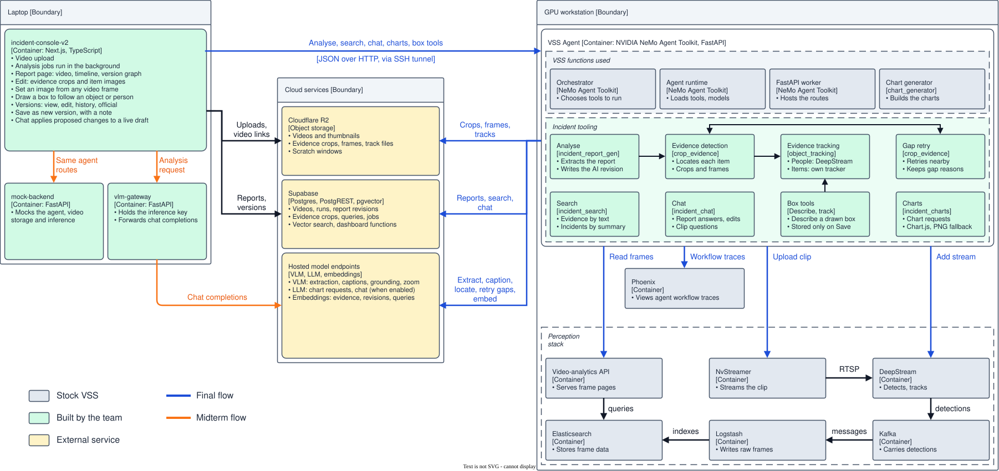

# Incident Search and Reporting

> **Pitch video:** [watch on YouTube](https://youtu.be/_THMlaojpK8)

A video-driven incident search and reporting system: upload a clip, get a structured incident report, review it, and search the evidence in plain language.

## What this is

This is a final year project built by students at Singapore Management University. It adds incident search and reporting on top of NVIDIA's Video Search and Summarization (VSS) blueprint.

A reviewer uploads a surveillance or anomaly clip in a web console. A vision-language model writes a structured, timestamped incident report (type, severity, summary, the people, instruments and assets involved) with evidence images cut from the video. Reviewers edit the report into new versions, mark one version official, search past incidents and evidence in natural language, ask questions about a report in a chat panel, and follow the totals on a dashboard.

## Architecture

## Get started

Deploy and run it from the [incident profile README](deploy/docker/developer-profiles/dev-profile-incident/README.md). The rest of the repository is the upstream blueprint, which the project builds on.

## Acknowledgements and licence

Built on the [NVIDIA AI Blueprint for Video Search and Summarization](https://github.com/NVIDIA-AI-Blueprints/video-search-and-summarization). The licence is unchanged from upstream: see [LICENSE](LICENSE).
