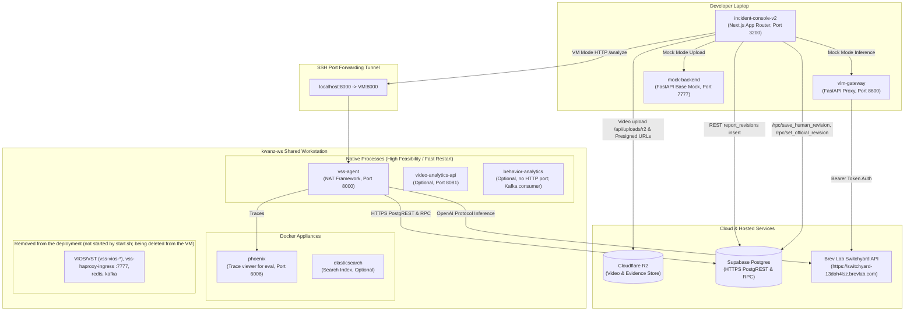

# Incident Search & Reporting Capstone — Architecture

This document describes the system architecture, component topology, deployment mechanics, and
runtime interaction sequences for `dev-profile-incident`.

---

## 1. System Context Architecture

The system spans three runtime tiers:
1. **Developer Laptop:** Hosts the modern frontend (`incident-console-v2`), local API proxies (`vlm-gateway`),
   and base mocks (`mock-backend`).
2. **Shared GPU Workstation (`kwanz-ws` VM):** Runs the AI agent (`vss-agent`) as a native process and
   Phoenix (the trace viewer used for eval) in Docker. VIOS/VST, HAProxy, Redis and Kafka are removed from the
   deployment ([decision](decisions.md)).
3. **Cloud & External Services:** Cloudflare R2 for durable video storage, Supabase for relational data via
   HTTPS PostgREST, and hosted LLM/VLM inference endpoints (NGC and Brev).

### System Context Diagram



### Component Reference Table

| Component | Host | Port | Runtime Type | Primary Source / Owner File | Responsibility |
|---|---|---|---|---|---|
| `incident-console-v2` | Laptop | 3200 | Node.js (Next.js 15 App Router) | `incident-console-v2/` | Primary user interface: video upload, report versions (View and Edit modes, History, official), `/library` search, report chat, report display |
| `vlm-gateway` | Laptop | 8600 | Python (FastAPI / Uvicorn) | `vlm-gateway/app.py` | Holds the Brev credential (`VLM_GATEWAY_API_KEY`) server-side and forwards `POST /v1/chat/completions` unchanged to `VLM_GATEWAY_BASE_URL` (default `https://switchyard-13doh4lsz.brevlab.com/v1`), model-agnostic, no streaming, `VLM_GATEWAY_TIMEOUT_SECONDS` (default 330, longer than the slowest per-model timeout in `contracts/inference.json`); `GET /health` answers `{"status": "ok"}`. Used in mock mode. A VM compose service (`vss-vlm-gateway`, `vlm-gateway/compose.yml`) exists, but `start.sh` never starts it |
| `base_profile_mock` | Laptop | 7777 | Python (FastAPI / Uvicorn) | `mock-backend/base_profile_mock/` | Zero-GPU mock of the agent, VST and inference, started by `--mode mock`. Uploads go to R2; analyze writes a real AI revision to finals (`mock: true` in the response); evidence embeddings are deterministic; incident search, revision search and chat answer from `finals_snapshot.json`; stock chat, WebSocket HITL, RTSP and VST routes are canned |
| `search_profile_mock` | Laptop | 7778 | Python (FastAPI / Uvicorn) | `mock-backend/search_profile_mock/` | Standalone mock of the stock search profile (agent search, VST sensor list, video-analytics `/frames`, Kibana and Elasticsearch stubs), plus incident search and revision search from the same snapshot; no incident chat or analyze |
| `vss-agent` | `kwanz-ws` | 8000 | Python (Native `nat serve`) | `services/agent/` | Core VSS agent: incident analysis, search, and chat workflows (`/api/v1/incidents/{id}/analyze`, `POST /api/v1/incidents/search`, `POST /api/v1/incidents/revisions/search`, `POST /api/v1/incidents/chat`), tool calling, report persistence; remote inference via Brev |
| `video-analytics-api` | `kwanz-ws` | 8081 | Node.js (Native) | `services/analytics/video-analytics-api/` | Optional MVP2 video analytics ingestion and query layer (`ENABLE_ANALYTICS=true`) |
| `behavior-analytics` | `kwanz-ws` | none (8080 is a HAProxy/label placeholder) | Python (Native) | `services/analytics/behavior-analytics/` | Optional MVP2 behavior perception pipeline (`ENABLE_ANALYTICS=true`) |
| `vss-haproxy-ingress` | `kwanz-ws` | 7777 | Docker container | `deploy/docker/services/infra/haproxy/` | Public reverse proxy on :7777: /api,/chat → vss-agent :8000; /vst,/storage → vss-vios-ingress :30888; /phoenix → :6006; optional analytics/kibana backends. **Removed from the deployment:** not started by `start.sh`, being deleted from the VM. |
| `vss-vios-streamprocessing`| `kwanz-ws` | 10000 | Docker container (GPU 0) | `deploy/docker/services/vios/` | VST storage/upload + replay API **Removed from the deployment:** not started by `start.sh`, being deleted from the VM. |
| `vss-vios-nvstreamer` | `kwanz-ws` | 31000 | Docker container (GPU 0) | `deploy/docker/developer-profiles/dev-profile-alerts/compose.yml` | NvStreamer RTSP file streamer (not in the upload path; not routed by ingress/HAProxy) **Removed from the deployment:** not started by `start.sh`, being deleted from the VM. |
| `vss-vios-ingress` | `kwanz-ws` | 30888 | Docker container | `deploy/docker/services/vios/` (foundational) | Nginx VST ingress: /vst/api/v1/sensor → sensor-ms :30000; other /vst/api/v1 and /vst/storage → streamprocessing :10000 **Removed from the deployment:** not started by `start.sh`, being deleted from the VM. |
| `vss-vios-sensor` | `kwanz-ws` | 30000 | Docker container (GPU 0) | `deploy/docker/services/vios/initiator/` | VST sensor registration service (`sensor-ms`; pinned to GPU 0 in `compose.override.yml`, but not started by `start.sh`) **Removed from the deployment:** not started by `start.sh`, being deleted from the VM. |
| `vss-vios-postgres` | `kwanz-ws` | none (Unix socket only) | Docker container | `deploy/docker/services/vios/` | VIOS internal database for camera sensors and stream registrations **Removed from the deployment:** not started by `start.sh`, being deleted from the VM. |
| `perception-2d-fusion` (`vss-rtvi-cv`) | `kwanz-ws` | 9000 | Docker container (GPU 0) | `deploy/docker/developer-profiles/dev-profile-search/video-analytics-2d-app/compose.yml` | Stock DeepStream perception service (pinned to GPU 0 in `compose.override.yml`; not started by `start.sh`; RT-CV indexing is dropped from MVP2) |
| `rtvi-embed` (`vss-rtvi-embed`) | `kwanz-ws` | 8017 (→8000) | Docker container (GPU 0, bridged) | `deploy/docker/services/rtvi/rtvi-embed/` | Stock Triton inference server for video embeddings (pinned to GPU 0 in `compose.override.yml`; not started by `start.sh`; RT-Embed indexing is dropped from MVP2, whose text embeddings and VLM are remote) |
| `redis` | `kwanz-ws` | 6379 (int) | Docker container | Stock compose infra | Message broker and caching layer **Removed from the deployment:** not started by `start.sh`, being deleted from the VM. |
| `phoenix` | `kwanz-ws` | 6006 (int) | Docker container (bridged mdx_default) | Stock compose infra | LLM/VLM telemetry and trace viewer; kept for eval. The only Docker service `start.sh` starts by default |
| `kafka` | `kwanz-ws` | 9092 | Docker container | Stock compose infra | Event bus that VST needed **Removed from the deployment:** not started by `start.sh`, being deleted from the VM. |
| `elasticsearch` | `kwanz-ws` | Internal | Docker container | Stock compose infra | JVM search index appliance (optional, only with `ENABLE_ANALYTICS=true`) |
| `Supabase` | Cloud | 443 (HTTPS) | Managed PostgREST / Postgres | `supabase/migrations/` (finals, including the versioned-report schema and functions); `supabase/midterm/` (frozen record) | Store for videos, runs, versioned report revisions, evidence crops and search history. One project per phase: see [Two Supabase projects](#two-supabase-projects-one-per-phase) |
| `Cloudflare R2` | Cloud | 443 (HTTPS) | S3-Compatible Object Store | `incident-console-v2/src/lib/r2/` | Canonical persistent object storage for video clips and screenshots |
| `Brev Switchyard` | Cloud | 443 (HTTPS) | Remote Switchyard Proxy | Upstream endpoint | Hosted VLM/LLM inference used by both `vss-agent` (VM) and `vlm-gateway` (laptop) |

### Native vs. Docker Service Split Policy

**Policy Rule:** Run a service natively whenever feasible.

Services are split based on feasibility:
- **Native Processes (High Feasibility):** `vss-agent` (Python/uv), `video-analytics-api` (Node.js), and `behavior-analytics` (Python). Running natively eliminates Docker image rebuilds on code changes (~2s process restart vs multi-minute container build).
- **Docker Appliances (Infeasible Natively):** Media engines and storage appliances (`vss-vios-streamprocessing`, `vss-vios-nvstreamer`, `vss-vios-ingress`, `vss-vios-postgres`; all removed from the deployment). These depend on proprietary CUDA and GStreamer container toolchains; host installation is infeasible. Stock perception and embedding appliances (`perception-2d-fusion` / `vss-rtvi-cv`, `rtvi-embed` / `vss-rtvi-embed`, `sensor-ms` / `vss-vios-sensor`) are containerized and pinned to GPU 0 in `compose.override.yml`, but are not started by `start.sh`.
- **Docker Appliances (No Benefit / JVM):** Infrastructure appliances (`phoenix`, and `elasticsearch` with `ENABLE_ANALYTICS=true`; `redis`, `kafka` and `vss-haproxy-ingress` are removed from the deployment). Standard prebuilt containers or heavy JVM runtimes where native execution provides no development benefit.
- **Networking:** Nearly all containers use host networking (`network_mode: host`); exceptions are `phoenix` (bridge `mdx_default`, published 6006:6006) and `vss-rtvi-embed` (if started; published `${RTVI_EMBED_PORT}`=8017→8000). Native processes reach all of them on `localhost`.

---

## 2. Deployment & Connectivity

The one-command entry point for setting up and launching the system is `start.sh` (`./start.sh --mode mock` or `./start.sh --mode vm`; `--mode local` is a deprecated alias for `mock`), executed directly from developer laptops. It automates backend checks, self-healing service deployment, port tunneling, and UI initialization.

```mermaid
flowchart TD
    Start["./start.sh --mode mock|vm"] --> CheckMode{Mode?}

    %% Mock Mode Path
    CheckMode -->|mock|  StartMock["Start mock-backend (127.0.0.1:7777)"]
    StartMock --> StartGateway["Start vlm-gateway (127.0.0.1:8600)"]
    StartGateway --> LocalInit["Export INCIDENT_AGENT_BASE_URL=http://127.0.0.1:7777,<br/>VLM_GATEWAY_URL=http://127.0.0.1:8600,<br/>ANALYSIS_MODE=gateway"]
    LocalInit --> RunV2Local["Launch incident-console-v2 (Port 3200)"]

    %% VM Mode Path
    CheckMode -->|vm| Preflight["SSH Preflight & IP Detection<br/>(.scripts/vm-preflight.sh)"]
    Preflight --> CheckSSH["Check VM State via SSH<br/>(docker compose ps & native-services.sh status)"]
    CheckSSH --> StateDecision{Deploy State?}
    
    StateDecision -->|Nothing Running| FreshDeploy["Deploy Docker Appliances over SSH (.scripts/vm-ensure-docker.sh)<br/>Start Native Services via native-services.sh"]
    StateDecision -->|Partial State| SelfHeal["Self-Heal: Start only missing Docker & Native services"]
    StateDecision -->|All Running| Ready["Backend Ready"]
    
    FreshDeploy --> OpenTunnel
    SelfHeal --> OpenTunnel
    Ready --> OpenTunnel

    OpenTunnel["Open backgrounded SSH tunnel (inline in start.sh)<br/>8000 only<br/>then wait for localhost:8000/health"] --> CheckConsole{--no-console?}
    CheckConsole -->|yes| Hold["Hold tunnel open (wait)"]
    CheckConsole -->|no| VMInit["Export INCIDENT_AGENT_BASE_URL=http://localhost:8000,<br/>ANALYSIS_MODE=agent"]
    VMInit --> RunV2VM["Launch incident-console-v2 (Port 3200)"]
```

### SSH Tunnel Port Forwards

VM mode forwards only `localhost:8000`, to the native `vss-agent`. The console no longer talks to `vss-haproxy-ingress` (:7777): uploads go from the console straight to R2, so no VST camera is created ([decision](decisions.md)). VIOS/VST, HAProxy, Redis and Kafka are removed from the deployment too: `start.sh` no longer starts or checks them, and they are being deleted from the VM. The forwards and their checks are in [`vm-api-contracts.md`](vm-api-contracts.md#tunnel); the VM address detection and SSH troubleshooting are in [`incident-profile-operations.md`](incident-profile-operations.md#3-laptop-to-vm-connectivity--ssh-troubleshooting).

### Two Supabase projects (one per phase)

| Project | Role | Schema | Access |
|---|---|---|---|
| **Finals** (new project, same organisation and region as midterm) | The live database every service uses | [`supabase/migrations/`](../supabase/README.md): the finals baseline, then the versioned-report schema and its functions, then later finals migrations | `service_role` (PostgREST) and `postgres` (direct DSN) only; RLS on everything; the public key reaches nothing |
| **Midterm** (`rfevukimyftzbxlehwel`) | Frozen record of the midterm phase | [`supabase/midterm/`](../supabase/midterm/README.md) (archive; never pushed) | Read-only after the freeze: `service_role` reads and runs the read RPCs, every write fails, direct-DSN sessions are read-only, `anon` is locked out |

Finals is built from the baseline and filled once from midterm by `supabase/copy/copy_midterm_to_finals.py` (one-way; [`../supabase/README.md`](../supabase/README.md)). The versioned-report schema and its functions (`save_human_revision`, `set_official_revision`, the rewritten search/library/dashboard functions) are applied on top through `supabase/migrations/`. **R2 is shared:** both projects name the same bucket and keys, so no object is copied and no R2 setting changes. A delete in finals removes R2 objects that the midterm record still names; that is accepted for a record.

What points at the database, and how it switches at the cutover:

| Where | Settings | Read by | How it switches |
|---|---|---|---|
| `dev-profile-incident/.env.local` on each laptop (symlinked into `incident-console-v2/`, `vlm-gateway/`, `mock-backend/`) | `INCIDENT_SUPABASE_URL`, `INCIDENT_SUPABASE_SERVICE_ROLE_KEY`, `INCIDENT_DB_DSN` | Console, eval, mock backend in local mode, the copy and parity scripts | Each teammate sets the 3 finals values |
| `.env.local` copies in other worktrees | same | Console or eval started from those worktrees | `.githooks/setup-worktree.sh` refreshes a copy that differs from the main worktree's file (never a symlink, never the main file); the freeze makes a stale one fail loudly |
| `generated.env.remote` on `kwanz-ws` | `INCIDENT_SUPABASE_URL`, `INCIDENT_SUPABASE_SERVICE_ROLE_KEY` | Native `vss-agent` (search, chat, AI revision insert, evidence embeddings); `.scripts/native-services.sh` | Back up, set the two finals values, restart `vss-agent` ("ask first"; [`incident-operate-vm`](../skills/incident-operate-vm/SKILL.md)) |
| `deploy/docker/services/agent/compose.yml` | `INCIDENT_SUPABASE_*` passthrough | The Docker `vss-agent` (not used; the native one owns :8000) | Nothing |
| `eval/` | `INCIDENT_DB_DSN` or `INCIDENT_SUPABASE_*` from the same `.env.local` | P1/RP1 batch (outside this change) | Same `.env.local`; eval's storage is outside this change |

The agent only **warns** when it cannot record a search query, so an agent still pointed at midterm keeps answering searches and silently loses the query logs: check that `queries` grows on finals after the switch. The cutover steps, checklist and rollback are in the [`incident-manage-database`](../skills/incident-manage-database/SKILL.md) skill.

---

## 3. Remote LLM/VLM Deployment Facts (Brev Switchyard & Remote Inference)

The VM deployment runs LLM, VLM, and evaluation judge inference against Brev Switchyard (`https://switchyard-13doh4lsz.brevlab.com`). There are no local NIM inference containers on `kwanz-ws`.

Live values are in [`status.md`](status.md); the full procedure for editing `generated.env.remote` is in [`incident-profile-operations.md`](incident-profile-operations.md).

### Inference Rules & Requirements

1. **Client Type Rule:** Use `_type: openai` for remote inference models, **never** `_type: nim`. The `nim_langchain` client leaks proprietary parameters (such as `verify_ssl`) into the HTTP JSON request body, which triggers HTTP 400 Bad Request errors on standard OpenAI-compatible endpoints.
2. **Model Selection Rules:**
   - **LLM (`nvidia/nemotron-3-ultra`):** Must support OpenAI tool calling (`bind_tools`) for `top_agent` and `json_schema` structured output for incident reporting. Also serves as `eval_llm_judge`.
   - **VLM (`nvidia/cosmos-3-super-reasoner`):** Must support base64 MP4 `video_url` inlining (`data:video/mp4;base64,...`) and frame-by-frame JPEG extraction.
3. **URL Format Rule:** Set `*_BASE_URL` without a trailing `/v1` (`https://switchyard-13doh4lsz.brevlab.com`). Agent and LangChain client instantiations append `/v1` automatically.
4. **Authentication Rule:** Set `OPENAI_API_KEY` to the Brev Switchyard key; it is shared across LLM, VLM, and `eval_llm_judge`.
5. **GPU:** only GPU 0 is used; see the [GPU rule](incident-profile-operations.md#5-vm-deployment-configuration-principles-generatedenvremote) (item 10). No local LLM/VLM NIM runs on either GPU.

---

## 4. Runtime Interaction Sequences

### Console middle layer (ports and adapters)

`incident-console-v2` reaches Supabase, R2, the gateway and the agent through ports and adapters; the layout and dependency rules are in [`mvp2/console-hexagonal-architecture.md`](mvp2/console-hexagonal-architecture.md).

- A report is read from one `report_revisions` row (`?revision=<id>`, else the official one, else the newest). A refusal by a database write function becomes a `StoreRejection`, which the route returns as 422 with the database's reason.
- `/library` Find evidence posts to `POST /api/search`, which calls the agent's `POST /api/v1/incidents/search` (body `{query, videoId?}`: with `videoId` the search covers that incident only, 50 hits, and the query may be empty, which lists the incident's evidence in video time order; without it, 20 hits across the library). The agent's incident search and evidence search share one embed-then-retrieve function (`semantic_search`), and the VLM critic is off by default (`INCIDENT_SEARCH_CRITIC`), so no hit carries a verdict in the console. The Find incidents text search calls the agent's `POST /api/v1/incidents/revisions/search`, then filters the result in the console. A hit's report link carries `?t=` and the report page seeks to that second.

### Console configuration

Server-only variables, read from `incident-console-v2/.env.local` (a symlink to the profile's shared `.env.local`); none may be exposed through `NEXT_PUBLIC_`:

| Variable | Use |
|---|---|
| `ANALYSIS_MODE` | `gateway` (default) or `agent` |
| `VLM_GATEWAY_URL` | the gateway, required in gateway mode |
| `INCIDENT_AGENT_BASE_URL` | the agent or the mock (chat, search, embeddings, and analysis in agent mode); uploads do not use it |
| `VLM_MODEL` | default model in the picker, one of `contracts/inference.json` (default `nvidia/cosmos-3-nano-reasoner`) |
| `CONTRACTS_DIR` | the shared `contracts/` directory (default `../contracts`) |
| `INCIDENT_SUPABASE_URL`, `INCIDENT_SUPABASE_SERVICE_ROLE_KEY` | PostgREST |
| `R2_ACCOUNT_ID`, `R2_ACCESS_KEY`, `R2_SECRET_KEY`, `R2_BUCKET` | video and evidence storage |

`GET /api/health` answers `status` (`ready` or `degraded`) and per-service booleans only; the `gateway` row is omitted (and not probed) in agent mode and reported only in gateway and mock modes.

### Console pages

- **`/library`** (the old `/reports` redirects here with its query string): Find incidents shows six cards per page, one per video (official revision, else newest), with severity, the title led by "Official vN" (when the shown version is official) or a "No official version" marker, summary, evidence and version counts, and MVP1's thumbnail: the upload-time screenshot only, with the severity and AI/Human badges on it, and MVP1's skeleton when the screenshot is missing or fails to load; filters are text, type, official only, severity band, added date and sort, shown as chips and kept in the URL. The text search falls back to the library's ILIKE match, with a note, when the agent fails or finds nothing. Find evidence shows the agent's top 20 hits with crop, match percentage, time, kind, threat and holder (no verdict badge: the critic is off); kind, threat and type filters and "Group by incident" work on the returned hits. A hit opens a viewer with the full frame and every box at that second (or the enlarged crop) and a link to the report at that second. "See evidence" on a card scopes Find evidence to that incident and loads its evidence at once; a query typed while scoped searches only that incident (the agent filters by `video_id` in the database, not in the browser).
- **`/videos/<id>`:** one video's re-generation card and full attempt history.
- **`/reports/<videoId>`:** View mode has a fixed top band (video; a timeline with one lane per entity over its seen span, its held instruments, then "Holder unknown" and Assets lanes; the versions graph, where each AI run is a branch and the star marks the official version; the star spins while a mark or clear saves and shows the answer at once, so a quick second mark still asks before it replaces), a scrolling pane (report fields, evidence cards by holder, where clicking a card's image opens a detail pop-up with the whole frame and box large, the id and title, the full description, "Held by" and threat for an instrument, "Holds" and the on-screen span for an entity, the time and a Play from here button that closes the pop-up and seeks the video (disabled with a note when the item has no time), read-only model output, run details, the version chat) and a bottom bar with "Edit from vN". Edit mode is described below.
- **`/dashboard`:** see [Dashboard analytics](#dashboard-analytics-and-cross-filtering). The browser uploads a WebP thumbnail (the frame 25% into each new upload, at most 640×360) to `thumbnails/<video-key>.webp`; a failure never blocks analysis.

### Report library pagination and deferred report loading

```mermaid
sequenceDiagram
    actor User as Reviewer
    participant UI as /library
    participant API as Next.js /api/reports
    participant DB as Supabase RPC
    participant R2 as Cloudflare R2

    User->>UI: Open library or change metadata/evidence filter
    UI->>API: GET summaries (page size 6; entity/instrument/asset terms)
    API->>DB: list_incident_report_summaries(...) (IncidentRepository.listReports)
    DB-->>API: 6 summaries + total count
    API->>R2: Sign up to 6 derived thumbnail keys
    API-->>UI: Metadata + small thumbnail URLs (no video URL)
    UI-->>User: Lazy screenshot images or skeleton fallback
    User->>UI: Open one report
    UI->>API: GET /api/reports/videoId?revision=revisionId
    API->>DB: Read one report_revisions row (IncidentRepository.getReport)
    API->>R2: Create selected object's signed URL
    API-->>UI: Full report + playback URL
```

Date inputs are directly editable: entering either boundary activates the custom range automatically. Preset
selection clears stale custom boundaries, and the date/time row has an explicit reset that clears both date and
time constraints. The API forwards inclusive day boundaries, optional time-of-day bounds, and the viewer's detected timezone to the summary RPC.

### Dashboard analytics and cross-filtering

`GET /api/dashboard` calls the service-role-only `get_incident_dashboard` RPC through `DashboardRepository.getDashboard`. It counts **official versions only**: one per video, through `videos.official_revision_id`.
- Videos with revisions but no official one ("awaiting official report"), videos without any report, and all uploaded videos are counted separately, all time, as static summary metric cards on the dashboard.
- Evidence statistics are canonical entity types plus normalised instrument and asset names, counted per distinct incident.
- Model coverage counts every analysis attempt in the period by outcome.
- Every other number links to `/library?scope=official&...` with the same period and filters, using `match=exact` for instrument and asset names, so the reports total equals the clicked number. The URL is the reports page's filter state.
- The period window is computed in the browser after mount and sent as zoneless UTC; the API reads it as UTC.
- The heatmap and weekday/hour cross-filters use the viewer's local time: `GET /api/dashboard` forwards the browser's detected `timezone` (e.g. `America/New_York`) to `p_timezone`, which groups and filters `generated_datetime` in that zone. `/library` detects the same zone itself, so drill-down links carry no timezone and the totals still match. The old `/reports` URL redirects to `/library` with its query string.

### Report versions: View, Edit and History

The report page has two modes. **View** shows the version on screen (its timeline lanes, versions graph, official star, evidence cards and run details); **Edit from vN** opens **Edit** mode, where the version being edited is the read-only A side and the unsaved draft is the editable B side, with one evidence row per entity and its held instruments as sub-rows. Deleting an entity deletes the instruments it holds; a row's Revert restores that item as in A. Draft-level **Undo** walks backward through changes and **Revert all** restores the opened version; neither writes a revision. In both modes on desktop, two vertical drag or arrow-key separators resize the video, timeline and version-history columns, while the bottom horizontal separator resizes their shared height from 190 to 600 px. The chosen layout survives View/Edit switching for the current page session. The page's **History** lists every revision of the incident (kind, author, time, note), newest first.
- **Save as new version** always appends a `human` revision and needs a note. There is no Restore: copying an older version back is an Edit from that version.
- **What a reviewer may edit:** the structured (Class A) fields and each item's image; model output and provenance are read-only ([field classes](analysis-schema.md#three-classes-of-report-fields)). IDs are renumbered by position, except an entity keeps its canonical `E<n>` id from View through Edit, Save and Compare (the draft's internal key is never saved as `entityId`, an added entity takes the next free `E<n>`, and Compare keeps canonical order; [decision](decisions.md#2026-10-28-entity-ids-and-their-order-are-canonical-across-report-view-edit-and-compare)); each item sends the item it came from as `source_id` (null for an added item) so its evidence follows it through a delete or reorder. A reviewer-drawn image keeps its `image_timestamp_seconds` and `image_box` (`[ymin, xmin, ymax, xmax]`, 0-1000) on its evidence entry.
- **Unsaved edits** exist only in the form. A refresh reloads the stored revision. There is no draft.

`PATCH /api/reports/[videoId]/edit {parentId, editedBy, edit, note?}` rejects Class B/C keys (400), validates the edit against the contract's own sub-schemas and ID/holder/window rules (422), builds the new payload and evidence (`humanRevisionContent`) and calls `save_human_revision_with_crops`, which appends a `human` revision whose parent is the revision that was opened. On a video with no official revision the route first asks the agent to embed the new evidence and the same call stores the crops; an embedding failure answers 502 and saves nothing ([`data.md`](data.md#save_human_revision_with_crops)). `GET /api/reports/[videoId]/revisions` is the History list. `POST /api/reports/[videoId]/evidence-image` stores an image under a new R2 key and returns the key for the edit to use. No route changes a revision, `model_runs.notes` or an existing R2 object, and there is no verify step.

The report shows "Reviewer-edited after generation", "Model assessed N/5; reviewer set M/5" beside the model severity rationale, and the model's original window beside a reviewer-set one.

- **Frames and crops (API):** `GET /api/reports/[videoId]/frame?t=` returns one frame as a JPEG, and `POST /api/reports/[videoId]/evidence-crop {timestampSeconds, region}` cuts a rectangle (fractions 0-1 from the top-left) from that frame and returns it as a JPEG, writing nothing. A malformed `t` is 400, a `t` at or past the video's length or a region outside the frame or under 1% wide or high is 422, an unknown video is 404, and a missing `ffmpeg` is 503. The crop is cut on the server because R2 has no CORS rule for the console origin, so a browser canvas crop of the signed video would be tainted. Both use `ffmpeg` on the console host's PATH (a laptop prerequisite, see [`incident-start`](../skills/incident-start/SKILL.md)). In Edit mode, **Replace image** on a draft card opens the frame picker: scrub to a second (an entity's picker stays within its seen span), press and hold at one corner, drag to the opposite corner, release to keep that rectangle, then select **Use this crop**. Pointer release or cancellation ends the active drag, so moving to the button does not change the completed rectangle. The browser holds the crop; Save uploads it through `evidence-image` before it writes the revision, and the picked second and box are saved on the evidence entry. `POST /api/reports/[videoId]/evidence-sweep` removes images a failed save left behind ([`data.md`](data.md#2-cloudflare-r2-storage-architecture)).
- **Report chat:** `POST /api/chat` sends `version_id` (the version on screen in View, or the version an Edit draft came from) and, in Edit, `draft_report`; the agent answers from that version's evidence (see [`vm-api-contracts.md`](vm-api-contracts.md)). Each answer is tagged with the version it came from.
- **Evidence display:** the report cards and Edit's cards show each item's whole video frame with its box drawn on it (`EvidenceFrame` `fullFrame`, object-contain, `lib/evidence/evidence-view.ts`), never a cut-out crop; the evidence search tiles and viewer do the same. The frame is the stored `frame` key signed like `image`; for an item analysed before frames were stored, or one a reviewer replaced with a picked frame, it is cut from the stored video by `GET /api/reports/[videoId]/frame?t=` at the entry's `box_seconds` or `timestamp_seconds`. `located: false`, or an old box covering the whole frame (`[0,0,1000,1000]`, the former fallback), shows the frame with no box and an "Object not located" note. The crop (`image`) is kept only for evidence search ([decision](decisions.md#2026-10-31-evidence-shows-the-whole-frame-with-a-box-not-a-crop)).
- **Zoomed second look (agent mode):** the whole-clip P1 pass names every item at thumbnail resolution, so a crumpled bag seen at 25 px can become "soccer ball". After an item is located, `CropEvidenceService` cuts it from the frame at native resolution with a 25% margin (upscaled to a 256 px short side for the model only; the stored crop is unchanged) and draws the box on a copy of the frame. The same VLM the grounding detector uses (`VLM_GATEWAY_BASE_URL`/`VLM_BASE_URL`, `VLM_NAME`) then takes two blind looks that never see the report's text (the marked frame alone; the marked frame plus the close-up), each answering `{name, description, confidence}`, and a text-only merge weighs the two looks against the report's current name and description, allowed to change them only when the looks agree with each other, answering `{name, description, confidence, changed}`; the verdict's confidence is the lowest of the three calls and both look names are kept on the entry as `zoom_seen`. When `changed` is true and `confidence` is at least 0.7 the agent rewrites `item_name` and `description` on the evidence entry **and** the matching item of the report payload (instrument and asset `name` and `description`; an entity's `description` only, its `type` is never changed), keeping `name_before`, `description_before` and `zoom_confidence` on the entry; the item id, `label`, timestamps and images are never touched. Every located entry gets `zoom_checked` and `zoom_seen` and, when not checked or ignored, a `zoom_gap`. Why three calls: on the 480p test clips a single vision prompt that carried the current name confirmed "soccer ball" for a 25-pixel smudge, and the close-up alone named the shoe beside the object; the marked frame named the bag. The flag `INCIDENT_ZOOM_NAMES_ENABLED` (default on) turns it off; a failed or slow call never fails the analysis; the calls are outside `max_crop_calls`; RP1's prose is generated before the second look, so a corrected name reaches the structured report and cards, not `report_text` ([decision](decisions.md#2026-10-31-zoomed-second-look-renames-a-located-item-from-its-close-up)).
- **Searchable crops:** an analysis or re-run of a video with no official revision also writes the new revision's crops (`set_revision_crops`; a failure is logged, the run stands), and a Save writes them in the same call as the revision, so `/library` can find the video ([`data.md`](data.md#evidence_crops)).

### Run history, re-generation and the official version

- **Video history.** A video is the parent of its analyses. `GET /api/videos/[videoId]/runs` builds the history from two sources:
  - runs with an AI revision for the video;
  - revision-less attempt records whose notes explicitly name the video: failed attempts.

  Each entry shows model, time, outcome, failure reasons or repair operations, the reviewer prompt, and whether its revision is the official one. Failed attempts are never reports.
- **Re-generation.** `POST /api/videos/[videoId]/runs {model, additionalInstruction?}` re-analyses the stored R2 object (the console's "reviewer prompt" box is `additionalInstruction`):
  - the same canonical request, strict validation and ID-only recovery as an upload;
  - always a new run and a new AI revision, which starts from the model's output (earlier edits are not carried across);
  - it never writes the `videos` row (the upload time is kept);
  - it never changes the official version.
- **Official version.** `PUT /api/videos/[videoId]/official {revisionId}` and `DELETE` call `setOfficialRevision`: for a mark, the console asks the agent for the revision's evidence embeddings (`POST /api/v1/incidents/evidence-embeddings`) and passes them to `set_official_revision`, which sets `videos.official_revision_id` and rebuilds the incident's `evidence_crops`; for a clear it passes none and the rows go. If the agent is unreachable the mark fails and nothing changes. Used from the report page and the video history.
- **Model choice:** both modes send the chosen allowlisted model (gateway to `vlm-gateway`, agent as `model` on `/analyze`). The run records the model the agent reports, so in agent mode the recorded model is the agent's.
- **Where it appears:** the re-run card (`ReanalysisCard`) is on `/videos/[id]` and in the report page's View mode (advanced tools).

### Sequence A: Upload, Analysis & Reporting in Gateway Mode (`ANALYSIS_MODE=gateway`)

*Zero-GPU local development flow using `vlm-gateway` and Cloudflare R2, on `incident-contract-v4`.*

```mermaid
sequenceDiagram
    autonumber
    actor User as Reviewer (Browser)
    participant UI as incident-console-v2 (Next.js)
    participant R2 as Cloudflare R2 Bucket
    participant Gateway as vlm-gateway (Port 8600)
    participant Brev as Brev Switchyard API
    participant DB as Supabase PostgREST & RPC

    User->>UI: Choose a model (allowlist from contracts/inference.json), then a video
    UI->>R2: PutObject (uploads/<name>, If-None-Match *) + HeadObject via /api/uploads/r2 (the only upload)
    UI->>UI: POST /api/analysis {filepath, filename, model}
    UI->>R2: HeadObject (object must exist and be nonempty)
    UI->>DB: Insert videos row if absent (upload lifecycle; never updated later)
    UI->>UI: Sign R2 GET URL; build P1 request = eval P1 (video, canonical prompt, strict response_format, 16384 tokens, 64 frames)
    UI->>Gateway: POST /v1/chat/completions (per-model timeout)
    Gateway->>Brev: Forward with Bearer auth (VLM_GATEWAY_TIMEOUT_SECONDS)
    Brev->>R2: GET video via presigned URL
    Brev-->>Gateway: Completion
    Gateway-->>UI: Completion
    UI->>UI: Strict parse + schema + cross-field rules; id-normalization-v1 only if every violation is ID-only, then re-validate
    alt valid_first_pass / valid_after_structural_repair
        UI->>DB: model_runs (immutable notes: request, raw response, validation, repair, report)
        UI->>DB: report_revisions (kind ai: payload, evidence, facets)
        UI->>DB: Read back and verify
        UI-->>User: Redirect to /reports/[videoId]?revision=[revisionId]
    else contract_failed / request_failed
        UI->>DB: model_runs attempt record only (no revision)
        UI-->>User: 422 / 502 / 504 with the reason; the attempt appears in the video's history
    end
```

---

### Sequence B: Upload, Analysis & Reporting in Agent Mode (`ANALYSIS_MODE=agent`)

*Full blueprint integration connecting laptop UI to native `vss-agent` on `kwanz-ws`.*

```mermaid
sequenceDiagram
    autonumber
    actor User as Reviewer (Browser)
    participant UI as incident-console-v2 (Next.js)
    participant Tunnel as SSH Tunnel (:8000)
    participant R2 as Cloudflare R2 Bucket
    participant Agent as vss-agent (:8000)
    participant Brev as Brev Switchyard API
    participant DB as Supabase PostgREST & RPC

    User->>UI: Select and upload video clip
    %% The only upload: straight to R2 through the console (no VST, no :7777)
    UI->>UI: POST /api/uploads/r2
    UI->>R2: PutObject (uploads/<name>, If-None-Match *)
    R2-->>UI: Durable R2 object key
    UI->>R2: HeadObject (exact uploaded byte length required)

    UI->>UI: Trigger POST /api/analysis
    UI->>R2: HeadObject (object must exist and be nonempty)
    UI->>DB: Insert videos row if absent (fresh id, filepath=R2 key; source stays null)
    UI->>UI: Sign 1-hour R2 GET URL locally

    UI->>Tunnel: POST localhost:8000/api/v1/incidents/[id]/analyze {model_run_id, video_url, skip_rp1: true}
    Tunnel->>Agent: Forward analyze request

    Agent->>Brev: P1 (video URL first, contract prompt, strict response_format) - same call as gateway mode
    Brev->>R2: GET video via presigned URL
    Brev-->>Agent: Schema-constrained JSON
    Agent->>Agent: Strict parse under core-scored-v1 (+ id-normalization-v1), derive duration; core violation -> 422 with raw_output
    Note over Agent,Brev: skip_rp1 - no RP1 call, like gateway mode (standalone calls run RP1)
    Note over Agent,DB: The agent inserts the AI revision and returns revision_id; the console records the run

    Agent-->>Tunnel: Return {report, report_text, model, contract_version, raw_output, finish_reason, revision_id}
    Tunnel-->>UI: Forward agent response

    UI->>UI: Strict parse + schema + cross-field rules under policy core-scored-v1; id-normalization-v1 only if needed
    alt valid_first_pass / valid_after_structural_repair
        UI->>DB: model_runs (immutable notes: request, raw response, validation, repair, report)
        UI->>DB: Verify the agent's AI revision (insert it only when revision_id is missing)
        UI->>DB: Read back and verify
        UI-->>User: Redirect to /reports/[videoId]?revision=[revisionId]
    else contract_failed / request_failed
        UI->>DB: model_runs attempt record only (no revision)
        UI-->>User: 422 / 502 / 504 with the reason; the attempt appears in the video's history
    end
```

---

### Sequence C: Natural Language Video Search & Conversational Chat (MVP2)

*Authoritative specification, sequence, and data flow: [`mvp2/README.md`](mvp2/README.md) and [`../contracts/chat-contract-v1/`](../contracts/chat-contract-v1/).*

> [!NOTE]
> MVP2 shifted from real-time perception/Elasticsearch indexing to a hybrid pipeline combining VLM extraction (`incident-contract-v4`), object cropping through a detector port (today the remote VLM; local open-vocabulary detectors are evaluated in [`mvp2/eval.md`](mvp2/eval.md)), Supabase `pgvector` (`evidence_crops`), conversational Q&A (`chat-contract-v1`), and a VLM critic that is dormant by default (`query_results`). See [`mvp2/README.md`](mvp2/README.md) for the authoritative architecture and end-to-end data flow.
