# Incident Search & Reporting Capstone — Data Layer & Schema

This document defines the relational database schema (Supabase PostgreSQL), the object storage layout
(Cloudflare R2), and documented data layer edge cases in the `dev-profile-incident` architecture.

---

## 1. Supabase PostgreSQL Schema

The database schema is defined authoritatively by versioned SQL migrations under
[`deploy/docker/developer-profiles/dev-profile-incident/supabase/migrations/`](../supabase/README.md)
(applied via `supabase db push`). Schema authority moved completely out of the retired Streamlit
v1 console's `incident-console/db.py`. It supports multi-model runs over the same video, a parallel
ground-truth evaluation structure, human review workflows, and the MVP2 vector search extension
(`evidence_crops`, `query_results`; see [`mvp2/README.md`](mvp2/README.md)).

### Report-library summary RPC

`list_incident_report_summaries` (latest: migration `20260928000000`) is a `SECURITY INVOKER`, `STABLE` SQL function exposed only to `service_role`.
- **Inputs:** it joins `reports`, `incidents`, `model_runs`, `videos` and `review_status` and applies search, filter, sort and pagination in Postgres. Beyond the earlier type, severity, status, date/time/weekday and evidence-substring filters it takes:
  - `p_scope`: `'all'` (default: every successful report) or `'official'` (only each video's selected official report);
  - `p_entity_types`: exact canonical entity type;
  - `p_evidence_match`: `'contains'` (default) or `'exact'` (normalised instrument/asset name equality);
  - `p_timezone`: IANA zone for the weekday and time-of-day filters (default `'UTC'`).
- **Folding:** legacy incident types are folded (`fighting` → `assault`, `animal` → `animal attack`) for both filtering and display. Migration `20261016010000` rewrites the stored values once, but folding stays until the migration is applied (agent mode now writes contract values, as phase 3 is complete).

- **Per-report outputs:**
  - the analysis `outcome`, from `run_outcome(notes)`;
  - `isOfficial`;
  - a nullable `confidence`;
  - the contract-v2 title (`incidentConsoleV2.report.incident.title`), falling back to the legacy title paths.
- **What it never returns:** notes, evidence arrays, signed URLs or video content. The normal library API fixes `page_size` at 6; `all=true` may request up to 1,000 lightweight summaries.

Helper functions (service role, `20260927180000`):
- `canonical_incident_type`, `canonical_entity_type` (`person` → `human`) and `normalized_name` (lower-case, trimmed, single spaces);
- `run_outcome(notes)`: `valid_first_pass`, `valid_after_structural_repair`, `contract_failed`, `request_failed` or `legacy`.

**Reviewer edits.** `apply_structured_report_edit(p_incident_id, p_model_run_id, p_edit, p_edited_by)` (`20260927160000`) replaces one run's structured projection in a single transaction:
- incident type, integer-second start/end, recomputed duration, description and severity level;
- that run's `entities` / `instruments` / `assets`;
- `review_status.edited_by/edited_at`.

It re-checks the contract's types, ranges, sequential IDs and holder references, and **never touches `model_runs.notes`**. The earlier `apply_incident_report_patch` (which wrote an `editedReport` copy into notes) remains in the database but is no longer called.

**Official report selection (D6).** `select_official_report(p_video_id, p_model_run_id, p_selected_by)` and `clear_official_report(p_video_id, p_cleared_by)` (`20260927170000`):
- only a successful analysis of the same video with a `reports` row can be selected;
- analysis never selects;
- selection is independent of review status.

**Dashboard.** `get_incident_dashboard` (latest: `20260928000000`) is a service-role-only aggregation RPC over **official incidents only**: one per video with an official report, filtered by the official report's generation time plus optional type, severity-band, weekday and hour (in the target timezone specified by `p_timezone`, defaulting to UTC). It returns:
- `total`;
- all-time `videos` counts: `uploaded`, `withOfficial`, `awaitingSelection` (has reports, none official) and `withoutReport` (no incident);
- severity, review funnel, types with per-type evidence, daily trend and heatmap;
- `entityTypes`, `topInstruments` and `topAssets` (by normalised name, counted per distinct incident);
- `threatLevels`;
- a confidence histogram excluding nulls, plus `confidenceNotProvided`;
- `modelCoverage`: per model, attempts by outcome, including failed attempts in the period.

Every dashboard count equals the library total for `scope=official` with the same filters (instrument/asset links use `match=exact`).

### Entity-Relationship Diagram

```mermaid
erDiagram
    VIDEOS {
        string id PK "String(20), 'v'+19hex or clip name, equals incident_id"
        string filepath "String(1024), R2 object key or legacy VST path"
        datetime uploaded_datetime "DateTime, naive UTC (DB default)"
        int duration "Integer, seconds"
        string source "String(512), sensorId"
    }

    QUERIES {
        string id PK "String(20)"
        text query_text "Text, user search query"
        datetime submitted_datetime "DateTime, naive UTC (DB default)"
    }

    MODEL_RUNS {
        string id PK "String(20)"
        string model_name "String(128)"
        string model_version "String(128)"
        string prompt_version "String(64)"
        datetime run_datetime "DateTime, naive UTC (DB default)"
        text notes "Text, v2 JSON / mock note / NULL"
    }

    INCIDENTS {
        string incident_id PK, FK "String(20) -> videos.id ON DELETE CASCADE"
        string model_run_id PK, FK "String(20) -> model_runs.id ON DELETE CASCADE"
        string type "String(32), free text"
        string start_timestamp "String(32), clock string (M:SS) or bare seconds"
        string end_timestamp "String(32), clock string (M:SS) or bare seconds"
        int duration "Integer, seconds"
        text description "Text, incident narrative"
        int severity_level "Integer, 1 to 5"
        float confidence_score "Double precision, 0.0 to 1.0"
    }

    REPORTS {
        string id PK "String(20)"
        string incident_id FK "String(20), composite FK -> incidents ON DELETE CASCADE"
        string query_id FK "String(20), nullable"
        string model_run_id FK "String(20), composite FK -> incidents ON DELETE CASCADE"
        string filepath "String(1024), artifact path (NULL or mock://)"
        datetime generated_datetime "DateTime, naive UTC (DB default)"
    }

    ENTITIES {
        string incident_id PK, FK "String(20), composite FK -> incidents ON DELETE CASCADE"
        string entity_id PK "String(20), E1 / e01 / sha256 / p..."
        string model_run_id PK, FK "String(20), composite FK -> incidents ON DELETE CASCADE"
        string type "String(16), free text (human/animal/unknown/person)"
        text description "Text, person/actor description"
        string image "String(1024), R2 evidence key (always NULL today)"
    }

    INSTRUMENTS {
        string incident_id PK, FK "String(20), composite FK -> incidents ON DELETE CASCADE"
        string instrument_id PK "String(20), I1 / i01 / sha256"
        string model_run_id PK, FK "String(20), composite FK -> incidents ON DELETE CASCADE"
        string entity_id "String(20), wielding entity"
        string name "String(256), tool or weapon name"
        text description "Text"
        int threat_level "Integer, 1 to 5 or null"
        string image "String(1024), R2 evidence key (always NULL today)"
    }

    ASSETS {
        string incident_id PK, FK "String(20), composite FK -> incidents ON DELETE CASCADE"
        string asset_id PK "String(20), A1 / a01 / sha256"
        string model_run_id PK, FK "String(20), composite FK -> incidents ON DELETE CASCADE"
        string name "String(256), property/vehicle name"
        text description "Text"
        string image "String(1024), R2 evidence key (always NULL today)"
    }

    REVIEW_STATUS {
        string incident_id PK, FK "String(20), composite FK -> incidents ON DELETE CASCADE"
        string model_run_id PK, FK "String(20), composite FK -> incidents ON DELETE CASCADE"
        string status "String(32), DB default 'unreviewed'"
        string verified_by "String(256), reviewer name"
        datetime verified_at "DateTime, naive UTC"
        string edited_by "String(256), editor name"
        datetime edited_at "DateTime, naive UTC"
    }

    NOTIFICATIONS {
        int id PK "Integer, autoincrement"
        string incident_id FK "String(20), composite FK -> incidents ON DELETE CASCADE"
        string model_run_id FK "String(20), composite FK -> incidents ON DELETE CASCADE"
        int severity "Integer, 1 to 5"
        datetime created_at "DateTime, naive UTC (DB default)"
        boolean acknowledged "Boolean, DB default false"
    }

    SEVERITY_EVAL_LOG {
        int id PK "Integer, autoincrement"
        string incident_id FK "String(20), composite FK -> incidents ON DELETE CASCADE"
        string model_run_id FK "String(20), composite FK -> incidents ON DELETE CASCADE"
        int ai_severity "Integer, 1 to 5"
        int human_severity "Integer, 1 to 5"
        string rater "String(256), rater name"
        datetime rated_at "DateTime, naive UTC (DB default)"
    }

    GT_INCIDENTS {
        string incident_id PK, FK "String(20) -> videos.id ON DELETE CASCADE"
        string type "String(32), free text"
        string start_timestamp "String(32), free text (bare seconds)"
        string end_timestamp "String(32), free text (bare seconds)"
        int duration "Integer"
        text description "Text"
        int severity_level "Integer, 1 to 5"
        string labelled_by "String(256)"
        datetime labelled_datetime "DateTime, naive UTC"
    }

    GT_ENTITIES {
        string incident_id PK, FK "String(20) -> gt_incidents.incident_id ON DELETE CASCADE"
        string entity_id PK "String(20)"
        string type "String(16)"
        text description "Text"
        string image "String(1024)"
    }

    GT_INSTRUMENTS {
        string incident_id PK, FK "String(20) -> gt_incidents.incident_id ON DELETE CASCADE"
        string instrument_id PK "String(20)"
        string entity_id "String(20)"
        string name "String(256)"
        text description "Text"
        int threat_level "Integer"
        string image "String(1024)"
    }

    GT_ASSETS {
        string incident_id PK, FK "String(20) -> gt_incidents.incident_id ON DELETE CASCADE"
        string asset_id PK "String(20)"
        string name "String(256)"
        text description "Text"
        string image "String(1024)"
    }

    ENTITY_MATCHES {
        string incident_id PK, FK "String(20)"
        string model_run_id PK, FK "String(20)"
        string entity_id PK, FK "String(20)"
        string gt_entity_id FK "String(20), NOT NULL"
        float similarity_score "Float"
        datetime matched_at "DateTime, naive UTC (DB default)"
    }

    INSTRUMENT_MATCHES {
        string incident_id PK, FK "String(20)"
        string model_run_id PK, FK "String(20)"
        string instrument_id PK, FK "String(20)"
        string gt_instrument_id FK "String(20), NOT NULL"
        float similarity_score "Float"
        datetime matched_at "DateTime, naive UTC (DB default)"
    }

    ASSET_MATCHES {
        string incident_id PK, FK "String(20)"
        string model_run_id PK, FK "String(20)"
        string asset_id PK, FK "String(20)"
        string gt_asset_id FK "String(20), NOT NULL"
        float similarity_score "Float"
        datetime matched_at "DateTime, naive UTC (DB default)"
    }

    VIDEOS ||--o{ INCIDENTS : "1 video = 1 incident (ON DELETE CASCADE)"
    VIDEOS ||--o{ GT_INCIDENTS : "has ground truth (ON DELETE CASCADE)"
    MODEL_RUNS ||--o{ INCIDENTS : "scores (ON DELETE CASCADE)"
    MODEL_RUNS ||--o{ REPORTS : "generates"
    INCIDENTS ||--o{ REPORTS : "summarized in (ON DELETE CASCADE)"
    QUERIES ||--o{ REPORTS : "originates from (ON DELETE SET NULL)"
    INCIDENTS ||--o{ ENTITIES : "contains (ON DELETE CASCADE)"
    INCIDENTS ||--o{ INSTRUMENTS : "involves (ON DELETE CASCADE)"
    INCIDENTS ||--o{ ASSETS : "impacts (ON DELETE CASCADE)"
    INCIDENTS ||--o| REVIEW_STATUS : "tracks review (ON DELETE CASCADE)"
    INCIDENTS ||--o{ NOTIFICATIONS : "triggers alerts (ON DELETE CASCADE)"
    INCIDENTS ||--o{ SEVERITY_EVAL_LOG : "evaluates (ON DELETE CASCADE)"
    GT_INCIDENTS ||--o{ GT_ENTITIES : "contains (ON DELETE CASCADE)"
    GT_INCIDENTS ||--o{ GT_INSTRUMENTS : "involves (ON DELETE CASCADE)"
    GT_INCIDENTS ||--o{ GT_ASSETS : "impacts (ON DELETE CASCADE)"
    ENTITIES ||--o{ ENTITY_MATCHES : "paired with GT (ON DELETE CASCADE)"
    GT_ENTITIES ||--o{ ENTITY_MATCHES : "referenced by (ON DELETE CASCADE)"
    INSTRUMENTS ||--o{ INSTRUMENT_MATCHES : "paired with GT (ON DELETE CASCADE)"
    GT_INSTRUMENTS ||--o{ INSTRUMENT_MATCHES : "referenced by (ON DELETE CASCADE)"
    ASSETS ||--o{ ASSET_MATCHES : "paired with GT (ON DELETE CASCADE)"
    GT_ASSETS ||--o{ ASSET_MATCHES : "referenced by (ON DELETE CASCADE)"
```



---

### Detailed Table Specifications

#### 1. Shared Reference Tables

##### `videos`
Primary registry of ingested video assets.
- **Identity Rule:** 1 video = 1 incident (`incidents.incident_id` == `videos.id`, no separate `video_id` column). `videos.id` serves as the natural primary key.

| Column | Type | Constraints | Description |
|---|---|---|---|
| `id` | `VARCHAR(20)` | PRIMARY KEY | Video identifier: `'v' + first 19 hex of sha256(sensorId)` for uploads (20 chars); clip-name ids (e.g. `Burglary012`, `RoadAccidents...`, `SYN-...`, `MOCK-...`) for fixture/eval rows. Equals `incident_id`. Raw sensor ids are never used directly as `id` since they can be up to 128 chars. |
| `filepath` | `VARCHAR(1024)` | NULLABLE | R2 object key (`uploads/<sensorId>/<uuid>.<ext>`, `anomaly/<category>/<clip>.mp4`, or `normal_videos/<clip>.mp4`). Not guaranteed: legacy v1-console rows may hold an absolute VST path (`/home/vst/...`) — validate with `isValidR2Key` before presigning. (The agent no longer writes `videos`; the console owns `videos.filepath`). |
| `uploaded_datetime` | `TIMESTAMP` | DEFAULT (now() AT TIME ZONE 'utc') | Naive UTC timestamp (`timestamp without time zone`) when uploaded. Real DB default added in migration `20260925031000`; previously client-side SQLAlchemy `default=_utcnow` in `incident-console/db.py` only — PostgREST writers that omitted it received NULL (58/162 historical rows have NULL `uploaded_datetime`). |
| `duration` | `INTEGER` | NULLABLE | Video duration in integer seconds |
| `source` | `VARCHAR(512)` | NULLABLE | Sensor ID, ingestion source, or camera stream name |
| `selected_model_run_id` | `VARCHAR(20)` | NULLABLE; composite FK `(id, selected_model_run_id)` → `incidents(incident_id, model_run_id)` ON DELETE SET NULL (`selected_model_run_id`) | The video's explicitly selected **official report** (D6). NULL = awaiting selection. Only set/cleared by `select_official_report` / `clear_official_report`; analysis never writes it. Because of this second relationship, PostgREST embeds between `videos` and `incidents` must name `incidents_incident_id_fkey`. |
| `selected_by` / `selected_at` | `VARCHAR(256)` / `TIMESTAMP` | NULLABLE | Who selected the official report and when (naive UTC). May outlive a selection cleared by the FK when the official incident is deleted; the UI treats `selected_model_run_id IS NULL` as "no official report". |

##### `queries`
Tracks natural language queries submitted by users (MVP2 search).

| Column | Type | Constraints | Description |
|---|---|---|---|
| `id` | `VARCHAR(20)` | PRIMARY KEY | Unique query identifier |
| `query_text` | `TEXT` | NOT NULL | Natural language query string |
| `submitted_datetime` | `TIMESTAMP` | DEFAULT (now() AT TIME ZONE 'utc') | Naive UTC timestamp when submitted (DB default added in migration `20260925031000`) |

##### `model_runs`
Tracks each execution of an AI pipeline run over an incident video.

| Column | Type | Constraints | Description |
|---|---|---|---|
| `id` | `VARCHAR(20)` | PRIMARY KEY | Unique model execution identifier |
| `model_name` | `VARCHAR(128)` | NOT NULL | Model identifier (e.g. `nvidia/cosmos-3-nano-reasoner`, `incident_report_gen`, `vss-agent`) |
| `model_version` | `VARCHAR(128)` | NULLABLE | Optional version tag of the model |
| `prompt_version` | `VARCHAR(64)` | NULLABLE | Prompt template version tag |
| `run_datetime` | `TIMESTAMP` | DEFAULT (now() AT TIME ZONE 'utc') | Naive UTC execution timestamp (DB default added in migration `20260925031000`) |
| `notes` | `TEXT` | NULLABLE | Free text, nullable. Since 2026-09-27 `incident-console-v2` writes the **immutable analysis-attempt record** `{"incidentConsoleV2":{recordType:"analysis_attempt", status, stage, failure, contractVersion, videoId, r2Key, attemptedAt, request, response, validation, repair, report?}}` for every attempt (see [`analysis-schema.md` §4](analysis-schema.md#4-storage)); it is never modified afterwards. Failed attempts (`contract_failed` / `request_failed`) are `model_runs` rows with no incident, report, review or evidence rows; their video association is `notes.incidentConsoleV2.videoId`. Earlier console rows hold `{"incidentConsoleV2":{report,editedReport?,rawModelOutput,normalizedModelOutput}}`; `mock-backend` stores a plain-text note; agent/seed/eval runs leave it NULL. Batch eval/seed runs (`P1-*`, `MR-SEED`, `MOCK8`) are shared by many videos: run history is keyed by (video, run), not by `model_runs` row. Any count of runs must filter by outcome (`run_outcome(notes)`) or count via `reports`. |

---

#### 2. Model Output Tables

##### `incidents`
AI-extracted incident intelligence for a specific model run over a video.

| Column | Type | Constraints | Description |
|---|---|---|---|
| `incident_id` | `VARCHAR(20)` | PRIMARY KEY, FK -> `videos.id` ON DELETE CASCADE | Associated video/incident identifier |
| `model_run_id` | `VARCHAR(20)` | PRIMARY KEY, FK -> `model_runs.id` ON DELETE CASCADE | Model run identifier |
| `type` | `VARCHAR(32)` | NULLABLE | Free text (VARCHAR(32)); contract taxonomy `road accident`, `burglary`, `explosion`, `assault`, `animal attack` (`incident-contract-v2` / `incident-contract-v3`) is not enforced by a DB CHECK constraint. Migration `20261016010000` (awaiting approval to apply) rewrites stored `fighting` → `assault` and `animal` → `animal attack`; 0 rows hold `other`. Agent mode now writes contract values (phase 3 done), but consumers fold them until the migration is applied. NULL is allowed. |
| `start_timestamp` | `VARCHAR(32)` | NULLABLE | Free text: either a clock string (`M:SS` / `H:MM:SS`, agent & console) or bare seconds (e.g. `"21"`, `"15.6"`, eval/P1 and `gt_*` rows). Consumers must accept both (see `eval_gt._timestamp_seconds`). |
| `end_timestamp` | `VARCHAR(32)` | NULLABLE | Free text: either a clock string (`M:SS` / `H:MM:SS`, agent & console) or bare seconds (e.g. `"21"`, `"15.6"`, eval/P1 and `gt_*` rows). Consumers must accept both (see `eval_gt._timestamp_seconds`). |
| `duration` | `INTEGER` | NULLABLE | Incident duration in seconds |
| `description` | `TEXT` | NULLABLE | Narrative summary of the incident |
| `severity_level` | `INTEGER` | NULLABLE | Severity score (1 to 5) |
| `confidence_score`| `DOUBLE PRECISION` | NULLABLE | Model confidence score (0.0 to 1.0). The column has always been `DOUBLE PRECISION`; migration `20260925031000` widened the `insert_incident` RPC parameter `p_confidence_score` from `REAL` to `DOUBLE PRECISION`, so rows written through the old RPC may still hold float4-rounded values. |

##### `reports`
Artifact pointer table linking an incident and model run to external files or queries.

| Column | Type | Constraints | Description |
|---|---|---|---|
| `id` | `VARCHAR(20)` | PRIMARY KEY | Report record identifier |
| `incident_id` | `VARCHAR(20)` | NOT NULL; composite FK `(incident_id, model_run_id)` -> `incidents` ON DELETE CASCADE | Linked incident identifier |
| `query_id` | `VARCHAR(20)` | NULLABLE, FK -> `queries.id` ON DELETE SET NULL | Triggering search query (always NULL today) |
| `model_run_id` | `VARCHAR(20)` | NOT NULL; composite FK `(incident_id, model_run_id)` -> `incidents` ON DELETE CASCADE | Linked model run identifier |
| `filepath` | `VARCHAR(1024)` | NULLABLE | Optional path to rendered report artifact: NULL (`incident-console-v2`) or `mock://reports/<file>` (`mock-backend`). |
| `generated_datetime`| `TIMESTAMP` | DEFAULT (now() AT TIME ZONE 'utc') | Naive UTC generation timestamp (DB default added in migration `20260925031000`) |

##### `entities`
Observed actors or persons extracted by the model during a specific run.

| Column | Type | Constraints | Description |
|---|---|---|---|
| `incident_id` | `VARCHAR(20)` | PRIMARY KEY; composite FK `(incident_id, model_run_id)` -> `incidents` ON DELETE CASCADE | Linked incident identifier |
| `entity_id` | `VARCHAR(20)` | PRIMARY KEY | Writer-specific id: `E1`/`E2` (seed/eval, contract), `e01`/`e02` (console-v2 gateway), `E1`/`E2` (agent standalone), `p...` (mock). |
| `model_run_id` | `VARCHAR(20)` | PRIMARY KEY; composite FK `(incident_id, model_run_id)` -> `incidents` ON DELETE CASCADE | Linked model run identifier |
| `type` | `VARCHAR(16)` | NULLABLE | Free text (VARCHAR(16)): console-v2 gateway mode writes contract entity types (`human`, ...); agent mode now writes contract entity types (phase 3 done), so `canonical_entity_type` folds `person` → `human` at query time until migration `20261016010000` is applied. Migration `20261016010000` (awaiting approval to apply) rewrites the stored `person` rows to `human` once; legacy seed/v1 rows may also hold `animal` / `unknown`. `GET /api/reports/[videoId]` maps every entity row (including legacy `animal` rows) into the report's `persons` list. |
| `description` | `TEXT` | NULLABLE | Visual description and observed actions |
| `image` | `VARCHAR(1024)` | NULLABLE | R2 object key for cropped evidence screenshot (schema-only, always NULL today) |

##### `instruments`
Observed tools, objects, or weapons extracted by the model.

| Column | Type | Constraints | Description |
|---|---|---|---|
| `incident_id` | `VARCHAR(20)` | PRIMARY KEY; composite FK `(incident_id, model_run_id)` -> `incidents` ON DELETE CASCADE | Linked incident identifier |
| `instrument_id`| `VARCHAR(20)` | PRIMARY KEY | Writer-specific id: `I1` (seed/eval, contract), `i01` (console-v2 gateway), `I1` (agent standalone). |
| `model_run_id` | `VARCHAR(20)` | PRIMARY KEY; composite FK `(incident_id, model_run_id)` -> `incidents` ON DELETE CASCADE | Linked model run identifier |
| `entity_id` | `VARCHAR(20)` | NULLABLE | Wielding entity identifier (if identified) |
| `name` | `VARCHAR(256)` | NULLABLE | Instrument name (e.g. `crowbar`, `knife`) |
| `description` | `TEXT` | NULLABLE | Contextual usage description |
| `threat_level` | `INTEGER` | NULLABLE | Threat rating (1 to 5, or NULL when not rated) |
| `image` | `VARCHAR(1024)` | NULLABLE | R2 object key for cropped evidence screenshot (always NULL today) |

##### `assets`
Observed physical property, infrastructure, or vehicles extracted by the model.

| Column | Type | Constraints | Description |
|---|---|---|---|
| `incident_id` | `VARCHAR(20)` | PRIMARY KEY; composite FK `(incident_id, model_run_id)` -> `incidents` ON DELETE CASCADE | Linked incident identifier |
| `asset_id` | `VARCHAR(20)` | PRIMARY KEY | Writer-specific id: `A1` (seed/eval, contract), `a01` (console-v2 gateway), `A1` (agent standalone). |
| `model_run_id` | `VARCHAR(20)` | PRIMARY KEY; composite FK `(incident_id, model_run_id)` -> `incidents` ON DELETE CASCADE | Linked model run identifier |
| `name` | `VARCHAR(256)` | NULLABLE | Asset name (e.g. `cash register`, `sedan`) |
| `description` | `TEXT` | NULLABLE | Observed physical damage or involvement |
| `image` | `VARCHAR(1024)` | NULLABLE | R2 object key for cropped evidence screenshot (always NULL today) |

---

#### 3. Review Workflow & Operational Tables

##### `review_status`
Carries the reviewer verification state independently of the AI report.

| Column | Type | Constraints | Description |
|---|---|---|---|
| `incident_id` | `VARCHAR(20)` | PRIMARY KEY; composite FK `(incident_id, model_run_id)` -> `incidents` ON DELETE CASCADE | Linked incident identifier |
| `model_run_id` | `VARCHAR(20)` | PRIMARY KEY; composite FK `(incident_id, model_run_id)` -> `incidents` ON DELETE CASCADE | Linked model run identifier |
| `status` | `VARCHAR(32)` | NOT NULL, DEFAULT `'unreviewed'` | State (`unreviewed`, `under review`, `verified`). Real DB default `'unreviewed'` added in migration `20260925031000`. |
| `verified_by` | `VARCHAR(256)` | NULLABLE | Reviewer username who verified the report |
| `verified_at` | `TIMESTAMP` | NULLABLE | Naive UTC timestamp of verification |
| `edited_by` | `VARCHAR(256)` | NULLABLE | Editor username who modified report fields |
| `edited_at` | `TIMESTAMP` | NULLABLE | Naive UTC timestamp of last edit |

##### `notifications`
Legacy alert queue retained for compatibility with the retired Streamlit console and evaluation tooling. The active
`incident-console-v2` application neither reads nor writes this table.

| Column | Type | Constraints | Description |
|---|---|---|---|
| `id` | `INTEGER` | PRIMARY KEY, AUTOINCREMENT | Unique notification identifier |
| `incident_id` | `VARCHAR(20)` | composite FK `(incident_id, model_run_id)` -> `incidents` ON DELETE CASCADE | Associated incident |
| `model_run_id` | `VARCHAR(20)` | composite FK `(incident_id, model_run_id)` -> `incidents` ON DELETE CASCADE | Associated model run |
| `severity` | `INTEGER` | NULLABLE | Triggering severity rating (typically >= 4) |
| `created_at` | `TIMESTAMP` | DEFAULT (now() AT TIME ZONE 'utc') | Alert creation timestamp (naive UTC, DB default added in migration `20260925031000`) |
| `acknowledged` | `BOOLEAN` | NOT NULL, DEFAULT FALSE | Reviewer acknowledgement status (DB default added in migration `20260925031000`) |

##### `severity_eval_log`
Tracks comparative human vs. AI severity scoring for human-in-the-loop evaluation.

| Column | Type | Constraints | Description |
|---|---|---|---|
| `id` | `INTEGER` | PRIMARY KEY, AUTOINCREMENT | Log entry identifier |
| `incident_id` | `VARCHAR(20)` | composite FK `(incident_id, model_run_id)` -> `incidents` ON DELETE CASCADE | Associated incident |
| `model_run_id` | `VARCHAR(20)` | composite FK `(incident_id, model_run_id)` -> `incidents` ON DELETE CASCADE | Associated model run |
| `ai_severity` | `INTEGER` | NULLABLE | Severity score produced by the AI |
| `human_severity`| `INTEGER` | NULLABLE | Severity score assigned by human reviewer |
| `rater` | `VARCHAR(256)` | NULLABLE | Evaluator name |
| `rated_at` | `TIMESTAMP` | DEFAULT (now() AT TIME ZONE 'utc') | Evaluation timestamp (naive UTC, DB default added in migration `20260925031000`) |

---

#### 4. Ground-Truth (GT) & Evaluation Matching Tables

##### `gt_incidents`, `gt_entities`, `gt_instruments`, `gt_assets`
Parallel tables mirroring `incidents`, `entities`, `instruments`, and `assets`, but without
`model_run_id`. They store verified human annotations.
- `gt_incidents.type`: Free text (`VARCHAR(32)`).
- `gt_incidents.start_timestamp` / `end_timestamp`: Free text (`VARCHAR(32)`), storing bare seconds (e.g. `"21"`, `"15.6"`).
- `gt_incidents` includes `labelled_by` and `labelled_datetime` (naive UTC) instead of AI confidence/model fields.
- `gt_entities`, `gt_instruments`, and `gt_assets` reference `gt_incidents(incident_id)` with `ON DELETE CASCADE` (they reference `gt_incidents`, not `videos` or `incidents`).
- `image` columns in `gt_*` tables are schema-only and always NULL today.

##### `entity_matches`, `instrument_matches`, `asset_matches`
Store accepted (above-threshold) similarity pairings produced during Tier 1 ground-truth evaluation
(`incident-console/matching.py`).
- **Composite Primary Key:** `(incident_id, model_run_id, <item>_id)`
- **Foreign Keys:** References model items (`entities`/`instruments`/`assets`) and ground-truth items (`gt_*`)
  with `ON DELETE CASCADE`. The `gt_*_id` foreign key columns (`gt_entity_id`, `gt_instrument_id`, `gt_asset_id`) are `NOT NULL`.
- **Columns:** `similarity_score` (`FLOAT`, NOT NULL), `matched_at` (`TIMESTAMP`, naive UTC, `DEFAULT (now() AT TIME ZONE 'utc')`).

#### 5. MVP2 Vector Search & Evidence Crops Tables

##### `evidence_crops`
Unified storage for item-level evidence crops, detector bounding boxes, and pgvector semantic embeddings (`20261016120000_mvp2_evidence_search_and_crops.sql`).
- **Primary Key:** `(incident_id, model_run_id, item_type, item_id)`
- **Foreign Key:** `(incident_id, model_run_id)` -> `incidents(incident_id, model_run_id) ON DELETE CASCADE`
- **Vector Index:** HNSW cosine distance (`vector_cosine_ops`) index `evidence_crops_embedding_hnsw_idx` with `m = 16, ef_construction = 64` on `embedding`.
- **Secondary Index:** Composite lookup index `evidence_crops_lookup_idx` on `(incident_id, model_run_id)`.
- **Row-Level Security:** RLS enabled; all permissions revoked from `anon` and `authenticated`; granted exclusively to `service_role`.

| Column | Type | Constraints | Description |
|---|---|---|---|
| `incident_id` | `VARCHAR(20)` | PRIMARY KEY, composite FK -> `incidents` ON DELETE CASCADE | Associated video/incident identifier |
| `model_run_id` | `VARCHAR(20)` | PRIMARY KEY, composite FK -> `incidents` ON DELETE CASCADE | Model run identifier |
| `item_type` | `VARCHAR(16)` | PRIMARY KEY, CHECK (`item_type IN ('entity', 'instrument', 'asset')`) | Evidence category |
| `item_id` | `VARCHAR(20)` | PRIMARY KEY | Sequential item identifier (`E1..`, `I1..`, `A1..`) |
| `item_name` | `VARCHAR(256)` | NOT NULL | Item name or detector label |
| `description` | `TEXT` | NOT NULL | Item visual description |
| `threat_level` | `INTEGER` | NULLABLE | Threat rating (1 to 5, or NULL for entities/assets) |
| `holder_entity_id` | `VARCHAR(20)` | NULLABLE | Identifier of holding entity (instruments only) |
| `timestamp_seconds` | `INTEGER` | NOT NULL | Whole-second offset from video start where item is visible |
| `bounding_box` | `INTEGER[4]` | NOT NULL | Normalized coordinates `[ymin, xmin, ymax, xmax]` (0–1000) from detector pass |
| `image` | `VARCHAR(1024)` | NOT NULL | R2 object key: `evidence/<videoId>/<modelRunId>/<collection>/<id>.jpg` |
| `embedding` | `vector(1024)` | NULLABLE | 1024-dimensional semantic text embedding for cosine retrieval |
| `created_at` | `TIMESTAMP` | NOT NULL, DEFAULT (now() AT TIME ZONE 'utc') | Naive UTC insertion timestamp |

##### `query_results`
Audit log and hit persistence for natural-language search queries and always-on VLM critic evaluation (`20261016120000_mvp2_evidence_search_and_crops.sql`).
- **Primary Key:** `id` (`VARCHAR(36)`)
- **Foreign Keys:** `query_id -> queries(id) ON DELETE CASCADE`; `(incident_id, model_run_id) -> incidents(incident_id, model_run_id) ON DELETE CASCADE`.
- **Secondary Indexes:** `query_results_query_rank_idx` on `(query_id, rank)`; `query_results_incident_item_idx` on `(incident_id, model_run_id, item_type, item_id)`.
- **Row-Level Security:** RLS enabled; all permissions revoked from `anon` and `authenticated`; granted exclusively to `service_role`.

| Column | Type | Constraints | Description |
|---|---|---|---|
| `id` | `VARCHAR(36)` | PRIMARY KEY | Unique result identifier (UUID or hex) |
| `query_id` | `VARCHAR(20)` | NOT NULL, FK -> `queries.id` ON DELETE CASCADE | Associated search query identifier |
| `incident_id` | `VARCHAR(20)` | NOT NULL, composite FK -> `incidents` ON DELETE CASCADE | Target incident identifier |
| `model_run_id` | `VARCHAR(20)` | NOT NULL, composite FK -> `incidents` ON DELETE CASCADE | Target model run identifier |
| `item_type` | `VARCHAR(16)` | NOT NULL, CHECK (`item_type IN ('entity', 'instrument', 'asset')`) | Target evidence item type |
| `item_id` | `VARCHAR(20)` | NOT NULL | Target evidence item identifier |
| `rank` | `INTEGER` | NOT NULL | Retrieval rank position (1-based) |
| `similarity_score` | `DOUBLE PRECISION` | NOT NULL | Vector cosine similarity score (`1.0 - distance`) |
| `critic_verdict` | `VARCHAR(16)` | NOT NULL, CHECK (`critic_verdict IN ('confirmed', 'rejected', 'unverified')`) | VLM critic verification outcome |
| `critic_rationale` | `TEXT` | NULLABLE | Objective rationale from VLM critic justifying verdict |
| `retrieved_at` | `TIMESTAMP` | NOT NULL, DEFAULT (now() AT TIME ZONE 'utc') | Retrieval timestamp (naive UTC) |

---

### The `search_evidence_items` Postgres RPC Function

`search_evidence_items` (`supabase/migrations/20261016120000_mvp2_evidence_search_and_crops.sql`) is a `SECURITY INVOKER`, `STABLE` SQL function exposed strictly to `service_role`. It executes pgvector HNSW cosine distance search over `evidence_crops.embedding`, strictly scoped to official reports (`videos.selected_model_run_id = ec.model_run_id`).

- **Parameters:**
  - `p_query_embedding vector(1024)`: Normalized 1024-dimensional query vector.
  - `p_top_k INTEGER DEFAULT 10`: Maximum candidate hits to retrieve.
  - `p_min_similarity DOUBLE PRECISION DEFAULT 0.2`: Minimum similarity score threshold (`1.0 - cosine_distance`).
  - `p_item_types TEXT[] DEFAULT ARRAY['entity', 'instrument', 'asset']`: Evidence category filters.
  - `p_incident_types TEXT[] DEFAULT NULL`: Incident taxonomy filters.
  - `p_min_severity INTEGER DEFAULT NULL`: Minimum severity level (1-5).
  - `p_max_severity INTEGER DEFAULT NULL`: Maximum severity level (1-5).
- **Official Scoping:** Inner joins `videos v ON v.id = ec.incident_id AND v.selected_model_run_id = ec.model_run_id` to ensure only official reports are retrieved. Videos awaiting official report selection or re-analysis runs that are not official are excluded.
- **Permissions:** `REVOKE ALL ON FUNCTION public.search_evidence_items FROM PUBLIC, anon, authenticated; GRANT EXECUTE ON FUNCTION public.search_evidence_items TO service_role;`.

---

### The `insert_incident` Postgres RPC Function

Because Supabase PostgREST does not support multi-statement client-held transactions or `SELECT ... FOR UPDATE`,
the atomic operation of saving an incident report is executed server-side via the stored procedure
`insert_incident` (`supabase/migrations/20260917141225_insert_incident_function.sql`, updated with `DOUBLE PRECISION` in `20260925031000_schema_defaults_and_precision.sql`):

```sql
CREATE OR REPLACE FUNCTION insert_incident(
    p_incident_id TEXT,
    p_model_run_id TEXT,
    p_type TEXT,
    p_start_timestamp TEXT,
    p_end_timestamp TEXT,
    p_duration INTEGER,
    p_description TEXT,
    p_severity_level INTEGER,
    p_confidence_score DOUBLE PRECISION
) RETURNS VOID LANGUAGE plpgsql AS $$
BEGIN
    DELETE FROM incidents
    WHERE incident_id = p_incident_id AND model_run_id = p_model_run_id;

    INSERT INTO incidents (
        incident_id, model_run_id, type, start_timestamp, end_timestamp,
        duration, description, severity_level, confidence_score
    ) VALUES (
        p_incident_id, p_model_run_id, p_type, p_start_timestamp, p_end_timestamp,
        p_duration, p_description, p_severity_level, p_confidence_score
    );

    DELETE FROM review_status
    WHERE incident_id = p_incident_id AND model_run_id = p_model_run_id;

    INSERT INTO review_status (incident_id, model_run_id, status)
    VALUES (p_incident_id, p_model_run_id, 'unreviewed');
END;
$$;
```

This ensures that re-analyzing an incident atomically replaces the previous report for that run ID
and resets review status to `'unreviewed'` in a single database transaction.

> [!IMPORTANT]
> **Cascading Deletes on Child Records:**
> Because every child table's composite foreign key `(incident_id, model_run_id)` to `incidents` is configured with `ON DELETE CASCADE`, the RPC's initial `DELETE FROM incidents` also silently cascades and deletes all related `entities`, `instruments`, `assets`, `reports`, `review_status`, `notifications`, `severity_eval_log`, and `*_matches` rows for that `(incident_id, model_run_id)`. Re-analyzing under the same `model_run_id` therefore wipes all child evidence, reports, notifications, and GT match records. Callers must re-insert evidence rows after calling the RPC (both the agent's `_persist_incident` and `incident-console-v2`'s `/api/analysis` do so explicitly).

> [!NOTE]
> **Cascades on Deleting Videos or Model Runs:**
> Foreign keys `videos -> incidents` and `videos -> gt_incidents` are `ON DELETE CASCADE`. Deleting a `videos` row (e.g. via `incident-console-v2/app/api/reports/[videoId]/delete/route.ts`) cascades to delete all model runs, evidence, GT rows, and evaluation matches for that video. Similarly, `model_runs -> incidents` is `ON DELETE CASCADE`; deleting a `model_runs` row wipes every incident scored under it (`insert_model_run` deliberately upserts for that reason).

---

### Client Access Models & PostgREST/Direct-Postgres Split

Database access is split across two client implementations according to operational requirements:

1. **Tooling & Retired v1 Console (Direct Postgres):**
   The retired v1 console (`incident-console/db.py`) historically used direct Postgres via SQLAlchemy Core and `psycopg2` (`INCIDENT_DB_DSN`). Active UI development in `incident-console-v2` uses Supabase PostgREST (`lib/postgrest/client.ts`). The console is database-backed only; there is no offline CSV-preview UI mode.

2. **Agent Side & Service Writers (Supabase PostgREST):**
   `services/agent/src/vss_agents/utils/incident_db.py` is the agent-side counterpart: an async Supabase
   PostgREST CRUD helper (`supabase-py`'s `AsyncClient`/`acreate_client`, not `asyncpg`/direct-Postgres) against
   the same schema, mirroring `incident-console/db.py`'s tables and columns for the subset an agent-side caller plausibly writes
   (`model_runs`, `incidents`, `entities`, `instruments`, `assets`, `reports`, `review_status`, `notifications`; the agent never writes `videos`; the `gt_*` and
   `*_matches` tables stay console/eval-only).
   - **Configuration:** `INCIDENT_SUPABASE_URL` and `INCIDENT_SUPABASE_SERVICE_ROLE_KEY`
     (deliberately NOT `INCIDENT_DB_DSN`, which stays owned by the console's own `incident-console/db.py`); unset means the feature is
     unavailable, no fallback.
   - **Network Constraint / DPI Blocking Rationale:** This split exists because the deployment VM (`kwanz-ws`) DPI-blocks raw Postgres wire
     protocol on port 5432, so only the HTTPS-based PostgREST route works for the agent from there — a direct-Postgres
     driver on the agent side breaks Analyze on `kwanz-ws`.
   - **Transaction Limits & RPC:** PostgREST has no client-held transactions or `SELECT ... FOR UPDATE`; all PostgREST writers
     (`services/agent/src/vss_agents/utils/incident_db.py`, `incident-console-v2/lib/postgrest/client.ts`, `incident-console/db_postgrest.py`,
     and `eval/db_postgrest.py`) call the atomic `insert_incident` Postgres RPC function
     (`deploy/docker/developer-profiles/dev-profile-incident/supabase/migrations/`) via `/rpc/insert_incident` (see [`../supabase/README.md`](../supabase/README.md)
     for how to apply it via `supabase db push`).

### Row-Level Security (RLS) & Access Control

**Pending:** migration `20261016000000_enable_rls_and_lockdown_anon.sql` has not been applied to the live database yet. Until it is, RLS stays disabled and `anon`/`authenticated` keep full access. Once applied, it enables Row-Level Security on all 22 public schema tables (`relrowsecurity = true`) to close known issue 8, with this effect:
- **Default-deny:** With RLS enabled and no permissive policies defined, anonymous (`anon`) and standard authenticated (`authenticated`) roles cannot read, insert, update, or delete rows in any table.
- **Revoked grants:** All table and sequence privileges in schema `public` are explicitly revoked from `anon` and `authenticated`.
- **RPC protection:** `EXECUTE` on `insert_incident` is revoked from `PUBLIC`, `anon`, and `authenticated` and granted solely to `service_role`. Other stored procedures (`list_incident_report_summaries`, `get_incident_dashboard`, `apply_structured_report_edit`, `select_official_report`, `clear_official_report`) were already restricted to `service_role`.
- **Default privileges:** These apply only to objects later created by the migrating role (`postgres`). In schema `public` they grant no table, sequence or function privileges to `anon` or `authenticated` and grant all to `service_role`. Globally, new functions get no `EXECUTE` for `PUBLIC` (`ALTER DEFAULT PRIVILEGES REVOKE EXECUTE ON FUNCTIONS FROM PUBLIC`), so `anon` and `authenticated` cannot inherit it. Objects created by other roles are not covered, so each new function should still carry its own explicit `REVOKE ALL ... FROM PUBLIC, anon, authenticated` and `GRANT EXECUTE ... TO service_role`, as earlier migrations do.
- **Role bypass:** Application services (`incident-console-v2`, `vss-agent`, `eval`, `mock-backend`) authenticate via HTTPS PostgREST using `INCIDENT_SUPABASE_SERVICE_ROLE_KEY` (`service_role`), or connect directly via Postgres wire protocol using `INCIDENT_DB_DSN` (`postgres`). Both roles hold PostgreSQL's `BYPASSRLS` attribute (`rolbypassrls = true`), preserving full access without regression. On Supabase `postgres` is not a superuser; it skips RLS through `BYPASSRLS`, not superuser status. `FORCE ROW LEVEL SECURITY` is not applied: it only subjects table owners (here `postgres`) to RLS, and `BYPASSRLS` overrides it, so it would change nothing.

### Fixture CSV Seed Data Quirk

Fixture data in `deploy/docker/developer-profiles/dev-profile-incident/incident-console/fixtures/data/*.csv`
(72 rows on disk, 36 real + 36 synthetic `SYN-`-prefixed placeholders with no matching R2 video) is the seed source for the Postgres importer
(`deploy/docker/developer-profiles/dev-profile-incident/incident-console/scripts/seed_supabase.py` via `incident-console/scripts/seed_data.py`), which drops the `SYN-`-prefixed rows and seeds only the
36 real incidents under one shared `model_run_id`.

---

## 2. Cloudflare R2 Storage Architecture

Cloudflare R2 provides S3-compatible, permanent object storage for all video media and evidence images.
Local disks on `kwanz-ws` are treated as temporary caches only (though VST stores ingested video files locally).

### Bucket Key Tree Layout

```
anomaly-detection-dataset/            # bucket name comes from R2_BUCKET
├── anomaly/                         # classified dataset clips (seed/eval) only
│   ├── animal_attacks/  assault/  burglary/  explosion/
│   ├── fighting/  road_accidents/  shooting/
│   │   └── <clip-name>.mp4
├── normal_videos/                   # baseline non-incident clips
│   └── <clip-name>.mp4
├── uploads/                         # all new user uploads (real VST fallback and local mock)
│   └── <encodeURIComponent(sensorId)>/<uuid>.<ext>   # ext lowercased, default .mp4
├── thumbnails/                      # browser-captured report-card screenshots for new uploads
│   └── <video-key>.webp             # e.g. thumbnails/uploads/<sensor>/<uuid>.mp4.webp
├── Report/                          # empty folder marker, unused by code
└── evidence/                        # canonical R2 layout for MVP2 crop evidence (CropEvidenceService)
    └── <videoId>/<modelRunId>/{entities,instruments,assets}/<id>.jpg
```

> [!NOTE]
> The `anomaly/` subfolders are reserved for classified seed/evaluation data. New user uploads are classification-neutral and use `uploads/<sensorId>/<uuid>.<ext>` in both local-mock and real-VST flows; the VLM's later incident classification does not move or rename the object.
> In addition to the five fixture categories, live R2 storage includes `assault/` and `shooting/`.
> The `Report/` prefix is a 0-byte directory marker and is unused by code.
> The `evidence/` tree stores cropped entity/instrument/asset evidence images generated by `CropEvidenceService` (`services/agent/src/vss_agents/utils/crop_evidence.py`). Key pattern: `evidence/<videoId>/<modelRunId>/<collection>/<id>.jpg`. Database row persistence and R2 upload are owned by PR 120.

### Key Validation & Generation Rules

1. **Validity Rule (`isValidR2Key` in `incident-console-v2/lib/r2/key.ts`):**
   A valid R2 object key must:
   - Be a non-empty string.
   - Not start with `/` (absolute filesystem path).
   - Not start with `.` or contain `..` (relative filesystem path).
   - Guard against VST/NvStreamer `filePath` outputs (which return `./streamer/media/...` or local file paths).
2. **Upload & Evidence Key Patterns:**
   Direct uploads from `incident-console-v2/app/api/uploads/r2/route.ts` format keys as:
   `uploads/${encodeURIComponent(sensorId.trim())}/${randomUUID()}${ext}`.
   Thumbnail keys are deterministic: `thumbnailKeyForVideo(videoKey)` returns
   `thumbnails/${videoKey}.webp`; no database column is required.
   Evidence crop keys are deterministic: `evidence_key(videoId, modelRunId, collection, itemId)`
   (in `services/agent/src/vss_agents/utils/crop_evidence.py`) returns
   `evidence/${videoId}/${modelRunId}/${collection}/${itemId}.jpg` where collection is `entities`, `instruments`, or `assets`.
3. **Durability Verification:**
   `verifyR2Video` performs `HeadObject` after a direct upload (requiring the exact expected nonzero byte length)
   and again before analysis (requiring a nonempty object). A valid-looking key alone is not treated as a stored video.
4. **Presigned Media URLs:**
   Access is private by default. Video playback and up to six report-card thumbnail URLs are generated server-side using AWS SDK S3 client
   presigning (`getSignedUrl` with `GetObjectCommand`, `ResponseContentDisposition: 'inline'`, and a 1-hour
   expiration window). Agent-side evidence crops and video files are resolved via `services/agent/src/vss_agents/utils/r2.py` (`resolve_r2_url` / `get_r2_presigned_url`), generating boto3 S3 presigned URLs (1-hour expiration) or using public base URLs when configured (`INCIDENT_VIDEO_BASE_URL`).

---

For known schema issues, dual-writer architecture compromises, and technical debt, see [`status.md`](status.md).
