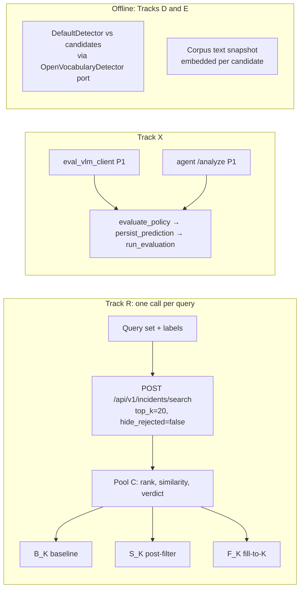

# MVP2 Eval: Retrieval Benchmark, Critic Ablation and System Comparison

Handoff specification for the PR 119 eval workstream ([MVP2 overview](README.md#pr-119---eval-system-vs-one-shot-baseline-retrieval)). It states what exists today, what each track measures, how it is scored and what it depends on. Items marked **proposal (P-n)** are not yet agreed; see [§8](#8-proposals-awaiting-approval).

Paths are relative to the profile directory unless they start with `services/` or `scripts/` (repository root).

## 1. Where evaluation stands today

### 1.1 `eval/` (P1/RP1 extraction benchmark)

- **Models:** the three allowlisted VLMs in `contracts/inference.json`: `nvidia/cosmos-3-nano-reasoner`, `nvidia/cosmos-3-super-reasoner`, `nvidia/nemotron-3-nano-omni-30b-a3b-reasoning`.
- **Ground truth:**
  - Five categories: road accident, burglary, explosion, assault, animal attack.
  - Ingested from the gitignored `eval_data/ground_truth_labelling.xlsx` by `scripts/eval_ingest_gt.py` into `gt_*` tables. `eval/db.py` creates them with SQLAlchemy `create_all`, not through `supabase/migrations`.
  - Ground truth has no per-item timestamps and no boxes.
- **Splits:**
  - 55 held-out videos, seed 42.
  - `eval_run.py` reads the gitignored `eval_data/split_*.json`. `eval_reproducibility/` holds tracked copies; copy them over or regenerate.
- **Runner:** `scripts/eval_run.py` sends the contract P1 request (`incident-contract-v3`) straight to the upstream model with a signed R2 URL.
  - It does not go through the `vlm-gateway` service, which is a pure proxy for the same request.
- **Validation:** `core-scored-v1` (`contract.py`) separates full contract validity (`contract_ok`) from core validity (`core_ok`).
  - Timeline-only defects are scored.
  - Any schema violation is scored as a miss.
- **Scoring** (`eval_gt.py`, `matching.py`):

  | Field | Method |
  |---|---|
  | Type and severity | Exact match |
  | Start / end / duration | Within ±5 s (`EVAL_TIMESTAMP_TOLERANCE_SECONDS`, a constant in `config.py`), plus mean absolute error in `scripts/eval_aggregate.py` |
  | Description and item text | LLM judge (`INCIDENT_JUDGE_MODEL`); passes at ≥ 0.5, hard-coded |
  | Entities, instruments, assets | 1-to-1 Hungarian matching at cosine ≥ 0.75 over `sentence-transformers/all-MiniLM-L6-v2`, then precision / recall / F1 |

  - MiniLM is served locally by `scripts/eval_embedding_server.py` (:8811). The model name is hard-coded in that script, `eval_run.py` and `eval_run_lib.py`.
- **What is not captured:**
  - No latency is recorded.
  - Token `usage` is kept only for the P1 call. No cost is recorded.
  - `eval_vlm_client.chat_completion` has no retry or 429 handling, so a failed request is scored as a miss.
  - The fixed run ids (`P1-cosmos3nano`, …) overwrite each other's database rows ([status](../status.md), known issue 8).
- **Box-accuracy pilot:** VLM bounding boxes were 0% well-framed, while over 95% of timestamps landed on the correct frame ([decisions](../decisions.md), 2026-10-16). The pilot report is kept outside the repository.
- `eval/docs/vlm_benchmark_results.md` is marked superseded (P1-v1 few-shot prompt).

### 1.2 What MVP2 already ships

| Piece | Current implementation | Source |
|---|---|---|
| Search route | `POST /api/v1/incidents/search` in `vss-agent` (`search-contract-v1`), live on `kwanz-ws` | `services/agent/src/vss_agents/api/incident_search.py` |
| Corpus | `evidence_crops`: one row per evidence item keyed `(incident_id, model_run_id, item_type, item_id)`, `embedding vector(1024)`, HNSW cosine (`m=16`, `ef_construction=64`). Only official reports are searchable (`search_evidence_items` joins `videos.selected_model_run_id`). | `supabase/migrations/20261016120000_mvp2_evidence_search_and_crops.sql` |
| Corpus size (2026-10-18) | 64 of 69 items from 13 official reports | [status](../status.md) |
| Embeddings | `nvidia/llama-nemotron-embed-vl-1b-v2`, 1024 dimensions. The **text** `"{name}: {description}"` is embedded (`passage`), and so is the query (`query`). Crops are not embedded. | `services/agent/src/vss_agents/utils/embeddings.py`; `scripts/backfill_official_timestamps.py` |
| Ranking | Cosine similarity order, no cutoff (`min_similarity` default 0.0). The candidate pool equals `top_k`. | [decisions](../decisions.md) 2026-10-18 |
| Critic | Always on, with no flag. Each hit gets one VLM call (`VLM_NAME`, currently `nvidia/cosmos-3-super-reasoner`), 30 s timeout, no retry. Call starts are spaced `INCIDENT_SEARCH_CRITIC_DELAY_SECONDS` apart (default 1.0). A failure gives `unverified`. The critic **does not reorder**: `rank` is fixed before it runs. It sees the crop image (when its URL is http(s)) and a prompt that includes the embedded description. | `incident_search.py`; [decisions](../decisions.md) 2026-10-16 |
| Rejected hits | Dropped from the response when `hide_rejected` is true (the default), but always written to `query_results` | `incident_search.py` |
| Detector | `DefaultDetector` asks the remote VLM for one `bbox_2d` on the keyframe at the item's `timestamp_seconds`. With no box, the whole frame is stored (`[0,0,1000,1000]`, confidence 0.0). It sits behind the `OpenVocabularyDetector` port. | `services/agent/src/vss_agents/utils/crop_evidence.py`; [decisions](../decisions.md) 2026-10-18 |
| Latency and cost signals | Only the end-to-end `execution_time_ms`. Critic token usage and per-call latency are not recorded. | `incident_search.py` |
| `/analyze` | Runs the **same one-shot P1 call** as gateway mode and `eval/`, using the vendored copy of the same contract. It skips RP1 when `skip_rp1` is set. The model is fixed per deployment by `VLM_NAME`. Cropping runs after the report and does not change it. There is no perception, tool calling or subagents. | `services/agent/src/vss_agents/tools/incident_report_gen.py`; `services/agent/src/vss_agents/api/incident_analyze.py` |
| Backends | Live agent on VM loopback, reached through the SSH tunnel at `http://localhost:8000`. Both mocks (:7777, launched by `start.sh --mode local`, and standalone :7778) return five canned hits and ignore the query text. :7778 does not implement `hide_rejected`. | [VM API contracts](../vm-api-contracts.md); `mock-backend/` |

## 2. Tracks

The original MVP2 eval goals are kept, but they are not all implementable today, so they are split by readiness. "One-shot baseline" keeps the meaning in the [overview](README.md#definitions-for-pr-task-doc-consistency): retrieval with the query embedding only, no critic.

| Track | Readiness | Question | Original goal |
|---|---|---|---|
| **R** Retrieval and critic | Implementable now (live agent) | How good is retrieval, and what does the always-on critic change? | Retrieval quality; critic utility |
| **X** Extraction parity | Implementable now (sanity check) | Do the gateway path and agent `/analyze` give the same results on the same model? | System vs one-shot (narrowed) |
| **F** Full-system extraction | Deferred | Does a compound VSS pipeline beat one-shot P1? | System vs one-shot (original intent) |
| **D** Detector framing | Implementable offline | How well framed are production crops, and would another detector do better? | Detector selection |
| **E** Embeddings | Implementable offline | Which embedding gives the best retrieval on this corpus? | Embedding comparison |

## 3. Track R: retrieval benchmark and critic ablation

### 3.1 Corpus

- **What is searched:** the `evidence_crops` rows that `search_evidence_items` returns, i.e. official reports only. An item is identified by `(incident_id, model_run_id, item_type, item_id)`.
- **Pinning (P-3):**
  - Each benchmark version has a **corpus manifest**: every item key, the SHA-256 of its embedded text, the embedding model and the migration version.
  - Before scoring, the harness re-reads the live corpus through PostgREST (`eval/db_postgrest.py`) and refuses to score if it has drifted. Drift means a changed official selection, items added or removed, or text changed.
- **Size:**
  - About 100 items from 20 or more official reports is a **provisional target**, not a validated minimum.
  - Every report states the actual size and diversity: items per incident type, per item type and per report, the share of whole-frame crops, and the number of relevant items per query.
  - Every report includes a Limitations section.
  - Today's corpus (64 items, 13 reports) supports a pilot, and results on it should be read as such.

### 3.2 Query set

- **Classes:** at least 8 seed queries in each of six classes:

  | Class | Example |
  |---|---|
  | Instrument | "knife" |
  | Entity | "person in a red jacket" |
  | Asset | "parked SUV" |
  | Incident scene | "cars colliding" |
  | Distractor (near miss) | "firearm" where the scene holds a phone |
  | Negative | Nothing in the corpus is relevant |

- **Size:** the original target of 50 or more positive queries stands.
- **Paraphrases** are allowed only as tagged variants of a seed. Statistics resample seeds, not variants.
- **Versioning:** the set is versioned, and its SHA-256 is recorded with every result.
- **Sourcing (open question, Q1 in §9):** human-authored, or LLM-proposed then human-verified. Either way it must meet §3.3.

### 3.3 Leakage and labelling (P-2)

- **Query authoring:** queries are not derived from `gt_*` text **or from the `evidence_crops` descriptions that are embedded**. The critic also reads those descriptions. Authors write from a short scenario brief (the classes plus an object vocabulary) without seeing either text source.
- **Leakage report:** for each query, report the highest token-trigram overlap and embedding similarity against every ground-truth and evidence text. Flagged queries are reviewed by a person, and the outcome is recorded.
- **Relevance labels:**
  - Binary, per (query, item key).
  - Judged from the crop and the video around `timestamp_seconds`, not from the description.
  - Labelling is **exhaustive** over the pinned corpus, which is practical at this size: one contact-sheet pass per query.
  - Two labellers on at least 20% of queries, with Cohen's κ reported and disagreements adjudicated.

### 3.4 Retrieval and filtering semantics

- **Candidate pool:** one search call per query and repeat, with `top_k = 20`, `min_similarity = 0.0` and `hide_rejected = false`.
  - The response is the candidate pool `C`: items in similarity order, each with a critic verdict.
  - Every list below is cut from the same `C`, so every comparison is paired on identical candidates.
- **Budgets:** for K ∈ {1, 3, 5, 10}:

  | List | Definition | Meaning |
  |---|---|---|
  | `B_K` baseline | `C[:K]` | One-shot retrieval, no critic |
  | `S_K` post-filter | `C[:K]` without `rejected` items, order kept | What production returns at `top_k = K`; can be shorter than K |
  | `F_K` fill-to-K | The first K non-`rejected` items of `C` | Retrieving K surviving results by over-fetching. Not current production behaviour; reported as a what-if |

- **`unverified`:** counts as kept (production never drops hits on critic failure). A sensitivity table repeats `S_K` and `F_K` with `unverified` dropped.
- **Ties:** broken by returned order, never re-sorted.

### 3.5 Metrics

For a query `q` with relevant set `Rel(q)`, a list `L` (one of `B_K`, `S_K`, `F_K`) and `hits = |L ∩ Rel(q)|`:

| Metric | Definition | Edge cases |
|---|---|---|
| Standard P@K | `hits / K` | Empty slots count as non-relevant |
| Returned precision | `hits / \|L\|` | Undefined when `\|L\| = 0`; such queries are excluded and counted |
| R@K | `hits / \|Rel(q)\|` | — |
| F1@K | Harmonic mean of standard P@K and R@K | 0 when both are 0 |
| MRR@K | 1 / position of the first relevant item in `L` | 0 when there is none |
| Coverage@K | `\|L\| / K` | Also reported: the share of queries with `\|L\| = 0` |
| False positives (positive queries) | `\|L\| − hits` | — |
| False positives (zero-relevant queries) | Mean `\|L\|`, and the share of queries with `\|L\| > 0` | These queries are excluded from P, R, F1 and MRR |

- **Aggregation:** macro-average over seeds, broken down by class.
- **Uncertainty:** 95% bootstrap intervals over seeds (fixed seed) are descriptive only. The `S_K` − `B_K` and `F_K` − `B_K` differences are paired per query.
- **Pool exhaustion:** if `C` holds fewer than K survivors, `F_K` is short, and that shows in coverage.

### 3.6 Critic ablation (from the same runs)

- **Why no switch is needed:** the critic only filters, never reranks, so all three lists come from the same call and no route change is needed.
- **Reported paired differences** (system − baseline):
  - Precision, both kinds.
  - R@K and F1@K.
  - False positives, including on distractor and negative queries.
  - Coverage.
  - **Latency:**
    - End-to-end: `execution_time_ms` and wall clock.
    - Raw path: the harness times query embedding plus the `search_evidence_items` RPC directly, with the same embedder settings.
    - p50 and p95, with the critic delay value stated. With a 1.0 s delay, end-to-end time is dominated by delay × `top_k`.
  - **Cost:** critic calls per query now; tokens once the route records them (§7), or an estimate clearly labelled as one.
  - The verdict flip rate across repeats.
- **Known confound:** the critic sees the same description that was embedded, so it is not independent of retrieval. Report critic precision separately on whole-frame crops.
- **Recommendation:** a written judgment of these trade-offs for operator search. There is no pass/fail threshold.

### 3.7 Reproducibility, reliability and budget

- **Metadata in every result file:**
  - agent git SHA
  - `search-contract-v1` and `incident-contract-v3` versions
  - request parameters
  - `EVIDENCE_EMBEDDING_MODEL`
  - critic model
  - `INCIDENT_SEARCH_CRITIC_DELAY_SECONDS`
  - corpus manifest hash and query set hash
  - every `query_id`
  - timestamps
- **Storage:** results are written to an immutable run directory, following `eval/eval_data/results/runs/<timestamp>/`.
- **Repeats (P-7):** N = 3 per query. The critic runs at temperature 0 but is not guaranteed deterministic.
- **Requests:**
  - Client timeout of at least 90 s ([VM API contracts](../vm-api-contracts.md)).
  - At most 2 retries with exponential backoff, on connection errors and 5xx only.
  - Queries run one at a time.
  - A query that still fails is recorded `request_failed` and excluded, and the count is reported.
- **Run validity (P-4):** a run is flagged when more than 5% of queries fail or more than 20% of verdicts are `unverified`. The flag means the critic or upstream degraded, not that the critic performed badly.
- **Budget:**
  - Each run states its paid calls up front: queries × N × 20 critic calls, plus embedding calls.
  - A plumbing run against a mock comes before any paid run. Mock numbers are never reported as results.
- **Side effect:** every live query writes rows into the shared `query_results` table. The harness records its `query_id`s so these rows can be excluded (§7).

### 3.8 Acceptance criteria

- The query set, labels, κ, leakage report and corpus manifest are committed.
- One valid N = 3 run reports all §3.5 metrics for `B_K`, `S_K` and `F_K` at every K, plus the §3.6 differences and latency/cost, broken down by class, with the corpus description and limitations.
- Hermetic tests in `eval/tests/` cover every edge case in §3.4 and §3.5.

## 4. Track X: extraction parity (gateway vs agent)

- **Question:** whether two routes to the *same* one-shot P1 call give equivalent results. This tests transport overhead, reliability and drift between the vendored and shared contracts. It is not a test of a compound system.
- **Arm 1:** `eval_vlm_client.analyze_video_with_p1`, the same request the console sends through `vlm-gateway`.
- **Arm 2:** agent `POST /api/v1/incidents/{id}/analyze` with `skip_rp1: true` and a caller-supplied `model_run_id`, on the live VM.
- **Model:** only the model set in the VM's `VLM_NAME` (currently `nvidia/cosmos-3-super-reasoner`). Changing it is an ask-first VM edit.
- **Controls:**
  - Same 55 held-out videos.
  - Same `inference.json` settings (300 s timeout) and the same retry policy for both arms.
  - The agent's `contract_version` must equal `contracts/VERSION`; otherwise the video is recorded `request_failed`.
- **Scoring:** the existing scorer, unchanged: `contract.evaluate_policy` → `eval_run.persist_prediction` → `eval_gt.run_evaluation` → `scripts/eval_aggregate.py`.
- **Reliability:**
  - Reported as `contract_ok` / `core_ok` rates.
  - `request_failed` is counted separately and never folded into accuracy.
  - Wall-clock latency per call.
  - Token usage where the response includes it; agent mode currently does not (§7).
- **Run ids (P-5):** each arm gets its own `model_run_id` namespace, e.g. `P1X-gw-<model>` and `P1X-agent-<model>`. The eval never calls `select_official_report`.
- **Acceptance:** per-field score differences with paired intervals, reliability and latency tables, and an explanation of any difference outside run-to-run variation.

## 5. Track F: full-system extraction (deferred)

- The original question stands: does a compound VSS pipeline (perception, tool calling, subagents) beat one-shot P1 on the same videos and ground truth?
- **Entry criteria:** such a pipeline exists and emits `incident-contract-v3`. It then joins Track X as a third arm with the same scorer.
- **Status:** multi-subagent routing and RT-CV / RT-Embed indexing are not started ([status](../status.md)).
- **Still open:** how to normalise token budgets and timeouts between a single call and a multi-call pipeline (Q2 in §9).

## 6. Offline tracks: detector (D) and embeddings (E)

### 6.1 Experimental evaluation vs production adoption

- **Experiments are allowed:** offline benchmarking of alternatives is in scope even where a [decision](../decisions.md) rejected them for production. That includes:
  - local Grounding DINO / OWLv2 / Florence-2
  - MiniLM and OpenAI embeddings
  - image or hybrid embeddings
  - an image-only critic
- **Where experiments run:** off `kwanz-ws` (developer GPU or CPU), against snapshots, with no change to the route, migrations or VM.
- **Ask first:** new dependencies and new API keys.
- **Adoption is separate:** using a result in production needs a new `decisions.md` entry superseding the current one, agreed by the owning workstream.

### 6.2 Track D: detector framing

- **Baseline:** production `DefaultDetector`, the remote VLM `bbox_2d` prompt at the VLM's `timestamp_seconds`.
  - It has **not** been framing-evaluated, although the pilot found VLM boxes 0% well-framed (in a different setting: boxes from video rather than from a single frame).
  - Measuring it comes first.
- **Candidates:** Grounding DINO, OWLv2, Florence-2 or others, plugged into the existing `OpenVocabularyDetector` port and reusing the `crop_evidence` padding and cropping helpers.
- **Frames:**
  - Item `timestamp_seconds` from the corpus in §3.1, optionally extended with Track X predictions.
  - Ground truth has no item timestamps or boxes, so framing labels are new human labels.
- **Rubric:**
  - *Well-framed:* the object is tightly enclosed.
  - *Partly framed:* clipped, or with large margins.
  - *Miss:* empty background or the wrong object.
  - Whole-frame fallbacks are their own class.
  - Two labellers on at least 20% of items, with κ reported.
- **Scope:** detector quality affects the critic's input and the UI crops, **not** retrieval ranking, which is text-only. Also report critic agreement on detector crops versus whole-frame crops.
- **Profiling:** latency on CPU and GPU, memory, and weight size.
- **Output:** a report with contact sheets. Any recommendation is advice only (see §6.1).

### 6.3 Track E: embeddings

- **Control:** production `nvidia/llama-nemotron-embed-vl-1b-v2` (1024-d).
- **Candidates must be callable today.** `llama-3.2-nv-embedqa-1b-v2` and `nv-embedqa-e5-v5` return HTTP 410 ([decisions](../decisions.md) 2026-10-18). Candidates:
  - the control at other dimensions
  - MiniLM through the existing eval server
  - OpenAI `text-embedding-3-small`, if a key is approved
  - image or hybrid crop embeddings with the `-vl` model
- **Method:**
  - Embed the snapshot texts exactly as the loader writes them (`"{name}: {description}"`) and the §3.2 queries, using the right `passage` / `query` input types.
  - Rank by brute-force cosine in memory, then score with §3.5.
  - Report latency and dimensions.
  - No migration is needed. A change of dimension or HNSW settings is a recommendation to the database owner.
- **Separate study:** the P1 scorer's Hungarian matching embedder is a measuring instrument, so changing it changes every historical score. Its sensitivity is reported separately, and MiniLM stays the scoring default unless a decision changes it.

## 7. Dependencies and boundaries

**Do not modify:**
- the search route or critic loop
- Supabase migrations
- the `incident-console-v2` UI
- contracts, mocks and VM configuration

These belong to their owning workstreams. Where this work needs something from them, ask for it:

| Need | Owner | Unblocks | Until then |
|---|---|---|---|
| Critic per-call token usage and latency (logged or returned) | Search route | Critic cost in §3.6 | Report call counts, or a labelled estimate |
| A source tag on `query_results` (eval vs user) | Search route and database | Clean search analytics | Harness lists its `query_id`s |
| Token usage in agent `/analyze` responses | Agent | Track X tokens | Report tokens for arm 1 only |
| More official reports in the corpus, and the 5 items from video `v5c609184047f88c720e` that failed to load | VM operations and reviewers | Results beyond pilot grade | State the corpus limits |
| Changes to dimensions or HNSW settings | Database | Acting on Track E | Recommendation only |
| `hide_rejected` and the 0.0 `min_similarity` default in the :7778 mock | Mock backends | Mock plumbing tests at contract parity | Test against :7777 |
| `contracts/search-contract-v1/README.md` says boxes are "never a direct VLM output" and `bounding_box` is nullable, while the code uses VLM boxes and a `NOT NULL` column | Contracts | Doc accuracy | Noted here |

**Search contract facts the harness relies on** (`contracts/search-contract-v1/`):
- **Request:** `query`, `top_k` (1–50, default 10), `min_similarity` (default 0.0; the RPC's own 0.2 default is not used by the route), `hide_rejected` (default true), and `filters` (`incident_types`, `min_severity`, `max_severity`, `item_types`).
- **Per hit:** `rank` in pre-critic order, `similarity_score`, `item`, `incident`, and `critic` (`confirmed` / `rejected` / `unverified`, with confidence and rationale).

## 8. Proposals awaiting approval

These are proposed evaluation policies, not agreed decisions. Once one is approved, add it to [`decisions.md`](../decisions.md) and remove the "proposal" marker here.

| ID | Proposal | Section |
|---|---|---|
| P-1 | Track structure: R / X / F / D / E, with Track X framed as a parity check and Track F deferred | §2 |
| P-2 | Query and labelling rules: no gt or evidence text as a query source, visual binary labels, exhaustive labelling, κ on ≥ 20% | §3.3 |
| P-3 | Corpus manifest pinning, and refusing to score on drift | §3.1 |
| P-4 | Run-validity flags (> 5% failed queries, > 20% `unverified`) | §3.7 |
| P-5 | Separate `model_run_id` namespaces for Track X | §4 |
| P-6 | Reports go in `eval/docs/mvp2/<track>-<date>.md` | §10 |
| P-7 | N = 3 repeats per query | §3.7 |

## 9. Open questions

1. **Query sourcing:** human-written operator queries, or LLM-proposed queries with human verification, within §3.3?
2. **Track F fairness:** how to normalise token budgets and timeouts between one call and a multi-call pipeline.
3. **Detector hosting:** if a candidate clearly beats `DefaultDetector`, where could it run, given that no local GPU model may run on `kwanz-ws`?

## 10. Work order and definition of done

Each item is its own PR from `main`, rebased onto `main` before merge. This handoff PR merges by itself.

1. **Retrieval metrics** (hermetic): a pure module implementing §3.4–3.5, with tests.
2. **Query set, labels and corpus manifest** (§3.1–3.3): the format, validators and the leakage check, with tests, plus the labelled set itself.
3. **Retrieval harness:** `eval/scripts/eval_retrieval.py`, using the live agent as in §3.7; tests run against a fake transport.
4. **Critic ablation report** (§3.6), from the step 3 output.
5. **Track E**, **Track D** and **Track X** can proceed in parallel once their inputs exist. Track F waits for its entry criteria.

**Definition of done:**
- Each track's acceptance criteria are met.
- Reports are under `eval/docs/mvp2/` (P-6).
- `uv run pytest tests/` passes hermetically.
- No paid run happens before a plumbing run and a stated budget.
- Commands are added to `skills/incident-run-eval/SKILL.md` when the scripts land.

## 11. Decisions this evaluation may inform

These are current decisions that evaluation results could support or challenge. They are listed for visibility, and none is reopened by this document.

| Current decision ([decisions](../decisions.md)) | What could inform it |
|---|---|
| `DefaultDetector` uses VLM boxes, and local detectors are rejected for the VM (2026-10-18). This conflicts with "VLM bounding boxes" being rejected in 2026-10-16. | Track D framing results for the baseline and the candidates |
| Text-only embeddings of descriptions (2026-10-18) | Track E image and hybrid embedding results |
| Critic always on, with no flag (2026-10-16) | §3.6 trade-offs |
| Search scoped to official reports only (2026-10-17) | Corpus limits in §3.1, if they stay binding |
| No similarity cutoff (2026-10-18) | Score distributions from Track R, for `min_similarity` tuning |
| MiniLM as the P1 matching embedder (eval) | Track E instrument-sensitivity study |
