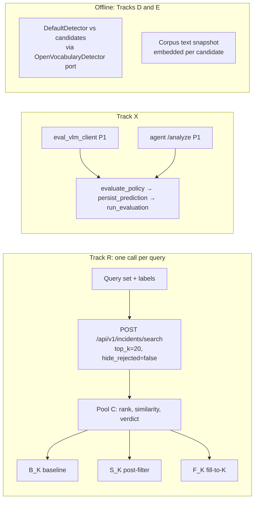

# MVP2 Eval: Retrieval Benchmark, Critic Ablation and System Comparison

Specification for the PR 119 eval workstream ([MVP2 overview](README.md#pr-119---eval-system-vs-one-shot-baseline-retrieval)): what exists today, what each track measures, how it is scored and what it depends on. Items marked **proposal (P-n)** are not yet agreed; see [§8](#8-proposals-awaiting-approval).

> **Note:** the search critic is no longer used: search runs without it (`INCIDENT_SEARCH_CRITIC`, off by default), so every hit is `unverified` and the critic material below describes dormant code.

> **Handoff**
> - **Owner:** the captain's teammate owns the retrieval eval, not the captain.
> - **Start:** at [§10](#10-work-order-and-definition-of-done). Agree the [§8](#8-proposals-awaiting-approval) proposals first and record each in [`decisions.md`](../decisions.md).
> - **Before a live run:** decide where retrieval labels and manifests are stored (open item 1 below), and upload and analyse a few real videos, because the finals search corpus may be empty (§1.2).
> - **Out of scope:** the multi-subagent routing config and full RT-CV / RT-Embed indexing were dropped, so Track F stays deferred (§5).
> - **Compute:** `kwanz-ws` uses GPU 0 only ([GPU rule](../incident-profile-operations.md#5-vm-deployment-configuration-principles-generatedenvremote)); offline detector and embedding experiments run off the VM (§6.1).
> - **Access:** each developer uses their own credentials in their own local `.env.local`, never committed or shared in chat. The variable names are in [§1.1](#11-eval-p1rp1-extraction-benchmark) (Configuration).
>
> **Open items for the eval owner**
> 1. **Eval storage.** P1 scoring no longer needs a database: since 2026-10-27 `eval_run.py` scores from an in-memory store loaded from the workbook (`eval/offline_store.py`) and opens no database unless `--db` is passed, and `db.get_db()` creates tables only with `init_schema=True` ([decision](../decisions.md#2026-10-27-eval-scores-offline-by-default-the-database-path-and-schema-creation-are-explicit)). Still open: where the retrieval query set, labels and corpus manifest are stored (§3.8 expects committed files). `eval/db.py` still maps the tables finals dropped, for the explicit `--db` path only.
> 2. **Retrieval benchmark (Track R):** the specification is this document, with the §8 proposals awaiting approval. Work-order step 1, the offline metrics module `eval/retrieval_metrics.py`, landed on 2026-10-25 ([§10.1](#101-step-1-retrieval-metrics-module-landed)); the query set, labels, corpus manifest, harness and runs are not started.
> 3. **P1 benchmark under `core-scored-v1`:** run it offline (malformed-ID frequency, per-model core and enrichment failure rates) under the ground-truth plan's approval gates (see the local planning document `.docs/mvp2/ground-truth-and-prompt-experiments-plan.md`, not tracked in Git).
> 4. **Contract ID patterns:** consider a contract version with ID patterns only if the malformed-ID evidence justifies it; it changes eval.

Paths are relative to the profile directory, except paths starting with `services/`, which are relative to the repository root. Eval scripts are written in full as `eval/scripts/…`. A bare file name (such as `eval_run.py` or `incident_search.py`) is shorthand for the file of that name given in full in the same section or table, or earlier in this document.

## 1. Where evaluation stands today

### 1.1 `eval/` (P1/RP1 extraction benchmark)

- **Models:** the three allowlisted VLMs in `contracts/inference.json`: `nvidia/cosmos-3-nano-reasoner`, `nvidia/cosmos-3-super-reasoner`, `nvidia/nemotron-3-nano-omni-30b-a3b-reasoning`.
- **Ground truth:**
  - Five categories: road accident, burglary, explosion, assault, animal attack.
  - Read from the gitignored `eval_data/ground_truth_labelling.xlsx`. `eval_run.py` loads it into an in-memory store for scoring (`eval/offline_store.py`, through `eval_ingest_gt.write_gt`); no database holds it. The `gt_*` tables existed on midterm and in the finals baseline, and `20261023000000_report_revisions_schema.sql` dropped them; `eval_ingest_gt.py --db` writes them only to a database that still has them.
  - `gt_incidents.type` is stored as the canonical lowercase type (`incident_report.canonical_incident_type`: `Fighting` → `assault`, `Animal` → `animal attack`). An unknown value is warned about on stderr and stored normalised, not dropped. GT rows ingested before this change may still hold capitalised or retired names; scoring folds them on the GT side.
  - Ground truth has no per-item timestamps and no boxes.
  - What a correct label is: [`eval/ground_truth/annotation-guidelines-v1.0.md`](../../eval/ground_truth/annotation-guidelines-v1.0.md) (approved 2026-10-27; interpretations A1-A14 decided in its §11).
- **Splits:**
  - 55 held-out videos, seed 42.
  - `eval/scripts/eval_run.py` reads the gitignored `eval_data/split_*.json`. `eval_reproducibility/` holds tracked copies; copy them over or regenerate. Their R2 keys were refreshed on 2026-10-27 after 24 clips moved to `anomaly/demo/` (membership unchanged).
- **Videos:** 80 clips (`anomaly/` without `shooting/`), downloaded and verified by `eval/scripts/eval_fetch_videos.py`; per-clip SHA-256, sizes and durations are in the tracked `eval_reproducibility/dataset-manifest-v1.json`.
- **Runner:** `eval/scripts/eval_run.py` sends the contract P1 request (`incident-contract-v4`) straight to the upstream model with a signed R2 URL.
  - It does not go through the `vlm-gateway` service, which is a pure proxy for the same request.
- **Configuration** (from `eval/.env.local`, a symlink to the profile's shared `.env.local`): `INCIDENT_DB_DSN` or `INCIDENT_SUPABASE_URL` and `INCIDENT_SUPABASE_SERVICE_ROLE_KEY` (database); `R2_ACCOUNT_ID`, `R2_ACCESS_KEY`, `R2_SECRET_KEY`, `R2_BUCKET` (signed video URLs); `VLM_GATEWAY_API_KEY` or `INCIDENT_LLM_API_KEY` and `INCIDENT_LLM_BASE_URL` (P1/RP1, the real Switchyard endpoint, not the mock); `INCIDENT_JUDGE_MODEL` (the description judge); `INCIDENT_EMBEDDING_BASE_URL` (the local MiniLM server below). The last four are not in the committed `.env`.
- **Results:** each run also writes a never-overwritten copy of every results file under `eval/eval_data/results/runs/<run start>/`, so past runs can be re-scored without another VLM call. The five former few-shot demonstration videos per category stay excluded.
- **Validation:** `core-scored-v1` (`eval/contract.py`) separates full contract validity (`contract_ok`) from core validity (`core_ok`).
  - Timeline-only defects are scored.
  - Any schema violation is scored as a miss.
- **Scoring** (`eval/eval_gt.py`, `eval/matching.py`):

  | Field | Method |
  |---|---|
  | Type and severity | Exact match |
  | Start / end / duration | Within ±5 s (`EVAL_TIMESTAMP_TOLERANCE_SECONDS`, a constant in `eval/config.py`), plus mean absolute error in `eval/scripts/eval_aggregate.py` |
  | Description and item text | Pinned LLM judge (`nvidia/nemotron-3-nano-30b-a3b`, `judge-prompt-v1`, temperature 0); passes at ≥ 0.5 |
  | Entities, instruments, assets | 1-to-1 Hungarian matching at cosine ≥ 0.75 over `sentence-transformers/all-MiniLM-L6-v2`, then precision / recall / F1 |

  - MiniLM is served locally by `eval/scripts/eval_embedding_server.py` (:8811).
  - Since 2026-10-27 every pin is fixed by [`evaluation-methodology-v1.0`](../../eval/methodology/evaluation-methodology-v1.0.md) (`eval/methodology.py`) and recorded in each result. A judge or embedder failure leaves the field unscored and stops the run, never a zero. The aggregate adds per-video 95% intervals, severity within ±1, bias and confusion, and holder accuracy, and refuses to pool methodology versions. Confirmed out-of-taxonomy clips (from the ground truth) leave type accuracy only and form their own breakdown row (§6 there). Conditional and end-to-end accuracy are reported apart, with reliability rates.
- **Run records** (since the 2026-10-02 benchmark work, on main from 2026-10-27): each P1 call's round-trip time (`timing.p1_elapsed_s`), the video's size and length, an `outcome` class that keeps request failures (`timeout`, `rate_limited`, `http_error`) out of the accuracy metrics, and a fixed rate-limit policy (20 s pacing; HTTP 429 only retried, at most twice). An empty predicted description scores 0.0 without a judge call ([decision](../decisions.md#2026-10-02-vlm-benchmark-incident-fields-only-timed-p1-round-trip-interleaved-models-no-blended-score)).
- **What is not captured:**
  - Token `usage` is kept only for the P1 call. No cost is recorded.
  - The judge model and prompt are not versioned or recorded with results.
  - The fixed run ids (`P1-cosmos3nano`, …) overwrite each other's rows when `--db` is used; the offline default keeps one store per run.
- **Box-accuracy pilot:** VLM bounding boxes were 0% well-framed, while over 95% of timestamps landed on the correct frame ([decisions](../decisions.md), 2026-10-16). The pilot report is kept outside the repository.
- `eval/docs/vlm_benchmark_results.md` is the incident-contract-v2 run of 2026-10-02 (incident fields, 55 videos × 3 models), not comparable with later contract versions.

### 1.2 What MVP2 already ships

| Piece | Current implementation | Source |
|---|---|---|
| Search route | `POST /api/v1/incidents/search` in `vss-agent` (`search-contract-v1`), live on `kwanz-ws` | `services/agent/src/vss_agents/api/incident_search.py` |
| Corpus | `evidence_crops`: one row per evidence item of each video's searchable revision (its official revision, else its newest), keyed `(revision_id, item_type, item_id)`, `embedding vector(1024)`, HNSW cosine. `search_evidence_items` returns only those rows. | [`data.md`](../data.md#evidence_crops); `supabase/migrations/20261023000000_report_revisions_schema.sql`, `20261023000200_searchable_latest_revision.sql` |
| Corpus size (2026-10-28) | Real-data search is live: 65 `evidence_crops` rows have embeddings, and 17 revisions (one per finals video; 17 videos total) have embeddings | [status](../status.md#3-database-status) |
| Embeddings | `nvidia/llama-nemotron-embed-vl-1b-v2`, 1024 dimensions. The **text** `"{name}: {description}"` is embedded (`passage`), and so is the query (`query`). Crops are not embedded. | `services/agent/src/vss_agents/utils/embeddings.py` |
| Ranking | Cosine similarity order, no cutoff (`min_similarity` default 0.0). The candidate pool equals `top_k`. | [decisions](../decisions.md) 2026-10-18 |
| Critic | Always on, with no flag. Each hit gets one VLM call (`VLM_NAME`, currently `nvidia/cosmos-3-super-reasoner`), 30 s timeout, no retry. Call starts are spaced `INCIDENT_SEARCH_CRITIC_DELAY_SECONDS` apart (default 1.0). A failure gives `unverified`. The critic **does not reorder**: `rank` is fixed before it runs. It sees the crop image (when its URL is http(s)) and a prompt that includes the embedded description. | `incident_search.py`; [decisions](../decisions.md) 2026-10-16 |
| Rejected hits | Dropped from the response when `hide_rejected` is true (the default), but always written to `query_results` | `incident_search.py` |
| Detector | `DefaultDetector` asks the remote VLM for one `bbox_2d` on the keyframe at the item's `timestamp_seconds`. With no box, the whole frame is stored (`[0,0,1000,1000]`, confidence 0.0). It sits behind the `OpenVocabularyDetector` port. | `services/agent/src/vss_agents/utils/crop_evidence.py`; [decisions](../decisions.md) 2026-10-18 |
| Latency and cost signals | Only the end-to-end `execution_time_ms`. Critic token usage and per-call latency are not recorded. | `incident_search.py` |
| `/analyze` | Runs the **same one-shot P1 call** as gateway mode and `eval/`, using the vendored copy of the same contract. It skips RP1 when `skip_rp1` is set. The model defaults to the VM's `VLM_NAME`; a request may name any allowlisted `model`. When the detector is available (`DefaultDetector` needs `VLM_GATEWAY_API_KEY` or `OPENAI_API_KEY`), best-effort cropping runs after P1 inside the same request: one remote VLM box call per entity, instrument and asset (up to 4 attempts each on 429/5xx), uploaded to R2 when R2 is configured and listed in the AI revision's `evidence`. It does not change the report, but it adds paid calls and wall-clock time to every `/analyze` response. There is no perception, tool calling or subagents. | `services/agent/src/vss_agents/tools/incident_report_gen.py`; `services/agent/src/vss_agents/api/incident_analyze.py` |
| Backends | Live agent on VM loopback, reached through the SSH tunnel at `http://localhost:8000` (its models and embeddings are remote; on `kwanz-ws` VSS uses GPU 0 only, [GPU rule](../incident-profile-operations.md#5-vm-deployment-configuration-principles-generatedenvremote)). Both mocks (:7777, launched by `start.sh --mode mock`, and standalone :7778) answer from one finals snapshot captured 2026-10-24, scoring hits by the share of query words they contain, with placeholder critic verdicts and crop URLs; the snapshot was regenerated on 2026-10-25 and holds the six finals AI revisions, without the three test videos the cleanup removed. Both mocks implement `hide_rejected` and the 0.0 `min_similarity` default. | [VM API contracts](../vm-api-contracts.md); `mock-backend/` |

## 2. Tracks (proposed, P-1)

This five-track structure is a proposal awaiting approval (§8, P-1). The original MVP2 eval goals are kept, but they are not all implementable today, so they are split by readiness. "One-shot baseline" keeps the meaning in the [overview](README.md#definitions-for-pr-task-doc-consistency): retrieval with the query embedding only, no critic.

| Track | Readiness | Question | Original goal |
|---|---|---|---|
| **R** Retrieval and critic | Implementable now (live agent; the critic must be switched on with `INCIDENT_SEARCH_CRITIC`) | How good is retrieval, and what does the critic change? | Retrieval quality; critic utility |
| **X** Extraction parity | Implementable now (sanity check) | Do the gateway path and agent `/analyze` give the same results on the same model? | System vs one-shot (narrowed) |
| **F** Full-system extraction | Deferred | Does a compound VSS pipeline beat one-shot P1? | System vs one-shot (original intent) |
| **D** Detector framing | Implementable offline | How well framed are production crops, and would another detector do better? | Detector selection |
| **E** Embeddings | Implementable offline | Which embedding gives the best retrieval on this corpus? | Embedding comparison |

## 3. Track R: retrieval benchmark and critic ablation

### 3.1 Corpus

- **What is searched:** the `evidence_crops` rows that `search_evidence_items` returns, i.e. each video's searchable revision (official, else newest). An item is identified by `(revision_id, item_type, item_id)`.
- **Pinning (P-3):**
  - Each benchmark version has a **corpus manifest**: every item key, the SHA-256 of its embedded text, the embedding model and the migration version.
  - Before scoring, the harness re-reads the live corpus through PostgREST (`eval/db_postgrest.py`) and refuses to score if it has drifted. Drift means a changed searchable revision (a new official selection, or a newer revision of a video with none), items added or removed, or text changed.
- **Size:**
  - About 100 items from 20 or more official reports is a **provisional target**, not a validated minimum.
  - Every report states the actual size and diversity: items per incident type, per item type and per report, the share of whole-frame crops, and the number of relevant items per query.
  - Every report includes a Limitations section.
  - The finals corpus may be empty today (§1.2); results on a small corpus are pilot grade and should be read as such.

### 3.2 Query set

- **Classes:** at least 8 seed queries in each of six classes:

  | Class | Example |
  |---|---|
  | Instrument | "knife" |
  | Entity | "person in a red jacket" |
  | Asset | "parked SUV" |
  | Incident scene | "cars colliding" |
  | Distractor (near miss) | A probe built from a generic confusion pair in the brief, e.g. "firearm" (confusable with a phone or wallet) |
  | Negative | Assigned after labelling: a query whose exhaustive labels mark no item relevant |

- **Class assignment:** authors tag the intended class (instrument, entity, asset, scene or distractor) when writing a query. Whether a query is *positive* (at least one relevant item) or *negative* is decided only by the exhaustive labels in §3.3, never by the author's expectation. If a class falls below 8 seeds after labelling, more blind queries are written for it.
- **Size:** the original target of 50 or more positive queries stands, counted after labelling.
- **Paraphrases** are allowed only as tagged variants of a seed. How variants enter metrics and statistics is defined in §3.5.
- **Versioning:** the set is versioned, and its SHA-256 is recorded with every result.
- **Sourcing (open question, Q1 in §9):** human-authored, or LLM-proposed then human-verified. Either way it must meet §3.3.

### 3.3 Leakage and labelling (P-2)

- **Authoring protocol.** One protocol applies to every class:
  1. **Brief.** A short scenario brief lists the query classes, the five incident categories and the entity types from `incident-contract-v4`, a generic surveillance object vocabulary and generic confusion pairs (e.g. firearm vs phone, crowbar vs walking stick). Its author must not draw on `gt_*` text, `evidence_crops` descriptions, report text or the corpus crops. The brief is committed with the query set.
  2. **Authors write blind.** Query authors see only the brief: no ground-truth text, no evidence or report text, no crops and no videos from the corpus. This keeps queries from being tailored to what is retrievable. The critic also reads the evidence descriptions, which is a further reason they stay hidden.
  3. **LLM assistance** (if chosen under open question 1) gets the same brief and nothing else; a person verifies each proposed query before it enters the set.
  4. **Labellers judge, they do not author.** Labelling (below) is done from crops and video, ideally by people who did not write the queries. Labelling decides positive vs negative; queries are not edited after labelling, only added.
  5. **Leakage check** runs on the final set (next bullet).
- **Leakage report:** for each query, report the highest token-trigram overlap and embedding similarity against every ground-truth and evidence text. Flagged queries are reviewed by a person, and the outcome is recorded.
- **Relevance labels:**
  - Binary, per (query, item key).
  - Judged from the crop and the video around `timestamp_seconds`, not from the description.
  - Labelling is **exhaustive** over the pinned corpus, which is practical at this size: one contact-sheet pass per query.
  - Two labellers on at least 20% of queries, with Cohen's κ reported and disagreements adjudicated.

### 3.4 Retrieval and filtering semantics

- **Candidate pool:** one search call per query and repeat, with `top_k = 20`, `min_similarity = 0.0` and `hide_rejected = false`.
  - The response is the candidate pool `C`: items in similarity order, each with a critic verdict.
  - Every list below is cut from the same `C`, so every comparison is paired on identical candidates.
  - `C[:K]` stands in for a separate `top_k = K` call. The RPC orders by cosine distance and then applies `LIMIT`, and the route ranks candidates in that order, so the two agree except where items have exactly equal distance across the K boundary: `ORDER BY ec.embedding <=> p_query_embedding` has no tie-breaker, so which tied item falls inside K is not guaranteed to match. The harness reports how many queries have an exact similarity tie at position K and K+1 for each K.
- **Budgets:** for K ∈ {1, 3, 5, 10}:

  | List | Definition | Meaning |
  |---|---|---|
  | `B_K` baseline | `C[:K]` | One-shot retrieval, no critic |
  | `S_K` post-filter | `C[:K]` without `rejected` items, order kept | What production returns at `top_k = K`; can be shorter than K |
  | `F_K` fill-to-K | The first K non-`rejected` items of `C` | Retrieving K surviving results by over-fetching. Not current production behaviour; reported as a what-if |

- **`unverified`:** counts as kept (production never drops hits on critic failure). A sensitivity table repeats `S_K` and `F_K` with `unverified` dropped.
- **Ties:** broken by returned order, never re-sorted. Because the RPC has no tie-breaker, the returned order of exactly tied items can differ between repeats; this is a known limitation, reported through the tie count above.

### 3.5 Metrics

For a query `q` with relevant set `Rel(q)`, a list `L` (one of `B_K`, `S_K`, `F_K`) and `hits = |L ∩ Rel(q)|`:

| Metric | Definition | Edge cases |
|---|---|---|
| Standard P@K | `hits / K` | Empty slots count as non-relevant |
| Returned precision | `hits / \|L\|` | Undefined when `\|L\| = 0`; comparisons use only instances where both lists are non-empty, with drop counts reported (below) |
| R@K | `hits / \|Rel(q)\|` | — |
| F1@K | Harmonic mean of standard P@K and R@K | 0 when both are 0 |
| MRR@K | 1 / position of the first relevant item in `L` | 0 when there is none |
| Coverage@K | `\|L\| / K` | Also reported: the share of queries with `\|L\| = 0` |
| False positives (positive queries) | `\|L\| − hits` | — |
| False positives (zero-relevant queries) | Mean `\|L\|`, and the share of queries with `\|L\| > 0` | These queries are excluded from P, R, F1 and MRR |

- **Aggregation unit (variants and repeats).** Metrics are first computed per query instance, meaning one variant (the seed text or one paraphrase) in one repeat. Then:
  1. Each variant's value is the mean over its repeats.
  2. Each seed's value is the mean over its eligible variants (equal weight per variant). A variant is eligible for P, R, F1 and MRR when it has at least one relevant item; variants with no relevant item contribute only to the zero-relevant false-positive metrics.
  3. Reported means are macro-averages over seeds, overall and per class. A seed with no eligible variant appears only in the zero-relevant metrics.
- **Uncertainty.** 95% bootstrap intervals resample seeds with replacement (a cluster bootstrap: a resampled seed brings all its variants and repeats), with a fixed seed. They are descriptive only. Differences such as `S_K` − `B_K` and `F_K` − `B_K` are computed per seed and then bootstrapped, so every difference is paired.
- **Returned precision is compared only on a shared query set.** It is undefined for an empty list, and `S_K` or `F_K` can be empty where `B_K` is not. For any comparison between two lists, returned precision uses only the query instances where *both* lists are non-empty, and that same set is used for both sides. The report states, for each K and comparison, how many instances were dropped because the first list, the second list or both were empty. Dropped instances are removed before the variant and seed means in the aggregation above. Returned precision is never compared across different query populations or denominators. Empty results stay visible through coverage and the empty-result share, which use every instance.
- **What post-filtering can and cannot change.** `S_K` keeps a subset of `B_K` (the same top-K candidates minus `rejected` items), so for every query `hits(S_K) ≤ hits(B_K)`:
  - Standard P@K, R@K and F1@K for `S_K` can never exceed `B_K`; they are equal unless the critic rejected a relevant item. Their `S_K` − `B_K` differences therefore measure the critic's **recall cost**, not a gain.
  - The critic's possible gains under post-filtering appear only in returned precision, false positives (`|L| − hits` on positive queries; mean `|L|` and the non-empty share on zero-relevant queries), and MRR, which rises when non-relevant items above the first relevant item are removed. MRR can fall, or drop to 0, when the first relevant item is rejected.
  - `F_K` (hypothetical fill-to-K) draws replacements from deeper in the pool, so it *can* raise standard P@K, R@K and F1@K above `B_K`. Those gains come with more critic calls (§3.6) and describe a configuration production does not run.
- **Pool exhaustion:** if `C` holds fewer than K survivors, `F_K` is short, and that shows in coverage.

### 3.6 Critic ablation (from the same runs)

- **Why no switch is needed:** the critic only filters, never reranks, so all three lists come from the same call and no route change is needed.
- **Reported paired differences** (system − baseline):
  - Precision, both kinds.
  - R@K and F1@K.
  - False positives, including on distractor and negative queries.
  - Coverage.
  - **Cost per list,** counted as the critic calls each list would need in production:

    | List | Critic calls |
    |---|---|
    | `B_K` | 0 |
    | `S_K` | K |
    | `F_K` | Pool position of the K-th surviving item (\|C\| if the pool runs out) |

    Tokens are added once the route records them (§7); until then any token figure is an estimate and labelled as one. The measurement call itself makes one critic call per pooled candidate (up to 20); that is the eval's cost (§3.7), not a list's.
  - **Latency:**
    - The methodology stays on the single pooled `top_k = 20` call; no extra paid timing runs are part of this plan.
    - **Measured latency** is reported in its own table: the pooled call's `execution_time_ms` and wall clock, and the raw path (the harness times query embedding plus the `search_evidence_items` RPC directly, with the same embedder settings). The pooled call makes up to 20 critic calls spaced `INCIDENT_SEARCH_CRITIC_DELAY_SECONDS` apart, so its time describes the measurement call, not `B_K` or `S_K` at production `top_k = K`.
    - **Estimated latency** per list is reported in a separate table, labelled as estimated: the raw-path time plus that list's critic calls and the delay between them. Estimated and measured figures are never mixed in one table or one difference.
    - **Optional future experiment:** direct timing runs at production `top_k = K` would measure per-list latency, but they cost more paid critic calls and need budget approval first (§9).
    - Every latency figure states the host it was measured from. `execution_time_ms` is measured inside the agent on the VM; harness timings include the network path from the harness host. Only figures from the same host are compared directly.
    - p50 and p95, with the critic delay value stated.
  - The verdict flip rate across repeats.
- **Known confound:** the critic sees the same description that was embedded, so it is not independent of retrieval. Report critic precision separately on whole-frame crops.
- **Recommendation:** a written judgment of these trade-offs for operator search. There is no pass/fail threshold.

### 3.7 Reproducibility, reliability and budget

- **Metadata in every result file:**
  - agent git SHA
  - `search-contract-v1` and `incident-contract-v4` versions
  - request parameters
  - `EVIDENCE_EMBEDDING_MODEL`
  - critic model
  - `INCIDENT_SEARCH_CRITIC_DELAY_SECONDS`
  - corpus manifest hash and query set hash
  - every `query_id`
  - timestamps
- **Where the metadata comes from.** The search API returns none of the agent git SHA, critic model, critic delay or embedding model. Before each run the operator records them from `kwanz-ws` (read-only):
  - the git SHA of the VM checkout (`/srv/rise-up/vss`);
  - the values of `VLM_NAME`, `INCIDENT_SEARCH_CRITIC_DELAY_SECONDS`, `EVIDENCE_EMBEDDING_MODEL` and `EVIDENCE_EMBEDDING_BASE_URL` that the running agent was started with (environment is captured at process start; see the `incident-operate-vm` skill);
  - only those named values. Never copy whole environment files, keys or DSNs into results, logs or commits.
- **Credentials and access the harness needs** (names only; values live in the gitignored `eval/.env.local` and are never printed or recorded):

  | Purpose | Needed | Notes |
  |---|---|---|
  | Live search | SSH tunnel to `kwanz-ws` (`start.sh --mode vm` or `.scripts/tunnel.sh`), agent at `http://localhost:8000` | Team VM access; no key in the harness |
  | Corpus manifest, drift check, raw-path RPC | `INCIDENT_SUPABASE_URL`, `INCIDENT_SUPABASE_SERVICE_ROLE_KEY` | `evidence_crops` and `search_evidence_items` are `service_role` only (RLS) |
  | Raw-path query embedding | `EVIDENCE_EMBEDDING_API_KEY` (or `NVIDIA_API_KEY`), with `EVIDENCE_EMBEDDING_BASE_URL` and `EVIDENCE_EMBEDDING_MODEL` | The Brev gateway key returns HTTP 403 on `/v1/embeddings`; adding a key to the harness host is ask-first (§6.1) |
  | Labelling contact sheets, Track D frames, Track X signed video URLs | `R2_ACCOUNT_ID`, `R2_ACCESS_KEY`, `R2_SECRET_KEY`, `R2_BUCKET` | Crop URLs in search responses are presigned for one hour, so labelling reads crops from R2 directly |
  | Track X arm 1 | `VLM_GATEWAY_API_KEY` | Already used by `eval/` |

- **Storage:** results are written to an immutable run directory, following `eval/eval_data/results/runs/<timestamp>/`.
- **Repeats (P-7):** N = 3 per query. The critic runs at temperature 0 but is not guaranteed deterministic.
- **Requests:**
  - Client timeout of at least 90 s ([VM API contracts](../vm-api-contracts.md)).
  - At most 2 retries with exponential backoff, on connection errors and 5xx only.
  - Queries run one at a time.
  - A query that still fails is recorded `request_failed` and excluded, and the count is reported.
- **Run validity (P-4):** a run is flagged when more than 5% of queries fail or more than 20% of verdicts are `unverified`. The flag means the critic or upstream degraded, not that the critic performed badly.
- **Budget:**
  - Each run states its paid calls up front: queries × N × up to 20 critic calls, plus embedding calls.
  - A plumbing run against a mock comes before any paid run. Mock numbers are never reported as results.
- **Side effect:** every live query writes rows into the shared `query_results` table. The harness records its `query_id`s so these rows can be excluded (§7).

### 3.8 Acceptance criteria

- The scenario brief, query set, labels, κ, leakage report and corpus manifest are committed.
- One valid N = 3 run reports all §3.5 metrics for `B_K`, `S_K` and `F_K` at every K, plus the §3.6 differences and latency/cost, broken down by class, with the corpus description and limitations.
- Hermetic tests in `eval/tests/` cover every edge case in §3.4 and §3.5. Done for the metrics (`eval/tests/test_retrieval_metrics.py`, [§10.1](#101-step-1-retrieval-metrics-module-landed)); the corpus-drift and request-failure cases belong to steps 2 and 3.

## 4. Track X: extraction parity (gateway vs agent)

- **Question:** whether two routes to the *same* one-shot P1 call give equivalent results. This tests transport overhead, reliability and drift between the vendored and shared contracts. It is not a test of a compound system.
- **Arm 1:** `eval_vlm_client.analyze_video_with_p1`, the same request the console sends through `vlm-gateway`.
- **Arm 2:** agent `POST /api/v1/incidents/{id}/analyze` with `skip_rp1: true` and a caller-supplied `model_run_id`, on the live VM.
  - **Response handling** matches the console (`incident-console-v2/src/modules/analysis/application/run-contract-analysis.ts`). A 200 response and a 422 response whose `detail` carries a string `raw_output` both go through `contract.evaluate_policy`, so the agent's own rejection never replaces `core-scored-v1`. Only transport failures (no response, timeouts, 504, and other non-422 errors, or a 422 without `raw_output`) are `request_failed`.
  - **Cropping:** arm 2 responses include post-P1 cropping when the VM's detector is available (§1.2). Arm 2 wall-clock latency is therefore reported as "P1 plus cropping" and is not compared directly with arm 1's P1-only latency; a P1-only figure for arm 2 depends on the agent item in §7. The crop calls count towards the paid-call budget: up to (entities + instruments + assets) × 4 remote VLM calls per video.
- **Model:** the agent defaults to the VM's `VLM_NAME` (currently `nvidia/cosmos-3-super-reasoner`); since #188 `/analyze` also takes any allowlisted `model` per request, so a VM edit is not needed to change it.
- **Controls:**
  - Same 55 held-out videos.
  - Same retry policy for both arms, and the `inference.json` P1 request timeout of 300 s. Both the agent (`services/agent/src/vss_agents/tools/incident_report_gen.py`, `DEFAULT_REQUEST_TIMEOUT_SECONDS = 300.0`), the console (`timeout_seconds` from `inference.json`), and `eval_vlm_client.chat_completion` (defaulting to `DEFAULT_TIMEOUT` read directly from `contracts/inference.json`) use 300 s.
  - The agent's `contract_version` must equal `contracts/VERSION`; otherwise the video is recorded `request_failed`.
- **Scoring:** the existing scorer, unchanged: `contract.evaluate_policy` → `eval_run.persist_prediction` → `eval_gt.run_evaluation` → `eval/scripts/eval_aggregate.py`.
- **Reliability:**
  - Reported as `contract_ok` / `core_ok` rates, computed the same way for both arms (arm 2 422 responses included, as above).
  - `request_failed` is counted separately and never folded into accuracy.
  - Wall-clock latency per call.
  - Token usage where the response includes it; agent mode currently does not (§7).
- **Run ids (P-5):** each arm gets its own `model_run_id` namespace, e.g. `X-gw-c3super` and `X-ag-c3super`. Ids must be 1-20 characters: `/analyze` validates `model_run_id` with `max_length=20`, and `model_runs.id` is `VARCHAR(20)`. The eval never calls `set_official_revision`.
- **Acceptance:** per-field score differences with paired intervals, reliability and latency tables, and an explanation of any difference outside run-to-run variation.

## 5. Track F: full-system extraction (deferred)

- The original question stands: does a compound VSS pipeline (perception, tool calling, subagents) beat one-shot P1 on the same videos and ground truth?
- **Entry criteria:** such a pipeline exists and emits `incident-contract-v4`. It then joins Track X as a third arm with the same scorer.
- **Status:** no compound pipeline is planned: the multi-subagent routing config and full RT-CV / RT-Embed indexing were dropped from MVP2 on 2026-10-24 ([decision](../decisions.md#2026-10-24-drop-multi-subagent-routing-and-full-rt-cv--rt-embed-indexing-from-mvp2)).
- **Still open:** how to normalise token budgets and timeouts between a single call and a multi-call pipeline (Q2 in §9).

## 6. Offline tracks: detector (D) and embeddings (E)

### 6.1 Experimental evaluation vs production adoption

- **Experiments are allowed:** offline benchmarking of alternatives is in scope even where a [decision](../decisions.md) rejected them for production. That includes:
  - local Grounding DINO / OWLv2 / Florence-2
  - MiniLM and OpenAI embeddings
  - image or hybrid embeddings
  - an image-only critic
- **Where experiments run:** off `kwanz-ws` (developer GPU or CPU; on `kwanz-ws` VSS may use GPU 0 only, [GPU rule](../incident-profile-operations.md#5-vm-deployment-configuration-principles-generatedenvremote)), against snapshots, with no change to the route, migrations or VM.
- **Ask first:** new dependencies and new API keys.
- **Adoption is separate:** using a result in production needs a new `decisions.md` entry superseding the current one, agreed by the owning workstream.

### 6.2 Track D: detector framing

- **Baseline:** production `DefaultDetector`, the remote VLM `bbox_2d` prompt at the VLM's `timestamp_seconds`.
  - It has **not** been framing-evaluated, although the pilot found VLM boxes 0% well-framed (in a different setting: boxes from video rather than from a single frame).
  - Measuring it comes first.
- **Candidates:** Grounding DINO, OWLv2, Florence-2 or others, plugged into the existing `OpenVocabularyDetector` port and reusing the `crop_evidence` padding and cropping helpers.
- **Frames:**
  - Item `timestamp_seconds` from the corpus in §3.1, optionally extended with Track X predictions.
  - Ground truth has no item timestamps or boxes, so framing labels are new human labels.
- **Rubric:**
  - *Well-framed:* the object is tightly enclosed.
  - *Partly framed:* clipped, or with large margins.
  - *Miss:* empty background or the wrong object.
  - Whole-frame fallbacks are their own class.
  - Two labellers on at least 20% of items, with κ reported.
- **Scope:** detector quality affects the critic's input and the UI crops, **not** retrieval ranking, which is text-only. Also report critic agreement on detector crops versus whole-frame crops.
- **Profiling:** latency on CPU and GPU, memory, and weight size.
- **Output:** a report with contact sheets. Any recommendation is advice only (see §6.1).

### 6.3 Track E: embeddings

- **Control:** production `nvidia/llama-nemotron-embed-vl-1b-v2` (1024-d).
- **Candidates must be callable today.** `llama-3.2-nv-embedqa-1b-v2` and `nv-embedqa-e5-v5` return HTTP 410 ([decisions](../decisions.md) 2026-10-18). Candidates:
  - the control at other dimensions
  - MiniLM through the existing eval server
  - OpenAI `text-embedding-3-small`, if a key is approved
  - image or hybrid crop embeddings with the `-vl` model
- **Method:**
  - Embed the snapshot texts exactly as the loader writes them (`"{name}: {description}"`) and the §3.2 queries, using the right `passage` / `query` input types.
  - Rank by brute-force cosine in memory, then score with §3.5.
  - Report latency and dimensions.
  - No migration is needed. A change of dimension or HNSW settings is a recommendation to the database owner.
- **Separate study:** the P1 scorer's Hungarian matching embedder is a measuring instrument, so changing it changes every historical score. Its sensitivity is reported separately, and MiniLM stays the scoring default unless a decision changes it.

## 7. Dependencies and boundaries

**Do not modify:**
- the search route or critic loop
- Supabase migrations
- the `incident-console-v2` UI
- contracts, mocks and VM configuration

These belong to their owning workstreams. Where this work needs something from them, ask for it:

| Need | Owner | Unblocks | Until then |
|---|---|---|---|
| Critic per-call token usage and latency (logged or returned) | Search route | Critic cost in §3.6 | Report call counts, or a labelled estimate |
| A source tag on `query_results` (eval vs user) | Search route and database | Clean search analytics | Harness lists its `query_id`s |
| Token usage in agent `/analyze` responses | Agent | Track X tokens | Report tokens for arm 1 only |
| P1-only timing in `/analyze` responses, or a way to skip post-P1 cropping per request | Agent | A P1-only latency comparison in Track X | Report arm 2 as "P1 plus cropping"; budget the crop calls |
| More searchable revisions with stored crops in the corpus (see the corpus size in §1.2) | VM operations and reviewers | Results beyond pilot grade | State the corpus limits |
| Changes to dimensions or HNSW settings | Database | Acting on Track E | Recommendation only |
| `contracts/search-contract-v1/README.md` says boxes are "never a direct VLM output" and `bounding_box` is nullable, while the code uses VLM boxes and a `NOT NULL` column | Contracts | Doc accuracy | Noted here |

**Search contract facts the harness relies on** (`contracts/search-contract-v1/`):
- **Request:** `query`, `top_k` (1–50, default 10), `min_similarity` (default 0.0; the RPC's own 0.2 default is not used by the route), `hide_rejected` (default true), and `filters` (`incident_types`, `min_severity`, `max_severity`, `item_types`).
- **Per hit:** `rank` in pre-critic order, `similarity_score`, `item`, `incident`, and `critic` (`confirmed` / `rejected` / `unverified`, with confidence and rationale).

## 8. Proposals awaiting approval

These are proposed evaluation policies, not agreed decisions. Once one is approved, add it to [`decisions.md`](../decisions.md) and remove the "proposal" marker here.

| ID | Proposal | Section |
|---|---|---|
| P-1 | Track structure: R / X / F / D / E, with Track X framed as a parity check and Track F deferred | §2 |
| P-2 | Query and labelling protocol: committed brief, blind authoring with no gt, evidence, report text or corpus media, positive/negative decided by labels, visual binary exhaustive labels, κ on ≥ 20% | §3.2, §3.3 |
| P-3 | Corpus manifest pinning, and refusing to score on drift | §3.1 |
| P-4 | Run-validity flags (> 5% failed queries, > 20% `unverified`) | §3.7 |
| P-5 | Separate `model_run_id` namespaces for Track X (ids of 20 characters or fewer) | §4 |
| P-6 | Reports go in `eval/docs/mvp2/<track>-<date>.md` | §10 |
| P-7 | N = 3 repeats per query | §3.7 |

## 9. Open questions

1. **Query sourcing:** human-written operator queries, or LLM-proposed queries with human verification, within §3.3?
2. **Track F fairness:** how to normalise token budgets and timeouts between one call and a multi-call pipeline.
3. **Detector hosting:** if a candidate clearly beats `DefaultDetector`, where could it run, given that on `kwanz-ws` only GPU 0 is available ([GPU rule](../incident-profile-operations.md#5-vm-deployment-configuration-principles-generatedenvremote)) and a local detector on the VM was rejected (2026-10-18)?
4. **Optional direct timing runs:** not planned. Direct timing at production `top_k = K` (§3.6) may be added later as a separate experiment if its paid critic calls get budget approval.

## 10. Work order and definition of done

Each item is its own PR from `main`, rebased onto `main` before merge. This handoff PR merges by itself.

1. **Retrieval metrics** (hermetic): a pure module implementing §3.4–3.5, with tests. **Landed 2026-10-25** ([§10.1](#101-step-1-retrieval-metrics-module-landed)).
2. **Query set, labels and corpus manifest** (§3.1–3.3): the format, validators and the leakage check, with tests, plus the labelled set itself.
3. **Retrieval harness:** `eval/scripts/eval_retrieval.py`, using the live agent as in §3.7; tests run against a fake transport.
4. **Critic ablation report** (§3.6), from the step 3 output.
5. **Track E**, **Track D** and **Track X** can proceed in parallel once their inputs exist. Track F waits for its entry criteria.

### 10.1 Step 1: retrieval metrics module (landed)

`eval/retrieval_metrics.py`, standard library plus numpy (already an eval dependency), no I/O. Tests: `eval/tests/test_retrieval_metrics.py` (part of `uv run pytest tests/`).

- **Input:** one `QueryInstance` per (seed, variant, repeat): `seed_id`, `variant_id`, `repeat`, `query_class`, the candidate `pool` in returned order (`Candidate(key, similarity, verdict)`) and the variant's `relevant` keys. An empty `relevant` set makes a zero-relevant (negative) variant. `validate_instances` refuses a repeated instance, a seed with two classes and a variant whose labels change between repeats.
- **Lists and metrics:** `cut_list` gives `B`, `S` and `F` exactly as §3.4 defines them (`drop_unverified=True` for the sensitivity variant; `B` never changes); `list_metrics` gives every §3.5 metric, `None` where undefined; `boundary_tie` reports a K / K+1 similarity tie.
- **Aggregation and intervals:** `seed_values` (repeats, then eligible variants), `estimate` (macro mean over seeds with a cluster-bootstrap interval), `paired_difference` (per-seed differences, then bootstrapped; returned precision on the instances where both lists are non-empty, with `returned_precision_drops`), and `summarize`, which returns all of it per K, list, comparison and class as JSON data.
- **Choices the spec left open** ([decision](../decisions.md#2026-10-25-retrieval-metrics-semantics-for-the-cases-the-eval-spec-leaves-open)):
  - A duplicate key in a pool keeps its slot but is never a second hit: it counts in `|L|`, coverage, MRR positions and false positives, and is counted in `duplicates`.
  - Intervals are 95% percentile intervals (linear interpolation) over 10,000 resamples by default; `seed` has no default, so every result names its bootstrap seed. Draws come from `random.Random(seed).random()`, so a result is reproducible from its seed and does not depend on input order.
  - Coverage and the empty share use every instance; zero-relevant metrics use only zero-relevant variants, aggregated the same way (repeats, variants, seeds).
- **Not in step 1:** the critic-call cost per list and the latency tables (§3.6, step 4), request handling, run metadata and validity flags (§3.7, steps 3 and P-4), the corpus manifest and drift check (§3.1, P-3), and no number of repeats is assumed (P-7).

### 10.2 What steps 2 to 5 still need

| Step | Needs before it can start | Open decision or dependency |
|---|---|---|
| 2. Query set, labels, corpus manifest | Approval of P-2 (protocol) and P-3 (manifest pinning); a non-empty corpus | Query sourcing (Q1); where labels and the manifest are stored (open item 1: storage for labels and manifests is undecided) |
| 3. Retrieval harness `eval/scripts/eval_retrieval.py` | Step 2; the live agent (running on `kwanz-ws:8000`, [status](../status.md#7-archive) known issue 5); SSH tunnel and the credentials in §3.7 | P-4 (validity flags), P-7 (repeats); mapping each search hit to a `Candidate` with key `(revision_id, item_type, item_id)`, `similarity_score` and `critic.verdict`, in `rank` order; the run directory layout (P-6 for reports) |
| 4. Critic ablation report | Step 3 output; `summarize` gives the list metrics and differences | Critic-call cost per list and latency tables are still to write (§3.6); token figures wait on the search route (§7) |
| 5. Tracks E, D and X | Their inputs (a corpus snapshot, framing labels, the 55-video split) | P-1 (track structure), P-5 (Track X run ids); Track E can reuse `retrieval_metrics` on in-memory rankings; Track X scores offline (`eval/offline_store.py`) |

The finals corpus now holds 17 revisions and 65 evidence crops with embeddings (§1.2), with real-data search live on the agent.

**Definition of done:**
- Each track's acceptance criteria are met.
- Reports are under `eval/docs/mvp2/` (P-6).
- `uv run pytest tests/` passes hermetically.
- No paid run happens before a plumbing run and a stated budget.
- Commands are added to `skills/incident-run-eval/SKILL.md` when the scripts land.

## 11. Decisions this evaluation may inform

These are current decisions that evaluation results could support or challenge. They are listed for visibility, and none is reopened by this document.

| Current decision ([decisions](../decisions.md)) | What could inform it |
|---|---|
| `DefaultDetector` uses VLM boxes, and local detectors are rejected for the VM (2026-10-18). This conflicts with "VLM bounding boxes" being rejected in 2026-10-16. | Track D framing results for the baseline and the candidates |
| Text-only embeddings of descriptions (2026-10-18) | Track E image and hybrid embedding results |
| Critic always on, with no flag (2026-10-16; superseded 2026-10-28: off by default behind `INCIDENT_SEARCH_CRITIC`) | §3.6 trade-offs |
| Search scoped to each video's searchable revision (2026-10-23) | Corpus limits in §3.1, if they stay binding |
| No similarity cutoff (2026-10-18) | Score distributions from Track R, for `min_similarity` tuning |
| MiniLM as the P1 matching embedder (eval) | Track E instrument-sensitivity study |
