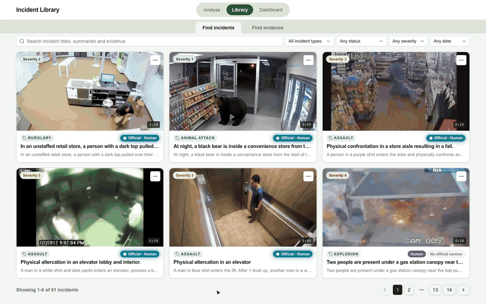
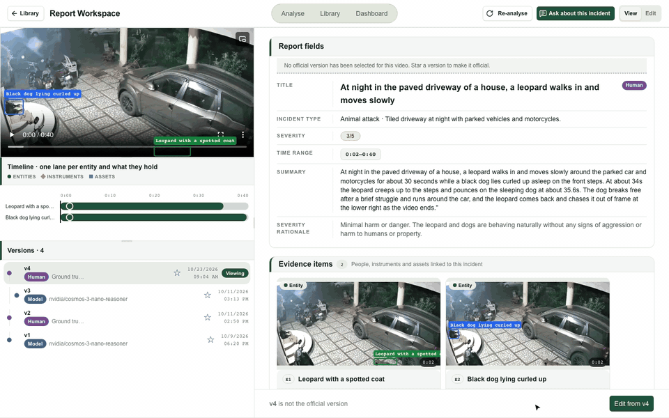
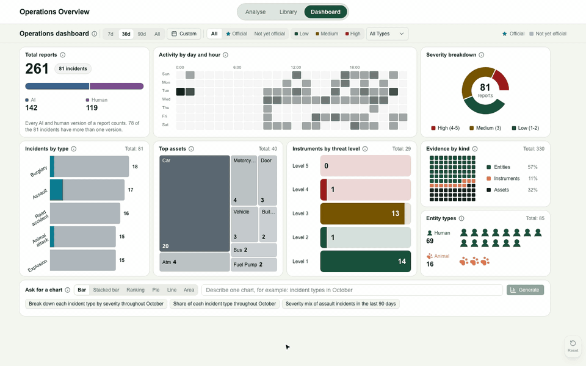
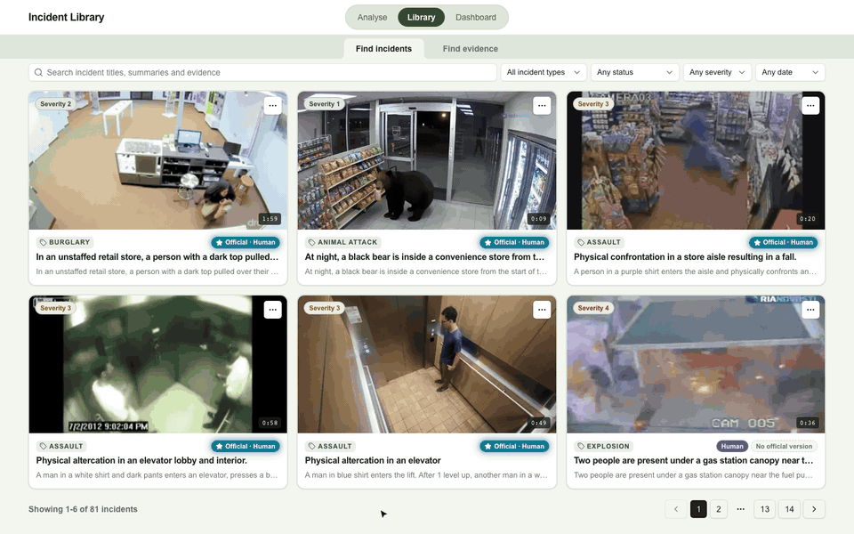
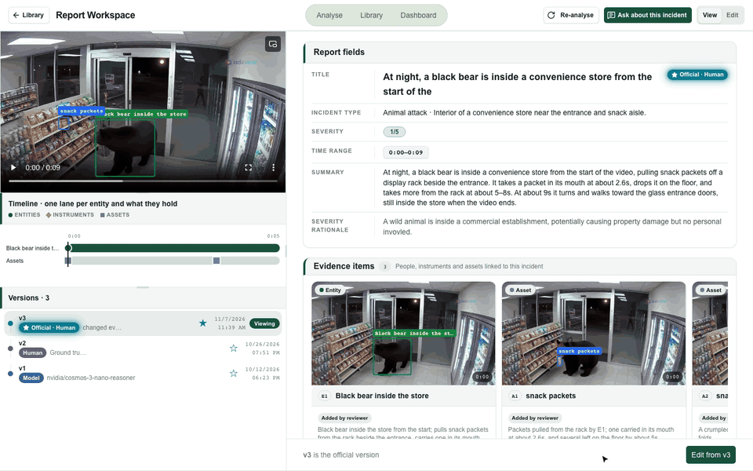

<!--
SPDX-FileCopyrightText: Copyright (c) 2025-2026, NVIDIA CORPORATION & AFFILIATES. All rights reserved.
SPDX-License-Identifier: Apache-2.0
-->
<!--
agents:
  context: How to deploy and run the incident search and reporting system. The backend runs on a GPU VM (the workstation); the web console runs on the laptop and reaches the backend through an SSH tunnel. Coding agents start at AGENTS.md.
  read-when: Deploying or starting the incident profile.
  owns: the deployment steps (prerequisites, copy and fill in .env, link, database setup, start, check, stop) and the demo clips (overview at the top, Features at the bottom).
  rules: Setting names only, never values. Detail beyond the steps belongs in .docs/incident-profile-operations.md, not here.
-->

# Incident profile: deployment

A reviewer uploads a video clip, a vision-language model writes a structured incident report, and the reviewer edits, searches and asks questions about it. This page deploys and runs the profile; the [repository README](../../../../README.md) introduces the project.



## 1. What you need

- **A GPU VM** you can reach over SSH without a password prompt (key login), with Docker and the NVIDIA container runtime. The project uses GPU 0 only.
- **On your laptop:** `ssh`, Node.js with `npm`, and `uv`. If the VM is on a Tailscale network, Tailscale must be connected.
- **Accounts and keys:** a Supabase project (database), a Cloudflare R2 bucket (videos and evidence images), an OpenAI-compatible endpoint and key for the language and vision models, and an NVIDIA API key (embeddings and container images).

## 2. Settings

The committed [`.env`](.env) is the template for both machines. Copy it, then fill in section 1 of the copy. Never put a real value in `.env` itself, never commit a copy, and never print the values.

```bash
cp .env .env.local     # laptop, in this folder
cp .env .env.remote    # VM, in this folder of the VM's checkout (the VM has no .env.local)
ln -sfn ../.env.local incident-console-v2/.env.local   # laptop: the console reads its own .env.local
```

`.githooks/activate.sh` (run once per clone) keeps the link and the copy in place in new worktrees, and leaves a VM checkout alone ([.githooks](../../../../.githooks/README.md)).

| Section 1 setting | Where | Meaning |
|---|---|---|
| `INCIDENT_SUPABASE_URL`, `INCIDENT_SUPABASE_SERVICE_ROLE_KEY` | both | The Supabase project |
| `INCIDENT_DB_DSN` | laptop only | The Supabase connection string, used by `setup-database.sh` |
| `R2_ACCOUNT_ID`, `R2_ACCESS_KEY`, `R2_SECRET_KEY`, `R2_BUCKET` | both | The Cloudflare R2 bucket |
| `VSS_SSH_HOST` | laptop only | SSH host name or address of the VM. No default |
| `NGC_CLI_API_KEY`, `OPENAI_API_KEY` | VM only | Keys for container images and the model endpoint |
| `LLM_BASE_URL`, `LLM_NAME`, `VLM_NAME` | VM only | Model endpoint (no `/v1`) and model names |

Section 2 holds defaults; the VM scripts fill in `HOST_IP`, `VSS_APPS_DIR` and `VSS_DATA_DIR` themselves. More rules for the VM file: [operations runbook](.docs/incident-profile-operations.md#5-vm-deployment-configuration-principles-envremote).

**Database (new, empty Supabase project only):** once `INCIDENT_DB_DSN` is filled in `.env.local`, run `./.scripts/setup-database.sh --env-file .env.local` on the laptop ([details](supabase/README.md#build-a-new-database)).

## 3. Start

Run from this folder, on your laptop (never on the VM):

```bash
./start.sh --mode vm
```

- `./start.sh --mode vm`: the default. Real backend on the VM, console on the laptop at <http://localhost:3200>.
- `./start.sh --mode vm --prod`: the same, with the console as a production build.
- `./start.sh --mode vm --no-console`: backend and tunnel only.

It starts on the VM only what is missing (Phoenix, the agent and the person-tracking stack), then opens the SSH tunnel and the console. The first tracking start takes about ten minutes; `ENABLE_TRACKING=false ./start.sh` skips it.

## 4. Check it is up

- `curl -s localhost:3200/api/health`: the console answers with true/false readiness flags.
- `./.scripts/tunnel-check.sh`: prints `agent ok` and `search route ok`.

If `start.sh` stops early, it prints the cause and the fix. More help: [incident-start skill](skills/incident-start/SKILL.md) and [connectivity troubleshooting](.docs/incident-profile-operations.md#3-laptop-to-vm-connectivity--ssh-troubleshooting).

## 5. Stop

- **Laptop:** Ctrl-C in the `start.sh` terminal stops the console and the tunnel.
- **VM:** nothing on the VM stops when `start.sh` exits, because the backend is shared. To stop it on purpose, run on the VM, from this folder:

  ```bash
  ./.scripts/native-services.sh stop   # the agent
  ./.scripts/tracking-stack.sh stop    # the person-tracking stack
  ./.scripts/down.sh                   # the agent and all containers, nothing removed
  ```

Never use NVIDIA's `dev-profile.sh` for this profile: its `down` deletes the VM's data and model cache.

## Features

**Report workspace:** the video with boxes that follow each item, the timeline, the report fields, the evidence items and the report's versions.



**Dashboard:** counts by hour, severity, type, assets, instruments and evidence; every panel follows the filters.



**Evidence search:** describe a person or an object in plain English and open a match at the second it appears.



**Ask about this incident:** a question about one report, answered from the report, with the tools the agent used.



## Read more

- [Architecture](.docs/architecture.md): context, containers, runtime and deployment
- [Operations runbook](.docs/incident-profile-operations.md): running the VM
- [Console reference](.docs/console-reference.md): pages, routes and configuration
- [Data layer](.docs/data.md): tables, functions, security, R2 keys
- [Report schema](.docs/analysis-schema.md): the report contract, validation and storage of model output
- [Agent API contracts](.docs/vm-api-contracts.md): the `vss-agent` HTTP endpoints
- [Skills](skills/README.md): launching, operating, analysing and migrating, step by step
- Changing code: [AGENTS.md](AGENTS.md)
