# MVP2 Eval Workstream Tasks: System-Level Benchmarking & Retrieval Suite

## 1. Context & Baseline: Where `eval/` Stands Today

The `dev-profile-incident/eval/` subproject is a standalone Python evaluation environment operating independently of live UI or streaming containers. To date, evaluation has focused on isolated Vision-Language Model (VLM) structured extraction ("P1") across 3 allowlisted models (`cosmos-3-nano`, `cosmos-3-super`, `nemotron-3-nano-omni`) on held-out surveillance video splits.

### 1.1 Existing Evaluation Assets & Mechanics
- **Ground-Truth Data & Ingestion:** Ground truth is structured around 5 canonical categories (Animal Attack, Assault, Burglary, Explosion, Road Accident) with tracked reproducible split manifests (`eval_reproducibility/split_*.json`) designating held-out test clips. Ground truth is ingested into Supabase `gt_*` tables (`eval_ingest_gt.py`).
- **P1 Extraction Runner (`scripts/eval_run.py`):** Runs zero-shot extraction using signed R2 video URLs under strict schema enforcement (`incident-contract-v3`).
- **Validation Policy (`core-scored-v1` in `contract.py`):** Differentiates full contract validity (`contract_ok`) from core database-backed validity (`core_ok`). If core fields pass schema and range checks, the run is scored; enrichment defects (timeline, uncertainties) do not zero the score.
- **Scoring Pipeline (`eval_gt.py` & `matching.py`):**
  - Incident taxonomy type and severity level: Exact match.
  - Incident start/end window: $\pm 5$s tolerance (`EVAL_TIMESTAMP_TOLERANCE_SECONDS`) and Mean Absolute Error (MAE).
  - Incident description: Semantic equivalence scored via LLM-as-a-judge (`INCIDENT_JUDGE_MODEL`, threshold $\ge 0.5$).
  - Entities, instruments, and assets: Optimal 1-to-1 Hungarian matching using cosine similarity ($\ge 0.75$) over text embeddings (`sentence-transformers/all-MiniLM-L6-v2`), computing Precision, Recall, and F1.
- **Box-Accuracy Pilot Finding:** A targeted 7-clip pilot across all 3 VLMs revealed that spatial coordinate regression from VLMs is completely broken (0% well-framed bounding boxes across 166 items), whereas temporal grounding is robust (>95% timestamp accuracy).

---

## 2. End Goals & Milestone Progression

MVP2 expands the evaluation mandate from isolated model scoring to **end-to-end system evaluation**, natural-language video retrieval benchmarks, critic efficiency analysis, and detector grounding validation.

Rather than prescriptive scripts, this workstream is structured around five strategic end goals. The assignee owns the methodology, experimental design, and execution.

```mermaid
flowchart TD
    subgraph G1["Goal 1: Baseline vs Full VSS System"]
        A1["One-Shot VLM Prompt\n(vlm-gateway Baseline)"] <-->|"Fair, reproducible\napples-to-apples"| B1["Full VSS Blueprint System\n(vss-agent, Perception, Search)"]
    end
    subgraph G2["Goal 2: MVP2 Retrieval Quality"]
        A2["Independent Benchmark Queries\n(50+ non-circular)"] --> B2["Retrieval Eval Harness\n(POST /api/v1/incidents/search)"]
        B2 --> C2["P@K, R@K, MRR, F1"]
    end
    subgraph G3["Goal 3: Always-On Critic Utility"]
        A3["Raw Vector Retrieval"] <-->|"Ablation:\nPrecision vs Latency/Cost"| B3["Critic-Verified Retrieval"]
    end
    subgraph G4["Goal 4: Open-Vocab Detector Selection"]
        A4["VLM Timestamp & Label"] --> B4["Candidate Detectors\n(Grounding DINO / OWLv2 / Florence-2)"]
        B4 --> C4["Full-Dataset Framing Eval"]
    end
    subgraph G5["Goal 5: Embedding Model Comparison"]
        A5["Candidate Embeddings\n(NeMo NIM vs OpenAI vs MiniLM)"] --> B5["Retrieval & Hungarian Match Benchmarks"]
    end
```

---

### End Goal A: System-Level Evaluation (One-Shot VLM Gate vs Full VSS Pipeline)

*Current State:* We only evaluate raw VLM prompt extraction (`vlm-gateway` calling hosted model switchyards directly). We do not benchmark the compound VSS system (`vss-agent` with perception, tool calling, and multi-subagent orchestration) against that baseline.

*End Goal:* A fair, reproducible, head-to-head empirical comparison quantifying whether the full VSS Blueprint system outperforms a direct one-shot VLM prompt baseline on the same benchmark videos and ground truth.

*How the Work Moves Toward It:*
1. **Define Equivalent Task Boundaries:** Establish identical input constraints (same video source, identical duration, same prompt context) and output schemas (`incident-contract-v3`) across both pathways.
2. **Standardize Evaluation Harness:** Create a runner capable of executing both pipelines deterministically:
   - **Baseline:** One-shot direct VLM prompt invocation via `vlm-gateway`.
   - **Full VSS:** Native `vss-agent` pipeline (`POST /api/v1/incidents/{id}/analyze` or multi-subagent workflow) deployed on `kwanz-ws` or local mock.
3. **Evidence of Reaching Goal:**
   - A unified benchmark report comparing both systems across:
     - Extraction Accuracy (Type, Severity, Temporal window MAE, Description similarity, Entity/Instrument/Asset F1).
     - Execution Latency (seconds per video).
     - Token & Compute Cost (API tokens and GPU utilization).
     - Contract Reliability (raw JSON schema adherence, need for repair).

---

### End Goal B: Retrieval Quality of MVP2 Evidence Search

*Current State:* The repository has zero search retrieval evaluation. Search functionality (`POST /api/v1/incidents/search`) is being implemented for MVP2.

*End Goal:* A quantitative retrieval benchmark suite validating search performance across diverse natural-language user queries, measuring Precision@K, Recall@K, Mean Reciprocal Rank (MRR), and F1.

*How the Work Moves Toward It:*
1. **Curate Independent Benchmark Queries:** Assemble a non-circular query set (50+ queries) paired with ground-truth positive and negative target videos/items.
   - *Constraint:* The Captain strictly rejected generating queries from `gt_incidents` text descriptions to avoid circular leakage.
2. **Develop Retrieval Harness (`eval/scripts/eval_retrieval.py`):**
   - Interacts with `POST /api/v1/incidents/search` (supporting local mock port 7778 and live agent port 8000).
   - Executes parameterized query sweeps ($K \in \{1, 3, 5, 10\}$, item type filters, severity constraints).
3. **Evidence of Reaching Goal:**
   - Automated benchmark run producing reproducible quantitative tables:
     - Mean Reciprocal Rank (MRR) across all queries.
     - P@1, P@3, P@5, P@10 and Recall@K curves.
     - Category breakdown (e.g. broad security questions vs specific weapon searches).
   - Automated regression tests in `eval/tests/` verifying retrieval metric calculation math.

---

### End Goal C: Always-On Critic Utility & Cost-Benefit Analysis

*Current State:* MVP2 plans an "always-on" VLM Critic evaluating every retrieved candidate crop before returning results to the user. Its actual precision boost versus latency and cost overhead is unmeasured.

*End Goal:* An empirical ablation report proving whether the always-on Critic earns its latency and token cost by filtering false positives and adversarial distractors.

*How the Work Moves Toward It:*
1. **Retrieval Ablation Sweep:** Run the benchmark queries in two configurations:
   - *Raw Retrieval:* Vector search candidate ranking based strictly on cosine distance / similarity score.
   - *Critic-Verified Retrieval:* Ranking post-Critic verification (`confirmed` vs `rejected`), assessing reranking and filtering.
2. **Distractor Resistance Test:** Include subtle distractors in the query evaluation set (e.g., querying "firearm" when the scene contains a wallet or cell phone; querying "crowbar" when a person holds a walking stick).
3. **Evidence of Reaching Goal:**
   - Comparative Delta Table:
     - $\Delta \text{Precision@K}$ and $\Delta \text{False Positive Rate}$.
     - Added Latency Overhead (p50, p95 round-trip latency in milliseconds per query).
     - Token Usage and Cost per query.
   - Clear recommendation: Does Critic verification justify the latency budget for real-time operator search?

---

### End Goal D: Open-Vocabulary Detector Selection & Full-Scale Framing Evaluation

*Current State:* The box pilot proved that general VLMs cannot predict bounding boxes (0% well-framed), but have >95% temporal accuracy. An open-vocabulary 2D detector is required to crop keyframes at the VLM's predicted `timestamp_seconds`.

*End Goal:* An evidence-backed model selection of an open-vocabulary detector (e.g., Grounding DINO, OWLv2, Florence-2) proven to produce tight, well-framed crops at production speed.

*How the Work Moves Toward It:*
1. **Detector Candidate Benchmarking:** Set up a comparative test harness evaluating candidates on the pilot video clips and extending to the full held-out dataset.
2. **Framing Quality Assessment:** Evaluate crops extracted at VLM `timestamp_seconds` using item labels:
   - *Well-framed:* Object tightly enclosed with minimal background clutter.
   - *Partly-framed:* Object clipped or excessive margins.
   - *Miss:* Empty background or incorrect object.
3. **Operational Profiling:** Measure CPU vs GPU latency, memory footprint, and model weight footprint.
4. **Evidence of Reaching Goal:**
   - A dedicated evaluation report in `eval/docs/` presenting visual contact sheets, framing accuracy percentages, and latency figures.
   - Final architecture recommendation for the frame cropping service.

---

### End Goal E: Embedding Model Comparison for Evidence Search

*Current State:* `eval/` currently uses local `sentence-transformers/all-MiniLM-L6-v2` for Hungarian entity matching. The database workstream will implement the production pgvector embedding pipeline.

*End Goal:* Empirical comparison of candidate text embedding models to determine which provides the highest retrieval accuracy and semantic alignment for incident evidence items.

*How the Work Moves Toward It:*
1. **Benchmark Candidate Embeddings:**
   - Option A: NVIDIA NeMo Retriever NIM (`nvidia/llama-3.2-nv-embedqa-1b-v2`).
   - Option B: OpenAI `text-embedding-3-small` (1536 dims).
   - Option C: Local `all-MiniLM-L6-v2` (384 dims).
2. **Evaluate Embedding Impact on Retrieval & Matching:**
   - Measure separation distance between true evidence items and adversarial negatives.
   - Compare Hungarian matching F1 on ground truth across embedding options.
3. **Evidence of Reaching Goal:**
   - Empirical accuracy vs dimensionality/latency trade-off matrix informing the database migration schema (vector dimensions and HNSW index parameters).

---

## 3. High-Level Workstream Checklist

Assignee builds on this branch (`fm/vss-mvp2-eval-handoff`):

- [ ] **System-Level Evaluation Framework:** Formulate and run a fair, reproducible benchmark comparing the one-shot VLM prompt baseline (`vlm-gateway`) against the full VSS Blueprint system on identical video splits.
- [ ] **Benchmark Query Sourcing Strategy Proposal:** Propose and resolve how the independent search evaluation dataset is created without circularity from ground-truth descriptions.
- [ ] **Retrieval Benchmark Suite (`eval/scripts/eval_retrieval.py`):** Implement the search evaluation harness computing P@K, R@K, MRR, and F1 across multiple retrieval configurations.
- [ ] **Always-On Critic Ablation Study:** Quantify whether the VLM Critic justifies its added latency and token cost by measuring false-positive reduction.
- [ ] **Open-Vocabulary Detector Evaluation:** Test candidate detectors (Grounding DINO, OWLv2, Florence-2) against keyframes extracted at VLM timestamps, delivering a definitive model recommendation for evidence cropping.
- [ ] **Embedding Model Benchmark:** Benchmark candidate embeddings (NVIDIA NeMo vs OpenAI vs MiniLM) on retrieval and entity matching accuracy.
- [ ] **Unit & Regression Test Coverage:** Expand `eval/tests/` with hermetic test suites guarding retrieval scoring and evaluation data parsing.

---

## 4. Dependencies & Interfaces

### 4.1 System Interfaces
- **Search API Contract (`contracts/search-contract-v1/`):**
  - Owned by Captain. Defines request parameters (`query`, `top_k`, `min_similarity`, `filters`) and response structures (`hits`, `critic` verdicts).
- **Incident Contract (`incident-contract-v3`):**
  - Owned by Captain. Standardizes `timestamp_seconds` and item labels on entities, instruments, and assets.
- **Search Backend:**
  - Mock backend on port 7778 (`mock-backend/search_profile_mock/`) for local testing.
  - Native `vss-agent` on port 8000 (`kwanz-ws`) for live system testing.

### 4.2 Workstream Boundaries (What NOT to Touch)
- **Do not modify Search Route Implementation:** Backend route handler and Critic loop belong to the Captain.
- **Do not modify Database Migrations:** Supabase SQL DDL and pgvector indexing belong to the database owner.
- **Do not modify Frontend UI:** `incident-console-v2/` search interface belongs to the console owner.

---

## 5. Open Questions Owned by the Assignee

1. **Benchmark Query Sourcing:** Propose whether to use human-curated operator queries (higher ecological validity) or LLM-generated query variants with human verification (faster scale).
2. **System Baseline Fairness:** How to normalize token budgets, prompt context, and execution timeouts when comparing one-shot VLM direct inference vs compound VSS pipelines.
3. **Detector Runtime Footprint:** Whether the selected open-vocabulary detector can run within the existing `vss-agent` venv, requires GPU acceleration, or needs a CPU-friendly fallback for local development.

---

## 6. Definition of Done

1. A comprehensive system-level evaluation report comparing the one-shot VLM baseline against the full VSS system is documented in `eval/docs/`.
2. `eval/scripts/eval_retrieval.py` runs against a live or mock search endpoint and outputs quantitative metrics (P@K, R@K, MRR, F1).
3. The Critic ablation analysis and detector recommendation reports are documented with empirical evidence and contact sheet artifacts.
4. All new evaluation modules and metric computations pass hermetic tests in `eval/tests/` (`uv run pytest tests/`).
