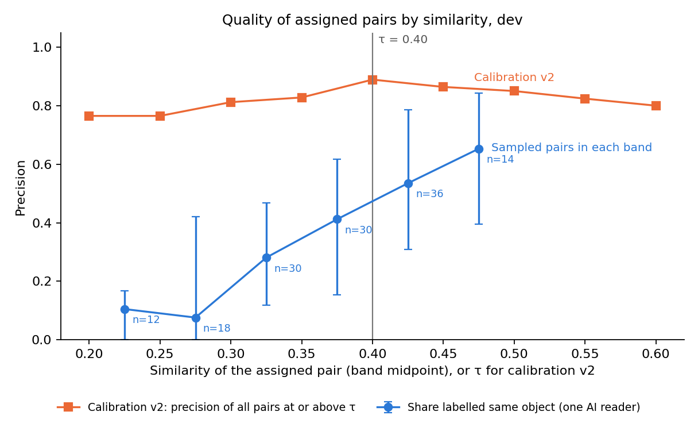
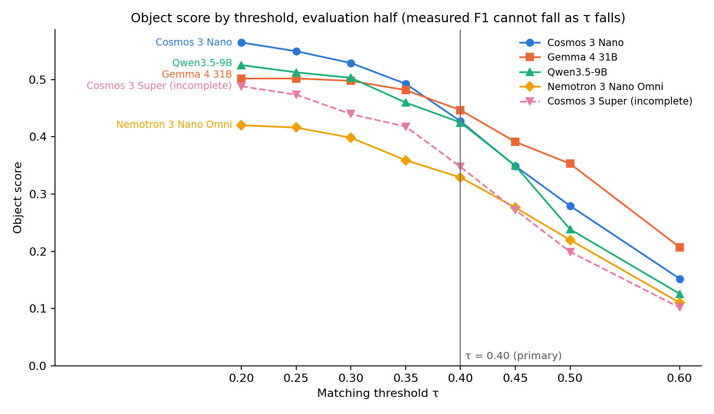

> **Erratum (2026-11-05).** Evaluation-half tables here reproduce the original chart view (invalid outputs as misses, no-output runs dropped), not valid-only. The retain-0.40 decision is unaffected: it rests on dev. The ranking statement is view-dependent: on valid-only counts Gemma leads from τ 0.30 upward and Qwen at τ ≤ 0.25, so "Nano leads at τ ≤ 0.35" holds only in the chart view (`evaluation_valid_only_object_score.json`; Omni there differs slightly because its A1 row is kept).

# Object-matching threshold: audit and sensitivity (τ = 0.40)

**τ = 0.40 stays primary.** This study is exploratory and post hoc. It changes no score, configuration, frozen file or scoring code. Written 2026-11-05.

- **Method:** stored score rows and stored MiniLM vectors, with the unchanged `matching.solve_assignment`. No VLM, LLM, judge or embedding call, and no spend. No vector was missing, so local MiniLM was not needed.
- **Labels:** 140 dev pairs labelled by **one AI reader, from texts only. These are not human labels.**
- **No bug changes a reported object result.** The replay reproduces every stored count exactly.

## Answers

| Question | Answer |
|---|---|
| Was τ = 0.40 selected through legitimate dev calibration? | **Yes, with limits.** It came from a stated rule on dev-only pairs, before any object scoring of the evaluation clips. It is not post-evaluation selection. The limits: AI labels only, a second look after a first result of 0.30, and calibration outputs from one model ([§1](#1-audit)) |
| Which lower threshold improves quality? | **None passes the rule.** 0.35 is the closest and cannot be told apart from 0.40 on quality. Below 0.35, quality falls clearly |
| True matches or more false positives? | **Both, and many cannot be decided.** Of about 50 dev pairs in [0.35, 0.40): about 21 same, 3 different, 26 cannot tell. Of about 58 in [0.25, 0.35): about 12 same, 26 different, 19 cannot tell |
| Consistent across kinds? | **No.** Below 0.40, 36% of entities are labelled same, against 8% of assets and 11% of instruments. Measured F1 rises in nearly every cell, but it would rise for wrong pairs too |
| Rankings sensitive? | **Yes, at the top.** Evaluation half: Gemma leads at τ ≥ 0.40, Nano at τ ≤ 0.35; Qwen moves between 2nd and 3rd. Omni is last at every τ. At 0.40 no model leads firmly: Gemma is first in 50% of resamples |
| Should 0.40 stay primary? | **Yes.** It is pre-registered, every lower candidate failed the dev rule, and changing it now would be post-hoc selection |
| What should future evaluations use? | One common τ, fixed on dev before evaluation, with the τ curve always reported beside it. Keep 0.40 for continuity, and re-derive it on a human-labelled pair set that covers every model. Decide filter-first against filter-after in that same step ([§7](#7-recommendations)) |

## 1. Audit

### How matching works

| Item | Finding | Source |
|---|---|---|
| Embedder | `sentence-transformers/all-MiniLM-L6-v2`, mean pooling, encoded with `normalize_embeddings=False` | `methodology.py`, `scripts/eval_embedding_server.py`, `evalv2/score_stage.py` |
| Embedded text | `type description` for entities, `name description` for instruments and assets. Only `.strip()`; no other preprocessing | `matching._entity_text`, `_named_text` |
| Truncation | The model card truncates at 256 word pieces. No stored description exceeds 150 words, so truncation is unlikely (a word-count proxy, not a token count) | 5,334 item texts checked |
| Similarity | Cosine, after L2 normalisation in `_cosine_similarity_matrix` | `matching.py` |
| Assignment | `scipy.optimize.linear_sum_assignment` on the negated matrix, per clip, per kind, per run | `solve_assignment` |
| Threshold | **After** assignment, inclusive (`>=`) | `solve_assignment` |
| Object score | Mean of entity F1 and the F1 of instruments and assets pooled by counts | `v2_c3_presentation_data.d2_rows` |

### What filtering after assignment causes

1. **The pairing does not depend on τ.** A lower τ only reveals lower pairs of the same assignment.
2. **Measured F1 can never fall as τ falls.** Each newly accepted pair turns one fp and one fn into a tp, right or wrong. Measured F1 therefore cannot choose τ; on its own it would always prefer the lowest value.
3. **It can lose matches.** Maximising the sum can prefer two weak pairs over one good one, and both are then rejected. Against filtering first, at 0.40: **6 matches lost of 377** on dev (all five models), **7 of 570** on the evaluation half (four complete models).
4. **It can change partners without changing counts.** 19 dev blocks and 16 evaluation blocks pair differently at 0.40.
5. **Identical predictions tie arbitrarily.** Two dev and two evaluation blocks pair differently from the stored run. All four have identical similarities and counts.

Items 3 to 5 are small, and the replay keeps this behaviour exactly. Both orders have published precedents ([§2](#2-published-methodology)).

### Why 0.40

| Date (+0800) | Event |
|---|---|
| 2026-10-02 | Benchmark on the 55 evaluation clips with contract v2. Per-video results were visible to the team. The file inspected is flagged `incident_only`, with no object matching |
| 2026-10-28 | Stage 1 on dev: at the pre-registered 0.75, item F1 is at the floor. A model-score table at 0.65 / 0.75 / 0.85 is reported, marked not for selection |
| 10-28 17:26–17:29 | Calibration v1: 22 blocks, 70 pairs, labels locked. Grid 0.30–0.80 |
| 10-28 17:42 | `065974d3a`: rule, code and v1 result first enter Git. **Result: 0.30** (F1 0.857; 0.40 gives 0.842), at the grid edge, provisional |
| 10-28 22:00–22:01 | v2 blocks and audit selection drawn, about two minutes before the rule commit. No labels yet |
| 10-28 22:02:35 | `dac60a9b2`: v2 rules committed |
| 10-28 22:06–22:12 | v2 labels and AI audit written |
| 10-28 22:25 | `21c4266d5`: **τ = 0.40**, F1 0.814 [0.65, 0.94]. 0.30 scores 0.812, inside the 0.01 tie margin, and the rule takes the higher τ |
| 10-29 onward | Stage 3 on the evaluation clips: the first object scoring there, after τ was fixed. C3 followed in November |

**Rule:** highest pooled F1 against labels, one τ for all kinds, ties within 0.01 to the higher τ.
**Candidates:** 0.30–0.80, then 0.10–0.80, in steps of 0.05.
**Sweep:** yes, on labelled dev pairs. Stage 1 model scores were not an input.

**Calibration pairs are on dev only.** I checked all 26 blocks against `split-v2`: 17 clips, all dev, none in the evaluation half. `eligible_blocks` also refuses non-dev records.

**Labels.** AI-labelled and AI-audited; no person reviewed them. Hashes match the recorded values: v1 `c53bae83…`, v2 `eda29ffb…`. Both files are read-only and dated 2026-10-28. I found no change after that date. The only change between v1 and v2 is the five ambiguous pairs that the v2 rule resolved.

**Genuine dev calibration, or post-evaluation selection?** Genuine dev calibration. Limits to state:

- **Second look.** The decision to extend, and the v2 rules, came after the v1 result of 0.30 was known. The rule text did not change, but the extension moved the result from 0.30 to 0.40, by a margin of 0.002 plus the tie rule. The move was toward the precision-favouring side.
- **Audit targeted by knowledge of results.** The auditor was blind, but the choice of audited pairs used the false matches at 0.30 and 0.40.
- **Human audit replaced.** v1.2's procedure required a person to audit at least 20 pairs. An AI audit replaced it under the owner-approved extension. Eight pairs await review, and the owner ruled out human review on 2026-11-03.
- **v1 timing cannot be checked in Git.** The v1 rule first appears at 17:42, after the v1 labels at 17:29. Its "before labelling" claim rests on the document. The v2 rule's order is verifiable.
- **Narrow source.** All pairs are Cosmos 3 Super outputs under the baseline prompt. Nano, Omni, Gemma and Qwen were never in calibration.
- **Weak separation.** The study itself says 0.30–0.40 over 0.75 firmly, and 0.40 over 0.30 weakly. 0.40 was picked in 55.6% of resamples.
- **The evaluation clips are not unseen.** They were in the 2026-10-02 benchmark, in Stage 3, and in earlier audits of these same scores.

## 2. Published methodology

**What the literature supports.** I found **no source that sets or supports a universal cosine threshold**, and none for MiniLM. The sources point to a task-specific operating point, chosen on validation data, with the sweep reported. "No universal threshold" is my inference from these sources, not a finding any of them tests directly.

| Topic | Source | What it says | Checked |
|---|---|---|---|
| Filter before assignment | [TrackEval `clear.py`](https://github.com/JonathonLuiten/TrackEval/blob/master/trackeval/metrics/clear.py) | Sets sub-threshold similarity to 0 before `linear_sum_assignment`; default 0.5 | Source code |
| Filter after assignment, over a sweep | [TrackEval `hota.py`](https://github.com/JonathonLuiten/TrackEval/blob/master/trackeval/metrics/hota.py); [Luiten et al., IJCV](https://arxiv.org/abs/2009.07736) | Assigns once, then keeps pairs at or above each α | Source code; abstract |
| Sweep instead of one threshold | [pycocotools `cocoeval.py`](https://github.com/cocodataset/cocoapi/blob/master/PythonAPI/pycocotools/cocoeval.py) | The headline AP is reported over IoU 0.50:0.95 | Source code |
| Similarity matching without a threshold | [BERTScore, Zhang et al., ICLR 2020](https://arxiv.org/abs/1904.09675) | Soft token matching by contextual-embedding similarity; baseline rescaling is for readability | Abstract; rescaling detail from a search excerpt |
| Selection on validation, reported on test | [Ditto, Li et al., VLDB 2021](https://arxiv.org/abs/2004.00584) | 3:1:1 split; test F1 is reported at the epoch best on validation. It selects a checkpoint, not a similarity threshold | Full text |
| In-sample risk | [sentence-transformers `BinaryClassificationEvaluator`](https://github.com/huggingface/sentence-transformers/blob/v3.0.1/sentence_transformers/evaluation/BinaryClassificationEvaluator.py) | Finds the F1-best cosine threshold on the labels it evaluates. Example thresholds are 0.77–0.84 on one dataset, far from ours | Source code |
| F1-optimal thresholds | [Lipton, Elkan, Narayanaswamy, ECML PKDD 2014](https://arxiv.org/abs/1402.1892) | With calibrated probabilities the best threshold is half the best F1. Maximising F1 with an uninformative score predicts everything positive | Abstract |
| Limits of cosine | [Steck, Ekanadham, Kallus 2024](https://arxiv.org/abs/2403.05440); [Ethayarajh 2019](https://arxiv.org/abs/1909.00512) | Cosine values can be arbitrary in some models, and contextual embeddings are anisotropic, so raw values do not carry across models | Abstracts |
| Embedder | [all-MiniLM-L6-v2 card](https://huggingface.co/sentence-transformers/all-MiniLM-L6-v2) | Truncates at 256 word pieces; recommends no similarity threshold | Model card |

**Could not verify:**
- [arXiv 2606.26205](https://arxiv.org/abs/2606.26205): a search excerpt reported per-type embedding cutoffs of 0.54–0.68 chosen on labelled validation data, but I could not read the PDF text. Not relied on.
- [Semantic F1](https://arxiv.org/abs/2509.21633) and a Hungarian soft-F1 ([arXiv 2607.24093](https://arxiv.org/abs/2607.24093)): search excerpts only. Not relied on.
- I did not find a published comparison of filter-first against filter-after, or any published threshold for matching short object descriptions.

**Published recommendations against our decisions.** Validating on held-out data, reporting sweeps and warning about in-sample thresholds are published practice. The value 0.40, the 0.01 tie rule, one τ for all kinds, the gates in [`selection-rule.md`](selection-rule.md), and filtering after assignment are our decisions. HOTA is a precedent for that order, not a recommendation of it for this task.

## 3. Replay at 0.40

Dev was run first for the sweep, and the evaluation half was checked at 0.40 only, before any selection.

| Half | Rows (with model output) | Blocks compared | Count mismatches | Pairs | Blocks pairing differently |
|---|---|---|---|---|---|
| Dev | 250 (249) | 747 | **0** | 377 | 2 (ties) |
| Evaluation | 466 (458) | 1,371 | **0** | 625 | 2 (ties) |

- All 15 evaluation-half P1 cells of `d2_object_identification.csv` match by tp, fp and fn.
- The three uncompared blocks are the A1 item (Omni Explosion004 repeat 1), which has no score block and is a miss, as in the chart.
- **Data note:** `c1a` and `c1a-recovery` hold only Nano, Omni and Super. Gemma's and Qwen's dev rows are in `c1e-openrouter-gemma4-31b` and `c1f-openrouter-qwen35-9b`, so those runs were added.

## 4. Dev sweep

**Object score** (Super is complete on dev). Intervals: clip-cluster bootstrap, seed 20261027, 2,000 resamples.

| Model | 0.20 | 0.25 | 0.30 | 0.35 | **0.40** [95%] | 0.45 | 0.50 | 0.60 |
|---|---|---|---|---|---|---|---|---|
| Nano | .371 | .341 | .320 | .300 | **.266** [.197, .455] | .237 | .179 | .075 |
| Gemma | .476 | .469 | .469 | .441 | **.419** [.275, .526] | .405 | .332 | .209 |
| Qwen | .576 | .558 | .527 | .460 | **.390** [.276, .493] | .327 | .214 | .127 |
| Omni | .361 | .354 | .334 | .299 | **.285** [.167, .406] | .258 | .176 | .097 |
| Super | .603 | .580 | .568 | .548 | **.485** [.402, .573] | .379 | .310 | .156 |

Full P, R, F1, tp, fp, fn, matched and unmatched counts, and paired changes: [`dev_sweep_by_kind.csv`](dev_sweep_by_kind.csv), [`dev_object_score.csv`](dev_object_score.csv). Categories: [`dev_by_category.csv`](dev_by_category.csv). Entity F1 gains from 0.40 to 0.30 are largest in Assault (.376 to .588, pooled over the four complete models). Category cells below 10 GT items are flagged not reportable.

## 5. Quality of the pairs

**Sample:** 140 pairs from 21 of 25 clips, drawn with seed 20261105, stratified by band, kind and model. The sheet hid similarity, band, model and clip. It is held in `/home/hengz/evalv2-data/v2/diagnostics/object-threshold/`.

`same` needed no contradiction in the texts and a unique fit. A colour conflict with no supporting context, identical GT items, or a species error on the same apparent animal became `cannot_tell`.

| Band | Assigned pairs | Labelled | Same / different / cannot tell (labelled) | Weighted precision [95%] | Decided only |
|---|---|---|---|---|---|
| [0.20, 0.25) | 19 | 12 | 2 / 8 / 2 | 0.105 [0.00, 0.17] | 0.118 |
| [0.25, 0.30) | 21 | 18 | 1 / 9 / 8 | 0.076 [0.00, 0.42] | 0.148 |
| [0.30, 0.35) | 37 | 30 | 9 / 12 / 9 | 0.281 [0.12, 0.47] | 0.363 |
| [0.35, 0.40) | 50 | 30 | 13 / 3 / 14 | 0.412 [0.15, 0.62] | 0.909 |
| [0.40, 0.45) | 57 | 36 | 15 / 8 / 13 | 0.535 [0.31, 0.79] | 0.748 |
| [0.45, 0.50) | 75 | 14 | 8 / 2 / 4 | 0.653 [0.40, 0.84] | 0.845 |



**Reading it:**
- **0.40 is not a quality cliff.** [0.35, 0.40) and [0.40, 0.45) overlap. The clear fall comes below 0.35.
- **Accepted pairs near 0.40 are not safe either.** Only about half of [0.40, 0.45) is labelled same, and that band's assets are 0 of 7.
- **Models differ at the same similarity.** Below 0.40: Gemma 8 of 8, Nano 26%, Qwen 23%, Omni 27%, Super 14%. Gemma's sample is small, and its interval is degenerate. A shared τ does not mean the same quality for each model.
- **Failure modes below 0.40:** 32 `different` pairs are 19 distinct objects with similar text and 13 entity-role confusions. 33 `cannot_tell` pairs are mostly generic descriptions (23). 25 `same` pairs include 10 synonyms and 6 general-for-specific. **Instrument against asset:** none seen, as matching runs within one kind.
- **Clustered sample:** Assault011 gives 18 pairs, and 9 of 27 instruments.

**Calibration v2 as a check** ([`calibration_v2_by_tau.csv`](calibration_v2_by_tau.csv)). It informed the original pick, so it is not independent evidence for 0.40.

| τ | TP / FP / FN | Precision [Wilson] | Recall | F1 |
|---|---|---|---|---|
| 0.30 | 26 / 6 / 6 | .812 [.65, .91] | .812 | .812 |
| 0.35 | 24 / 5 / 8 | .828 [.66, .92] | .750 | .787 |
| **0.40** | 24 / 3 / 8 | .889 [.72, .96] | .750 | .814 |
| 0.45 | 19 / 3 / 13 | .864 [.67, .95] | .594 | .704 |
| 0.50 | 17 / 3 / 15 | .850 [.64, .95] | .531 | .654 |

Its precision is cumulative, leaves ambiguous pairs out, and had frames, so it does not compare with the band shares above. Both agree on direction: going below 0.40 adds false matches, and calibration gains no true match from 0.35.

## 6. Selection and evaluation-half reporting

**Selection:** [`dev-selection.md`](dev-selection.md), under [`selection-rule.md`](selection-rule.md) (written before the dev sweep). **No candidate passed, so 0.40 is retained.**

**Erratum to the sealed file:** `dev-selection.md` says 62 of 140 pairs are `cannot_tell`; the correct count is **50**. The file is left unchanged to keep its hash. The gates and the decision come from `dev_gates.csv` and are not affected.

Even with `cannot_tell` left out, 0.35 fails L4 (Omni +0.013, Gemma's interval touches 0) and L6 (calibration F1 0.787). `dev-selection.md` was sealed at 15:40:27 in `selection-ledger.json`, and the evaluation sweep followed at 15:40:28. The script refuses to run it otherwise. **Step 7 does not apply:** no experimental config or rescored output was produced.

**Evaluation-half object score: reporting only, never an input to the choice.** Super is the frozen 26-row snapshot, **INCOMPLETE**; A5-s was not read.

| Model | 0.20 | 0.25 | 0.30 | 0.35 | **0.40** [95%] | 0.45 | 0.50 | 0.60 | Δ 0.30 vs 0.40 [95%] |
|---|---|---|---|---|---|---|---|---|---|
| Nano | .565 | .550 | .529 | .493 | **.427** [.348, .512] | .349 | .279 | .152 | +.102 [.059, .150] |
| Gemma | .502 | .502 | .498 | .482 | **.447** [.353, .530] | .391 | .353 | .207 | +.051 [.024, .081] |
| Qwen | .525 | .513 | .503 | .460 | **.425** [.336, .511] | .350 | .239 | .126 | +.078 [.047, .109] |
| Omni | .420 | .416 | .398 | .359 | **.329** [.250, .401] | .277 | .220 | .110 | +.069 [.037, .104] |
| Super, INCOMPLETE | .488 | .474 | .440 | .418 | **.348** [.251, .529] | .272 | .199 | .102 | +.092 [.047, .166] |



Exact interval ends are in [`evaluation_object_score.csv`](evaluation_object_score.csv). By kind: [`evaluation_sweep_by_kind.csv`](evaluation_sweep_by_kind.csv) and the [chart](plots/evaluation_f1_by_kind.png). Categories: [`evaluation_by_category.csv`](evaluation_by_category.csv).

**Rankings by object score, four complete models** ([`evaluation_rankings.csv`](evaluation_rankings.csv), [`dev_rankings.csv`](dev_rankings.csv)):

| τ | Evaluation half | Share of resamples first | Dev |
|---|---|---|---|
| 0.20–0.30 | Nano > Qwen > Gemma > Omni | Nano .51–.67 | Qwen > Gemma > then Nano and Omni swap |
| 0.35 | Nano > Gemma > Qwen > Omni | Nano .46, Gemma .38 | Qwen > Gemma > Nano > Omni |
| **0.40** | Gemma > Nano > Qwen > Omni | Gemma .50, Qwen .27, Nano .23 | Gemma > Qwen > Omni > Nano |
| 0.45 | Gemma > Qwen > Nano > Omni | Gemma .64 | Gemma > Qwen > Omni > Nano |
| 0.50–0.60 | Gemma > Nano > Qwen > Omni | Gemma .87–.88 | Gemma > Qwen, then lower pair varies |

Nano's lead at low τ rests on the pairs labelled lowest on dev (26% same below 0.40). Its gain is the largest because it lists the most items, so more low pairs exist to accept. That is a reason not to read the low-τ order as better. The dev and evaluation orders also differ at most τ, so ranks between close models should not be quoted without intervals.

**Kind-specific thresholds (secondary, exploratory; not adopted).**

| Kind | Dev median / share of assigned pairs below 0.40 | Evaluation median / share | Labelled same below 0.40 | Labelled same in [0.40, 0.45) |
|---|---|---|---|---|
| Entities | .470 / 30% | .496 / 22% | 36% (n=56) | 69% (n=22) |
| Assets | .550 / 22% | .513 / 26% | 8% (n=18) | 0% (n=7) |
| Instruments | .402 / 47% | .421 / 39% | 11% (n=16) | 14% (n=7) |

If anything, assets would want a higher τ than entities, not a lower one. The samples cannot carry that: 7 pairs in the band above, and instruments are 14 reference items on 9 clips, with one clip giving a third of the labelled pairs. **Default stays one threshold.**

## 7. Recommendations

1. **Keep 0.40 as the primary V2 result.** Report object scores as conditional on it.
2. **Show the τ curve with every object score**, as the V2 pre-registration already plans. Do not present measured F1 at a lower τ as better matching.
3. **Do not quote the order of Gemma, Nano and Qwen as settled.** It changes with τ, and intervals overlap.
4. **For a future evaluation:** fix one common τ on dev before evaluation, from a human-labelled pair set covering every model and similarity band, as v2.0's proposed matching validation set describes. Keep 0.40 until that exists.
5. **Decide filter-first in that step**, not here. The effect at 0.40 is small (about 1.2 to 1.6% of matches), but it should be a stated choice.
6. **Treat generic descriptions as a measurement limit.** About 40% of labelled pairs near τ could not be decided from text, so no threshold on this text similarity will separate them. Frames or structured attributes would be needed.

**Limits of this study:** one AI reader, who also wrote the rule, saw the aggregate dev sweep and knew earlier evaluation-half figures, labelled text only. Cell sizes are small, and intervals are wide. Counting `cannot_tell` against a pair is deliberately strict; the decided-only column shows the other reading. This study covers V2 Track A, not Stage 3.

## 8. Reproduce

```bash
cd deploy/docker/developer-profiles/dev-profile-incident/eval
export OMP_NUM_THREADS=1
S=scripts/v2_object_threshold_sensitivity.py
nice -n 19 uv run --frozen python $S replay      # replay.json: tp/fp/fn at 0.40, both halves
nice -n 19 uv run --frozen python $S dev         # dev sweep, rankings, categories, assignment diagnostic
nice -n 19 uv run --frozen python $S sample      # blind sheet and key (private), band population
# labels-ai.jsonl (private) is the AI reader's labels; SHA-256 6596ef20f60a…
nice -n 19 uv run --frozen python $S tally       # label quality, gates
nice -n 19 uv run --frozen python $S seal        # once only: already sealed here
nice -n 19 uv run --frozen python $S evaluation  # refuses unless the seal matches
nice -n 19 ~/.cache/vss-agent-venv/bin/python $S plots
nice -n 19 uv run --frozen pytest tests/v2/test_v2_object_threshold_sensitivity.py -q
```

Pair texts stay private, in `/home/hengz/evalv2-data/v2/diagnostics/object-threshold/`. Repo files hold ids, counts and scores.

**Files:** [`selection-rule.md`](selection-rule.md), [`dev-selection.md`](dev-selection.md), `selection-ledger.json`, [`annex.md`](annex.md), `replay.json`, `dev_*.csv`, `evaluation_*.csv`, `calibration_v2_by_tau.csv`, `plots/`.
